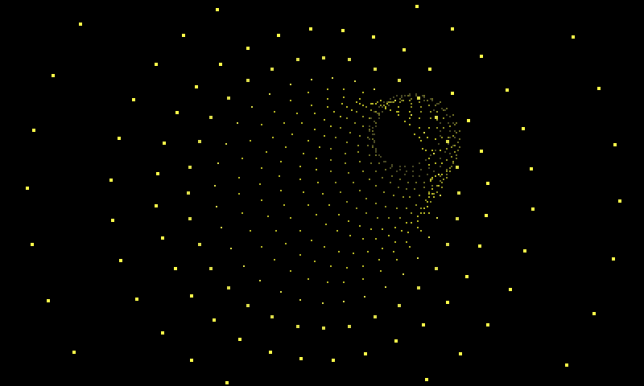
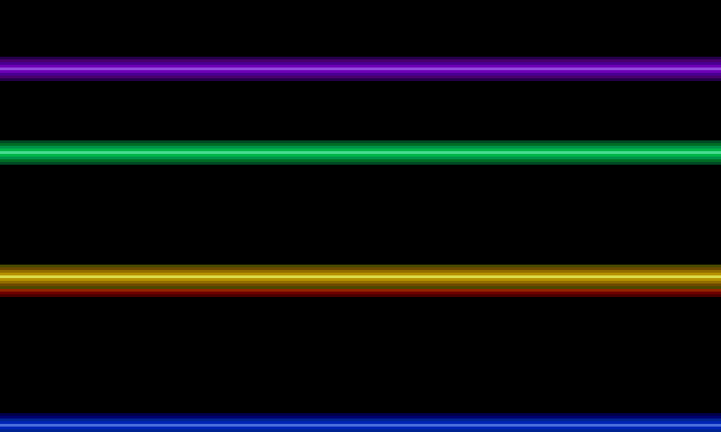
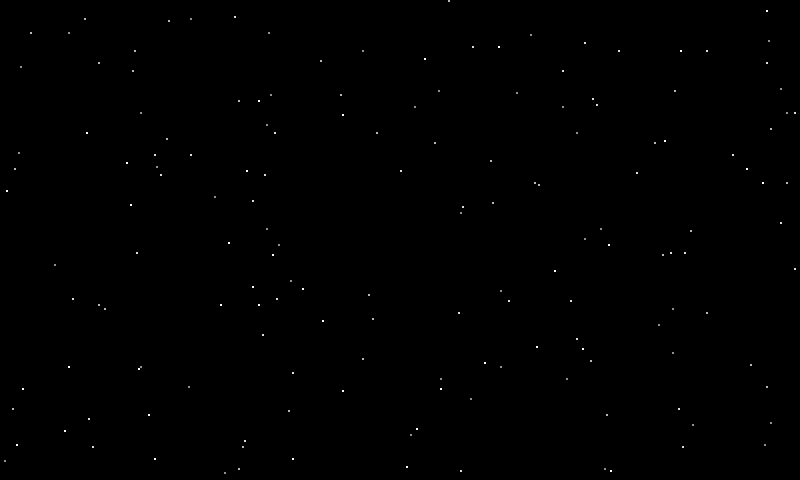
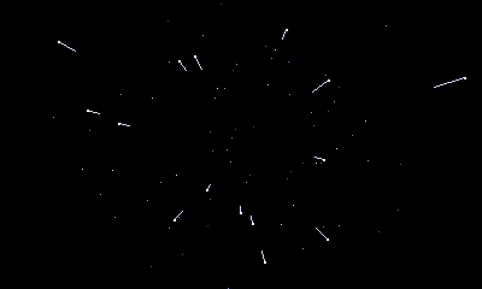
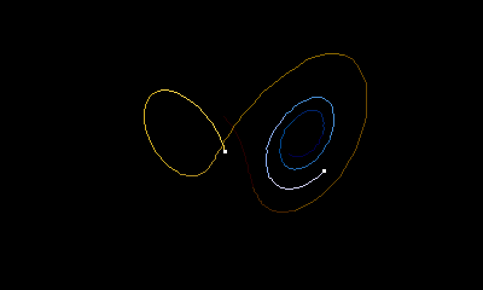
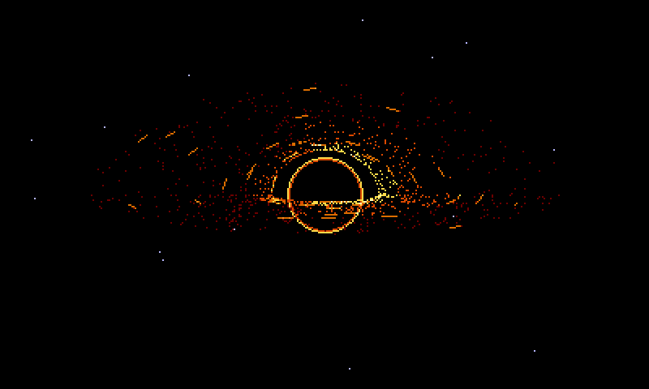
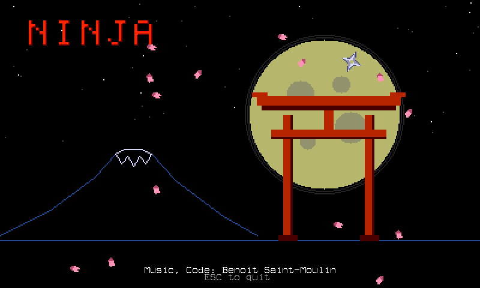

# Micro-8 Demos

Classic demoscene effects and two tune players for the **Micro-8**, written in **Lofi**. Code by Benoit (BSM)
Saint-Moulin.

The copper bars, the sinus scroller and the flat star field are ports of my own reference effects (HTML5 and
68K assembly versions, written for teaching): same algorithm, same constants. The dots tunnel grew from the same
family into a winding tunnel. Every demo has a black background, and each source starts with a comment that says
what the effect does and how it is done on the machine.

## The demos

| Demo | Files | What it is |
|---|---|---|
|  | `DOTTUNNL.SRC` | **Dots Tunnel**: 18 circles of 32 points from the horizon to the edge of the screen. The far end swings, so the tunnel bends ahead like a road; every circle is turned a little more than the one before, so the rays become spirals; the hue travels around the colour circle. Bitmap layer, double buffer, integer maths (8 points turned 4 times a circle). |
|  | `COPPER.SRC` | **Copper Bars**: 8 bars swinging over the whole screen on a sine, each with its own speed, phase and slowly turning hue, a dark to bright to dark gradient and a shine line. No pixel is drawn: a raster display list rewrites the background colour every 3 lines; the list is double buffered and swapped at the vertical blanking. |
|  | `SINUS.SRC`, `SINUS.SPR` | **Sinus Scroller**: the message scrolls 2 pixels a frame, every letter rides the sine wave, the hue turns with time and slides along the text, the letters are lighter at the bottom of the wave. Every letter is a hardware sprite (48 x 42 screen pixels): the program only gives 24 positions a frame. `SINUS.SPR` is the font (a 5 x 7 dot matrix font, stored in 4 colour indexes). |
|  | `STARS.SRC` | **Stars Field**: 5 layers of one-pixel grey stars drifting to the right, each layer faster than the one before. A star is only redrawn when it moves by a whole pixel, so a frame only touches a few stars. |
|  | `CUBES3.SRC` | **Three nested wireframe cubes**, each turning on three axes at its own speeds, the edges at the back drawn dimmer. Integers only: the three columns of the rotation matrix times half the side give three vectors A, B, C; the 8 corners are +-A +-B +-C (4 additions, 4 opposites); the 12 edges are drawn from 4 corners, 3 edges each; the farthest corner gives the 3 hidden edges. 60 frames a second. |
|  | `STARS3D.SRC` | **Stars 3D**: 96 stars come from the horizon and rush past the viewer (distance on screen = distance from the axis * 255 / depth), dim blue far away, white and bigger when near, the nearest with a streak behind them. The whole field rolls, one way then the other. |
|  | `LORENZ.SRC` | **Lorenz attractor**: two points follow the three Lorenz equations, computed live, from starts a tenth apart. They fly together for a few seconds, then part for good (the butterfly effect). Each leaves a fading trail of 150 positions, gold and blue, and the view turns around the vertical axis. |
|  | `BLKHOLE.SRC` | **Black Hole**: the shadow and its photon ring, the accretion disk seen almost edge on (flat in front of the shadow, its back half bent into an arch over it), matter turning faster near the hole (Kepler), the side coming towards the viewer brighter, and the stars behind pushed aside by the gravitational lens. The disk is 1100 dots drawn once; the moving streaks and stars are drawn over it with the XOR mask of `line()` and `plot()`. |
|  | `NINJA.SRC`, `NINJA.SPR`, `NINJA.M8S` | **Ninja**: an original tune in the spirit of the Last Ninja soundtracks (a Japanese pentatonic colour, a koto figure in sixteenth notes, a galloping bass, a lead and its echo, taiko and wood accents; 54 bars, tempo 126) on a night scene: a full moon, a red torii, the outline of a mountain, falling cherry petals. The moon breathes with the bass, the stars twinkle with the koto, the torii glows on the taiko, a shuriken is thrown on each snare, a blade cuts the picture on the cymbal. Scene drawn once in the bitmap, petals and shuriken as sprites, glows by palette. |
|  | `COMMANDO.SRC`, `COMMANDO.M8S`, `COMMAND2.M8S`, `COMMAND3.M8S`, `COMMANDO.TLS`, `COMMANDO.SPR`, `COMMANDO.MAP` | **Commando**: my arrangement of the Commando game theme (not an original composition), whole (256 bars, tempo 245), on a night raid seen from above: tiles scrolled by hardware, and the music drives the soldier, his tracers, the shell bursts and the title. The tune is three tracker files (a tracker file holds 64 blocks) that the program chains and loops. |
|  | `NESGALOP.SRC`, `NESGALOP.M8S`, `NESGALOP.TLS`, `NESGALOP.SPR`, `NESGALOP.MAP` | **NES Galop**: a NES-style tune (28 bars, tempo 176) on a night ride: three parallax bands by raster split, a horse galloping on the bass, the melody written in stars. |

The `.M8S` files are ordinary tracker projects: they also open in the tracker of Micro-8 Studio, in
[`TRACKER2.SRC`](../Tracker) and in [`PLAYER.SRC`](../Tracker). They hold plain notes; the Commando and NES Galop
programs add what a tracker file cannot carry (chords as a fast arpeggio on one voice, vibrato on the lead).

## Running them

- **In Micro-8 Studio**: open a `.SRC` and press F5. ESC ends the demo.
- **On the machine**: copy the folder to the SD card, then `compile NAME.SRC` and `run NAME.BIN`.
- Keep the resource files next to the program: the `.SPR`, `.TLS` and `.MAP` files that carry its name, and the
  `.M8S` files of `COMMANDO.SRC`, `NESGALOP.SRC` and `NINJA.SRC` (the tunes are also looked for in
  `/BSMCODE/TRACKER`).

## State

- Written for **Micro-8 OS 0.9**. Sources use LF line ends and lines under 159 characters, as the machine's
  compiler needs.
- Written and run in the emulator of Micro-8 Studio only. They have **not been compiled on the real machine
  yet**, and the tunes have been checked note by note against their source projects, not by ear on the hardware.
- Frame times in the emulator's timing model: 3 ms (copper bars), 6 ms (scroller), 10 ms (stars, cubes), all at 60
  frames a second; 22 ms (tunnel), 24 ms (3D stars), 25 ms (Lorenz), 27 ms (black hole), shown at 30 frames a
  second. Commando takes about 4 seconds to load its three files.
- Every demo gives the machine back on ESC (palettes, layers, background colour).

The Micro-8 is (c) Franck Sauer: [www.micro-8.com](https://www.micro-8.com).
