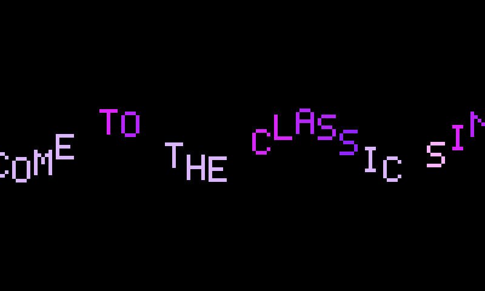
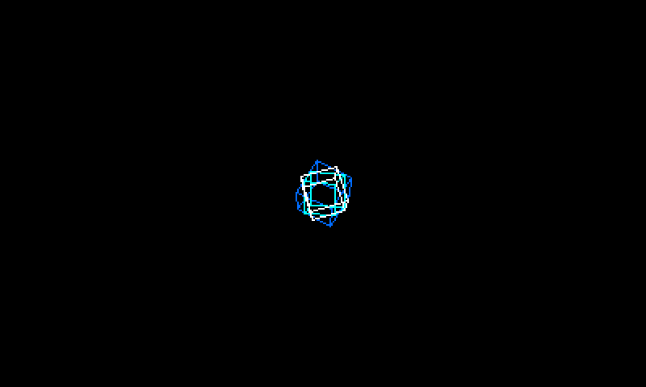
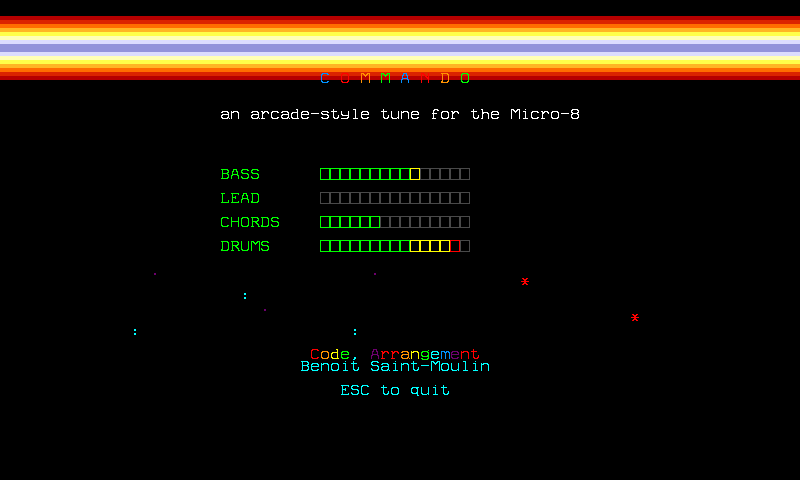
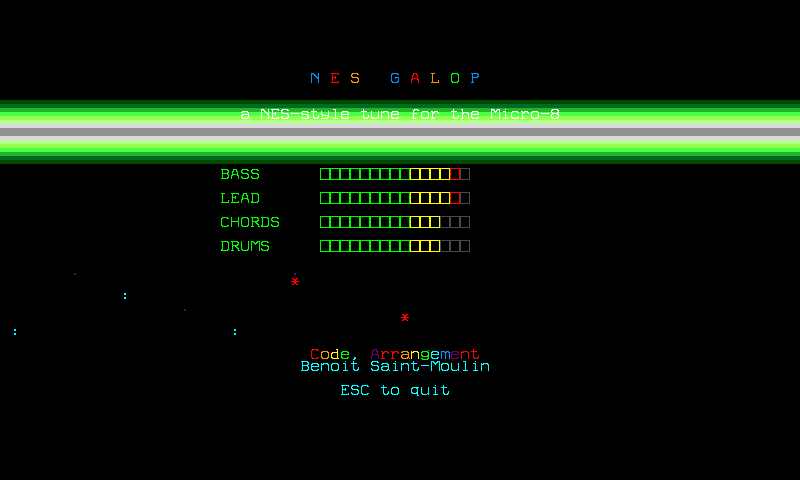

# Micro-8 Demos

Classic demoscene effects and two tune players for the **Micro-8**, written in **Lofi**. Code by Benoit (BSM)
Saint-Moulin.

The four 2D effects are ports of my own reference effects (HTML5 and 68K assembly versions, written for
teaching): same algorithm, same constants, black background. Each source starts with a comment that says what
the effect does and how it is done on the machine.

## The demos

| Demo | Files | What it is |
|---|---|---|
|  | `DOTTUNNL.SRC` | **Dots Tunnel**: 16 circles of 32 points on the same 32 rays, flying towards the viewer, brighter and bigger as they come closer, each circle breathing a little. Bitmap layer, double buffer, integer maths (5 angles, 8 symmetries a circle). |
|  | `COPPER.SRC` | **Copper Bars**: 8 bars swinging over the whole screen on a sine, each with its own speed, phase and slowly turning hue, a dark to bright to dark gradient and a shine line. No pixel is drawn: a raster display list rewrites the background colour every 3 lines; the list is double buffered and swapped at the vertical blanking. |
|  | `SINUS.SRC`, `SINUS.SPR` | **Sinus Scroller**: the message scrolls 2 pixels a frame, every letter rides the sine wave, the hue turns with time and slides along the text, the letters are lighter at the bottom of the wave. Every letter is a hardware sprite (48 x 42 screen pixels): the program only gives 24 positions a frame. `SINUS.SPR` is the font (a 5 x 7 dot matrix font, stored in 4 colour indexes). |
|  | `STARS.SRC` | **Stars Field**: 5 layers of one-pixel grey stars drifting to the right, each layer faster than the one before. A star is only redrawn when it moves by a whole pixel, so a frame only touches a few stars. |
|  | `CUBES3.SRC` | **Three nested rotating wireframe cubes**, built on the `CUBEOPTI.SRC` technique by Fabrice Lete (on the SD card, `/EXAMPLES/GRAPHICS`). |
|  | `COMMANDO.SRC`, `COMMANDO.M8S`, `COMMAND2.M8S`, `COMMAND3.M8S` | **Commando**: my arrangement of the Commando game theme (not an original composition), the whole tune: 256 bars, tempo 245, on a cracktro screen (raster bar, level meters, parallax stars). The tune is three tracker files (a tracker file holds 64 blocks) that the program chains and loops. |
|  | `NESGALOP.SRC`, `NESGALOP.M8S` | **NES Galop**: a NES-style tune, 28 bars, tempo 176, on the same cracktro screen. |

The `.M8S` files are ordinary tracker projects: they also open in the tracker of Micro-8 Studio, in
[`TRACKER2.SRC`](../Tracker) and in [`PLAYER.SRC`](../Tracker). Voices: bass on FM1, lead on FM2, chords on the
next FM voices, drums on the DPCM kit.

## Running them

- **In Micro-8 Studio**: open a `.SRC` and press F5. ESC ends the demo.
- **On the machine**: copy the folder to the SD card, then `compile NAME.SRC` and `run NAME.BIN`.
- Keep the resource files next to the program: `SINUS.SPR` with `SINUS.SRC`, the `.M8S` files with
  `COMMANDO.SRC` and `NESGALOP.SRC` (the two players also look in `/BSMCODE/TRACKER`).

## State

- Written for **Micro-8 OS 0.9**. Sources use LF line ends and lines under 159 characters, as the machine's
  compiler needs.
- Written and run in the emulator of Micro-8 Studio only. They have **not been compiled on the real machine
  yet**, and the tunes have been checked note by note against their source projects, not by ear on the hardware.
- Frame times in the emulator's timing model: 3 ms (copper bars), 6 ms (scroller), 10 ms (stars), 17 ms
  (tunnel, shown at 30 frames a second). Commando takes about 4 seconds to load its three files.
- Every demo gives the machine back on ESC (palettes, layers, background colour).

The Micro-8 is (c) Franck Sauer: [www.micro-8.com](https://www.micro-8.com).
