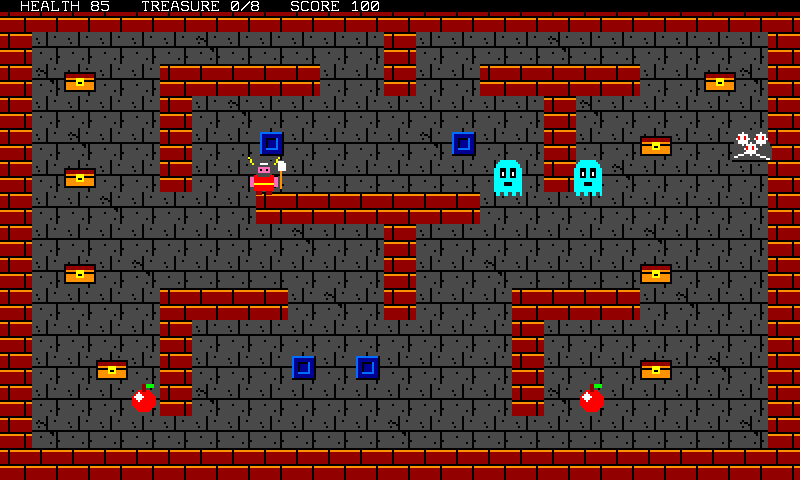

# DUNGEON HUNT

The tutorial project of the Micro-8 Studio manual (chapter 5): a small top-down dungeon game in the spirit of the 1980s
arcade classics, made with every editor of Studio. Code & Music: Benoit (BSM) Saint-Moulin.

Arrows move the warrior, `Z` throws an axe, `Enter` starts, `Esc` quits. Open the 8 chests to win, destroy the ghost
generators, eat apples: health drops by one every second.

| File | What it is |
|---|---|
| `HUNT.SRC` | the finished program |
| `HUNT1.SRC`, `HUNT2.SRC`, `HUNT3.SRC` | the program at the end of tutorial steps 4, 5 and 6 |
| `HUNT.SPR`, `.PLA`, `.PLB` | 11 sprites and their palettes |
| `HUNT.TLS`, `.PAL`, `HUNT.LVL` | the 4 tiles, their palette, the 25 x 15 map |
| `HUNT.LAY` | the map's layers: solid, chests, generators, apples |
| `HUNT.SCR` | the title screen |
| `HUNT.M8S` (+ `.NOTES.json`) | the music |
| `HUNT.M8P` | the Studio project |

**In Micro-8 Studio**: `File > Project > Open Project...`, pick `HUNT.M8P`, press F5.
**On the machine**: copy the folder to the SD card, then `cd HUNT`, `compile HUNT.SRC` and `run HUNT.BIN`.
