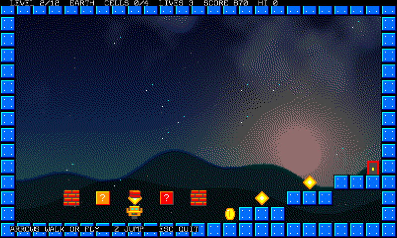

# GRAVITY

The tutorial project of the second Micro-8 Studio tutorial (on the [website](https://www.micro-8-studio.com/gravity.html)): a
platform game in twelve levels and five worlds, built on the physics and entity blocks of the Micro-8 library. Code & Music: Benoit (BSM) Saint-Moulin.

Arrows walk (and fly, in space), `Z` or Up jumps, `Enter` starts, `Esc` quits. You have three lives and a high score that the game
keeps. Take the energy cells of a room, avoid the spikes and the patrolling drones, then reach the exit. Jump from under a brick to
break it (some hide a cell), hit the boxes for a coin or a heart, look for hidden blocks, take coins and hearts and use the
teleporters. Each world has its own gravity: earth, moon, heavy, ice, a storm that changes the world, and space with none. A screen with
a picture of the place comes before each world, and the same picture is behind its rooms.

| File | What it is |
|---|---|
| `GRAVITY.SRC` | the finished program, with the Micro-8 library blocks it uses |
| `GRAVITY.SPR`, `.PLA` | the sprites and their palette |
| `GRAVITY.TLS`, `GRAVITY.PAL` | the tiles and their palette |
| `GRAVITY1.LVL` ... `GRAVITY12.LVL` | the 25 x 15 maps of the twelve levels |
| `GRAVITY1.LAY` ... `GRAVITY12.LAY` | the layers of each map: what is solid, where the cells, spikes, exit, start, springs and drones are |
| `GRAVITY.ENT` | the entity table of the drones (Studio generates their code from it) |
| `GRAVITY.SCR` | the text of the title screen |
| `GRAVITY.BMP`, `GRAVITYW.BMP`, `GRAVITYO.BMP`, `GRAVITYB.PAL` | the pictures of the title (GRAVITY), of the victory (YOU DID IT) and of the game over, and their palette |
| `GRAVB1.BMP` ... `GRAVB6.BMP`, `GRAVW1.BMP` ... `GRAVW6.BMP` (and a `.PAL` each) | the picture of each place behind the rooms, and the screen shown before it |
| `GRAVITY.M8S` | the music |
| `GRAVITY.HI` | the high score: the game writes it itself when a game ends |

**In Micro-8 Studio**: the project is in `Examples/OS/BSMCODE/GRAVITY`; open `GRAVITY.SRC` and press F5.
**On the machine**: copy the folder to the SD card, then `cd GRAVITY`, `compile GRAVITY.SRC` and `run GRAVITY.BIN`.
