# Micro-8 Studio: User Manual

Micro-8 Studio is the desktop workshop for the Micro-8 console: a code editor that knows the Lofi language, an emulator
with a debugger, and the editors for everything a program loads (sprites, tiles, maps, pictures, sounds, music, text
screens). This manual has three parts:

- **Getting started** (chapters 1 to 4): install, a tour of the window, your first program, and the Lofi language in ten minutes.
- **Tutorial** (chapter 5): a complete game, DUNGEON HUNT, built step by step with every editor, tested, and sent to the card.
- **Reference** (chapters 6 to 11) and **appendices** (shortcuts, file formats, troubleshooting): what each part of Studio does, in detail.

The Micro-8 itself (its hardware, its commands, the whole Lofi API) is described in the *Micro-8 User's Manual*, which Studio
opens with `F1`. This manual is about Studio and links to that one for the machine.

## Contents

- [1. Overview](#1-overview)
- [2. A tour of the window](#2-a-tour-of-the-window)
- [3. Your first program](#3-your-first-program)
- [4. Lofi in ten minutes](#4-lofi-in-ten-minutes)
- [5. Tutorial: DUNGEON HUNT](#5-tutorial-dungeon-hunt)
  - [5.1. Step 1: create the project](#51-step-1-create-the-project)
  - [5.2. Step 2: the sprites](#52-step-2-the-sprites)
  - [5.3. Step 3: the dungeon, with its layers](#53-step-3-the-dungeon-with-its-layers)
  - [5.4. Step 4: load the assets and walk](#54-step-4-load-the-assets-and-walk)
  - [5.5. Step 5: chests, apples and health](#55-step-5-chests-apples-and-health)
  - [5.6. Step 6: axes, ghosts and generators](#56-step-6-axes-ghosts-and-generators)
  - [5.7. Step 7: title screen, music and sound](#57-step-7-title-screen-music-and-sound)
  - [5.8. Step 8: debug and measure](#58-step-8-debug-and-measure)
  - [5.9. Step 9: check, export, and run on the machine](#59-step-9-check-export-and-run-on-the-machine)
  - [5.10. Where to go from here](#510-where-to-go-from-here)
- [6. Editor](#6-editor)
- [7. Run &amp; Debug](#7-run-debug)
- [8. Image Converter](#8-image-converter)
- [9. Asset Editors](#9-asset-editors)
  - [9.1. Sprite editor](#91-sprite-editor)
  - [9.2. Tile / map editor](#92-tile-map-editor)
  - [9.3. Bitmap editor](#93-bitmap-editor)
  - [9.4. Sound editor](#94-sound-editor)
  - [9.5. Wave editor](#95-wave-editor)
  - [9.6. Tracker](#96-tracker)
  - [9.7. Screen designer](#97-screen-designer)
  - [9.8. Micro-8 Library](#98-micro-8-library)
  - [9.9. Projects](#99-projects)
  - [9.10. Transfer with the Machine (MIDI)](#910-transfer-with-the-machine-midi)
- [10. Small Windows](#10-small-windows)
- [11. Known Limitations](#11-known-limitations)
- [Appendix A. Keyboard shortcuts](#appendix-a-keyboard-shortcuts)
- [Appendix B. File formats](#appendix-b-file-formats)
- [Appendix C. Troubleshooting](#appendix-c-troubleshooting)

---

## 1. Overview

Studio is made of four tools that share one window:

- an **editor** with live analysis: errors are underlined while you type, with the same rules as the real compiler;
- an **emulator** of the Micro-8 with a debugger (breakpoints, stepping, variables, memory, hardware registers);
- **asset editors** equivalent to the SD card's own tools, plus a tracker and a wave editor: they read and write the real
  files byte for byte, so what you save here opens on the machine and back;
- a **project** system that keeps a program and its files together, checks them, and sends them to a card or to the machine.

**Install.** Unzip the portable version anywhere (a drive, a USB stick) and run `Micro8Studio.exe`, nothing to install; the
installer places the same files under Program Files or a folder of your choice. The folder holds `Examples\` (the
Micro-8 user manual and `OS\`, the default SD card) and `runtime\`. Studio keeps its settings in `data\` next to the
`.exe` (nothing in the registry), so the folder can be copied as it is to another PC. The emulator core is compiled for
the processor: x86-64, AVX2 or AVX-512, picked at startup (shown in Help > About).

**The card.** The machine's files live on an SD card. Studio emulates it with a folder: the **root**, by default
`Examples\OS` next to the application. Everything a program opens (`import`, `export`, `fOpen`...) is looked up there,
exactly as on the card. `Root...` in the Files panel picks another folder, for example a copy of your own card. File names
follow the card's FAT rules: 8 characters and a 3-letter extension (`HUNT.SRC`, `LEVEL1.LVL`).

**The firmware.** Studio targets **Micro-8 OS 0.9** (shown in the status bar and in About). The checker, the emulator and
the size estimate follow that firmware's exact rules, found by compiling real programs on the console.

Themes (View > Dark / Light Theme, or Preferences), the language of the interface (English or French, Preferences,
restart to apply), and a splash screen with real progress steps (`--no-splash` to skip it).

## 2. A tour of the window

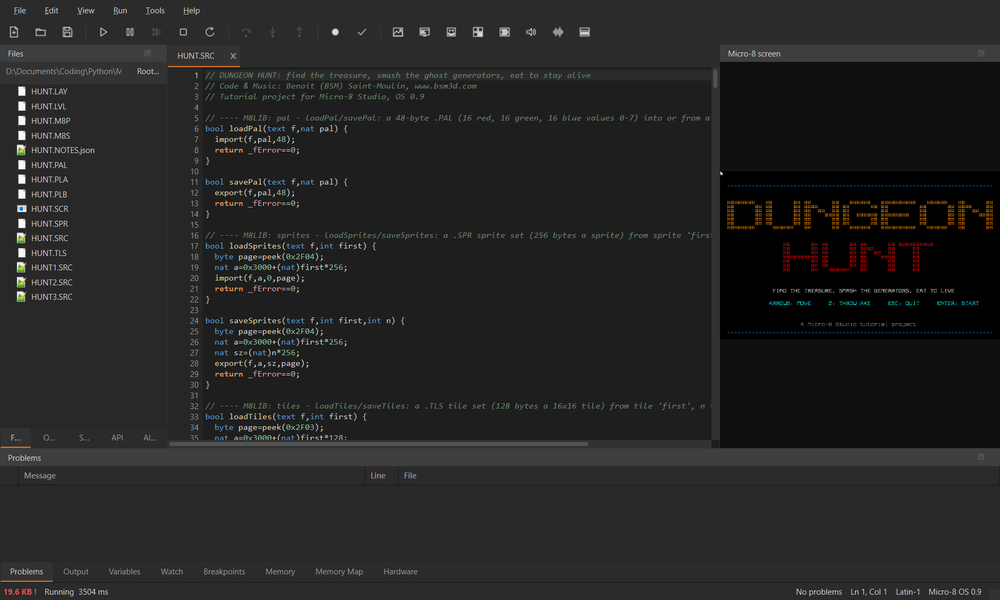

- **Menu bar.** `File` (new, open, recent, examples, **New Asset** for every editor, **Project**, save), `Edit` (editing,
  find, rename, format, **Insert Micro-8 Library**, preferences), `View` (show or hide every panel, themes, zoom),
  `Run`, `Tools` (the editors, the image converter, sound options, transfer to the machine) and `Help`.
- **Toolbar.** Left to right: new, open, save; run, pause, continue, stop, restart; step over, into, out; toggle breakpoint,
  check the program; then the **Image Converter** and the seven editors: screen designer, sprites, tiles, bitmap, sound,
  wave, tracker. Hover an icon for its name and shortcut.
- **The editor area** in the middle: one tab per file. Code and asset editors share the tabs, so a program, its sprites
  and its map are one click apart. A click switches tabs; a double click in the empty area opens a file.
- **The Micro-8 screen** (right): the emulated 800 x 480 display. `F5` runs the program in it. Click it once to give it
  the keyboard: arrows, `Z` and `X` (the A and B buttons), `Enter` (Start), `Tab` (Select) are the game pad.
- **Left panels** (tabs at the bottom of the column): **Files** (the card as a tree: double-click opens a file in the
  right editor, right-click makes a folder), **Outline** (the program's functions and variables), **Search**, **API**
  (every function of the machine with its signature) and the **AI Assistant**.
- **Bottom panels:** **Problems** (errors and warnings, click to jump), **Output** (messages of the program and of
  Studio), **Variables**, **Watch** and **Breakpoints** (the debugger), **Memory** (a hex dump), **Memory Map** (how much of the code,
  data and external memory the program uses) and **Hardware** (layers, scrolling, palettes, sprites, synth registers).
- **Status bar.** The state (`Ready`, `Running`, `Paused`), the size of the source file (it turns red past the limit of
  the machine's own text editor, 8 KB by default, which does not stop the program from compiling), problems, the cursor
  position and the firmware.

`View > Focus Mode` (`Ctrl+Shift+M`) hides every panel when you need the room. A panel can be dragged out of the window,
or onto another monitor, and put back.

## 3. Your first program

**Hello.** `File > New` (`Ctrl+N`) opens an empty tab. Type:

```c
// hello
print("Hello, Micro-8!");
```

Press `F5`. The text appears on the Micro-8 screen. A Lofi program is a list of statements run from the top, there is no
`main` to write (a function called `main` is only a habit). Statements end with `;` and `//` starts a comment.

**A loop.** Replace the program with:

```c
// five lines
for(int i=1;i<=5;i++) print("Line ",i,"␍");
```

`␍` stands for the control character "new line" (code 13) that `print` obeys. It is not typed from the keyboard: use
`Edit > Insert Control Glyph > New line`. Studio keeps such characters as pictures so that a file is saved byte for byte.

**Something that moves.** Sprites are small images the hardware draws for you. This program makes a white square (a sprite
image is 24 x 21 pixels of 4 bits, 256 bytes in all) and moves it with the arrows. It needs no file, so you can type it as it is:

```c
// a sprite you move
nat gfxModes=0x2F00;
poke(gfxModes,peek(gfxModes)|0b00000100);       // sprites on
memSet(0x3000+256,252,0x22,0x20);               // image number 1 of the sprite set: all pixels colour 2 (white)
sprPal(0,0);                                    // sprite 0 uses palette A
sprRef(0,1);                                    // and shows image 1
int x=400;
int y=240;
while(_keyDwn!=12) {                             // until ESC
	if((_padLft&0b01000000)!=0) x-=2;            // left
	if((_padLft&0b10000000)!=0) x+=2;            // right
	if((_padLft&0b00010000)!=0) y-=2;            // up
	if((_padLft&0b00100000)!=0) y+=2;            // down
	sprPos(0,x,y);
	vSync();                                     // wait for the screen to be drawn
	sprUpdt();                                   // show the sprites where they now are
}
```

Run it (`F5`), click the screen, use the arrows, press `Esc` to stop. What you just met:

- `peek` and `poke` read and write the machine's memory and registers; `0x2F00` decides which layers are shown.
- `_padLft` holds the game pad's eight buttons as bits: Right 128, Left 64, Down 32, Up 16, Select 8, Start 4, B 2, A 1.
  Studio maps the keyboard to the pad (arrows, `Z`, `X`, `Enter`, `Tab`).
- `sprPos` only *notes* the position; `sprUpdt` copies it to the hardware once the frame is done (`vSync` waits for that
  moment). Every game loop on the Micro-8 has this shape: **read the pad, move things, wait for the frame, show**.

**Stopping and finding errors.** `Shift+F5` stops, `Ctrl+Shift+F5` restarts. Type `prnt("x");` and the line is
underlined at once, the **Problems** panel says why, and `F5` refuses to run until it is fixed: the real machine would
refuse it too.

**Saving.** `Ctrl+S` asks for a name on the card: 8 letters at most, then `.SRC`. Studio keeps the file exactly as typed
(tabs, line endings), so the machine's own editor opens it without surprises.

## 4. Lofi in ten minutes

Lofi is a small C-like language. Everything here runs in Studio and on the machine. The complete description is chapter 6
of the *Micro-8 User's Manual*; this is the part you need for chapter 5.

### 4.1. Variables and types

```c
byte lives=3;            // 0 to 255
nat address=0x1200;      // 0 to 65535, made for addresses
int score=-120;          // -32768 to 32767
real speed=1.5;          // half-precision float: slow and imprecise, keep it for tables
bool alive=true;
text name="BSM";
```

**Integers are 16 bits.** `int a=200; int b=a*200;` does not make 40000: it wraps to -25536 without an error. A product
must stay under 32767, so scale values down (`>>7` instead of `/128`) or keep them small. This is the number one
surprise on this machine and the reason the tutorial game keeps its numbers small.

A value of another type needs a **cast**: `byte b=(byte)(x+3);`. The compiler refuses an `int` where a `byte` is expected,
which is why the tutorial writes `sprPos((byte)(3+i),x,y)`.

### 4.2. Operators

```c
int a=7;
int b=a*3+1;             // + - * / %
bool big=(a>5)&&(b!=0);  // == != < > <= >=  and  && || !
int bits=a&0b0101;       // & | ^ ~ on bits (binary and hex literals: 0b0101, 0xFF)
int up=a<<2;             // shifts: by a byte, never by an int
a+=2;                    // also -= *= /= and a++ a--
print(b," ",big," ",bits,"␍");
```

### 4.3. Choices and loops

```c
int n=0;
while(n<10) {            // while and for, with break and continue
	n++;
	if(n==3) continue;   // skip the rest of this turn
	if(n>6) break;       // leave the loop
	print(n," ");
}
if(n>6) print("stopped","␍"); else print("never","␍");
```

### 4.4. Functions

A function is written once, **before** the line that calls it (Lofi compiles in one pass). `void` means it returns nothing.

```c
int square(int v) {
	return v*v;
}
void show(text label,int value) {
	print(label,": ",value,"␍");
}
show("seven squared",square(7));
```

Functions cannot be nested, but they can call each other and themselves. The call depth is limited to 64.

### 4.5. Arrays and your own types

```c
int table[5]={10,20,30,40,50};    // a size is a constant; the first index is 0
table[2]=99;                      // there is no bounds check: stay inside
int total=0;
for(int i=0;i<5;i++) total+=table[i];
print(total,"␍");

type pt { int x; int y; };        // a group of values
pt p={4,7};
p.x+=1;
print(p.x,",",p.y,"␍");
```

Arrays of `byte` are how a program holds a map, a screen or a file's bytes. The tutorial reads its level into
`byte level[379];` and indexes it as `level[4+row*25+column]`.

### 4.6. Talking to the machine

Almost everything the hardware does is reached by a few calls and a few addresses:

| You want | Use |
|---|---|
| to write text | `print(...)`, `curPos(x,y)`; the text screen is 80 x 40 characters at `0x1200` (glyphs) and `0x1E80` (colours) |
| to read the pad, keys, mouse | `_padLft`, `_padRght`, `_keyDwn`, `_mouseX`, `_mouseY`, `_mouse` |
| to draw sprites | `sprRef`, `sprPos`, `sprFlip`, `sprPal`, `sprPrio`, then `sprUpdt` |
| to test a collision | `isSprSpr`, `isSprBox`, `isSprPoint`, `isSprTile`, `sprOther` |
| to show tiles | a map in the tile buffer (`areaCpy`), the hardware scroll registers `0x2F01`, `0x2F02` |
| to switch layers | register `0x2F00` (bit 4 text, 3 tiles, 2 sprites, 0 bitmap) |
| to wait for the next frame | `vSync()` |
| to play sound | `ymVoice` and `ymNoteOn` (six FM voices), `synVoice` and `synNoteOn` (the digital synth) |
| to read a file | `import(file, address, size)` and the `fOpen` family |
| to keep time | `_time` (seconds), `clkSet()` and `_mSec` (milliseconds) |

The **API** panel lists every function with its signature, and `F1` opens the machine's manual. Studio's **completion** (`Ctrl+Space`) and **parameter hints** show signatures as you type.

Two things worth knowing before the tutorial:

- **A hidden sprite sits at (0,0)**, and all sprites at (0,0) overlap each other: a collision test between two hidden
  sprites is true. The tutorial game meets this bug and handles it.
- **`print` repaints** the colours of the cells it writes (black on transparent by default). To get white text, set the
  colour buffer after printing, as the tutorial does.

## 5. Tutorial: DUNGEON HUNT

This chapter builds a complete game from nothing: **DUNGEON HUNT**, a top-down arcade dungeon in the spirit of the 1980s
classics. A horned warrior walks through a dungeon, throws axes in the direction he faces, opens treasure chests, eats
apples to stay alive, and must destroy the **generators** (heaps of bones that send ghosts after him) before they swarm him.

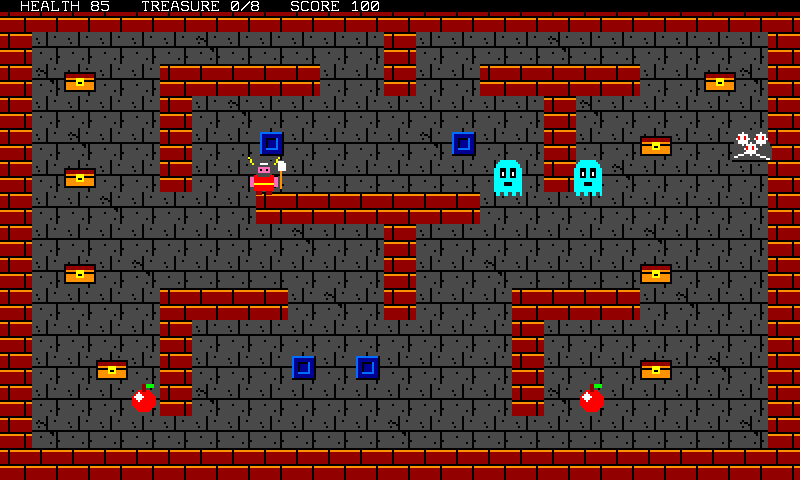

You will use every part of Studio: the project system, the sprite editor, the tile and map editor with its **layers**, the
program editor with its live analysis, the screen designer, the tracker, the debugger, and the transfer to the card.
Plan about two hours, less if you open the finished files instead of drawing them.

**The rules.** Arrows move the warrior, `Z` (button A) throws an axe, `Enter` starts, `Esc` quits. Health starts at 99
and drops by one every second; an apple gives 30 (never more than 99). A ghost that touches the warrior costs him 10 and
dies. An axe kills a ghost (10 points), three axes destroy a generator (100 points), and each chest is 50 points.
**Open the 8 chests to win; reach 0 health and you die.**

**What the game is made of.** One program and six kinds of files, each made with its own editor:

| File | Made with | Holds |
|---|---|---|
| `HUNT.SRC` | the code editor | the program |
| `HUNT.SPR` (+ `.PLA`, `.PLB`) | sprite editor | 11 sprite images, their collision boxes, the palettes |
| `HUNT.TLS` (+ `.PAL`) | tile editor | 4 tiles of 16 x 16 pixels, and their palette |
| `HUNT.LVL` | tile editor | the 25 x 15 map: a tile number per cell |
| `HUNT.LAY` | tile editor (layers) | the map's 8 layers: what is solid, where the chests, generators and apples lie |
| `HUNT.SCR` | screen designer | the title screen |
| `HUNT.M8S` | tracker | the music |
| `HUNT.M8P` | Studio | the project: the list of all of the above |

**Two ways to follow.** You can *build* the game in your own folder, drawing the assets and typing the code, or *read*
it in the finished project that ships with Studio: the folder `TUTORIAL` of the card (`File > Project > Open Project...`,
`TUTORIAL\HUNT.M8P`) holds every file, plus three **checkpoints**, `HUNT1.SRC`, `HUNT2.SRC` and `HUNT3.SRC`, which are the
complete program at the end of steps 4, 5 and 6. If a step does not work, open its checkpoint and compare. The four programs are
played start to finish by an automated test that checks the rules below.

| Step | What you do | Result |
|---|---|---|
| 1 | create the project | an empty program that runs |
| 2 | draw the sprites | `HUNT.SPR` |
| 3 | build the dungeon and its layers | `HUNT.TLS`, `HUNT.LVL`, `HUNT.LAY` |
| 4 | load the assets, walk, never cross a wall | `HUNT1.SRC` |
| 5 | chests, apples, health, win and lose | `HUNT2.SRC` |
| 6 | axes, ghosts, generators | `HUNT3.SRC` |
| 7 | title screen, music, sounds | `HUNT.SRC`, `HUNT.SCR`, `HUNT.M8S` |
| 8 | debug and measure | what the machine will do with it |
| 9 | check, export, run on the machine | a game on the card |

### 5.1. Step 1: create the project

A project is **one folder of the card** holding a program and its assets, described by a small manifest `NAME.M8P`.

1. In the **Files** panel, right-click the root and choose **New folder...**; call it `MYHUNT` (8 characters at most).
2. `File > Project > New Project...`: pick that folder, and give the name `HUNT` (1 to 8 letters, digits or `_`).
3. Studio writes `HUNT.M8P` and `HUNT.SRC` and opens the program:

```c
// HUNT
// Micro-8 Studio project: the assets live next to this file on the SD card.

void main()
{
	print("HUNT␍");
}

main();
```

Press `F5`: the screen says `HUNT`.

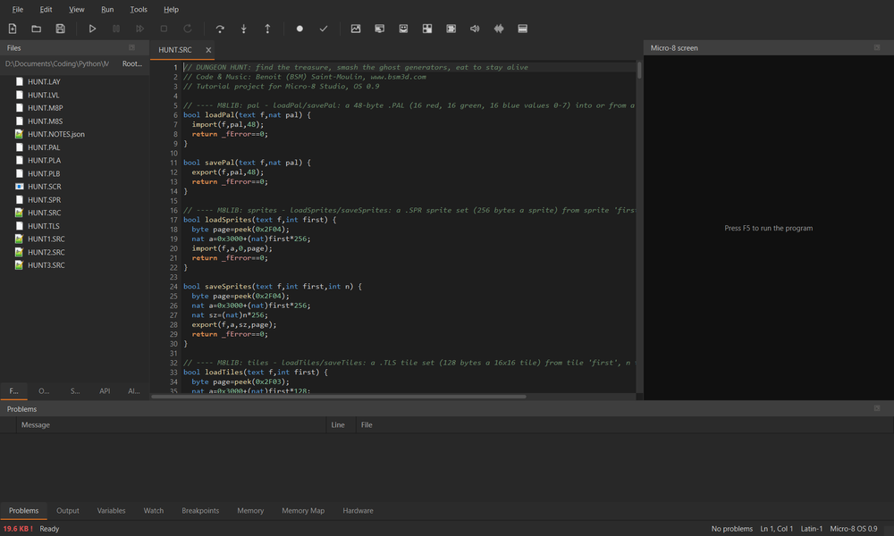

From now on `Ctrl+S` saves the file, and `File > Project > Save Project`
(`Ctrl+Alt+Shift+S`) saves everything that is open plus the manifest. Files you create in the project's folder join the project
by themselves (or use **Add Current File to Project**).

> If you only want to read the finished game, skip the drawing and the typing: open `TUTORIAL\HUNT.M8P` and go on to step 4.

### 5.2. Step 2: the sprites

A hardware sprite is an image of **24 x 21 pixels, 4 bits a pixel** (16 colours, the first one transparent), and the machine
shows up to 32 of them at once. `File > New Asset > New Sprite set` opens the **sprite editor**:

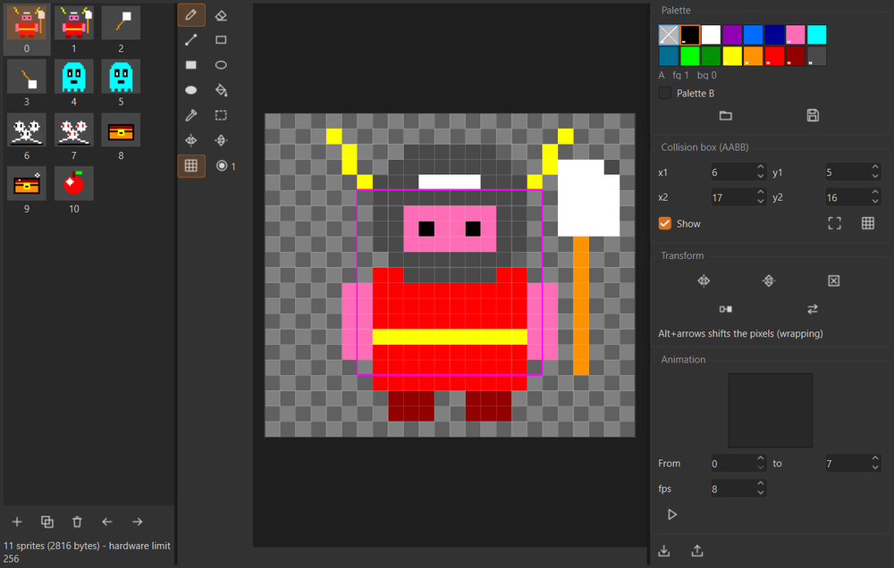

- The list on the left holds the images; **+** adds one, the others duplicate, delete or move it. The canvas is the
  selected image, the palette is above it (index 0 is transparent). Use the pencil, line, rectangle, oval, fill and
  eyedropper tools; `Alt` plus the arrows shifts the pixels; the grid and the onion skin help.
- The **collision box** (the magenta frame, the four fields *x1 y1 x2 y2*) is the rectangle the hardware uses in
  `isSprSpr`, `isSprBox` and friends. It is saved in the last 4 bytes of the image. The **fit** buttons shrink it to the opaque pixels.
- `Ctrl+S` asks for a name: `HUNT.SPR`. Studio also writes the two palettes, `HUNT.PLA` (palette A) and `HUNT.PLB`.

Draw these 11 images, in this order, and give each the box below (the numbers are what the program counts on):

| # | Image | Box x1 y1 x2 y2 | Used for |
|---|---|---|---|
| 0, 1 | the warrior, two walking frames | 6 5 17 16 | the player |
| 2, 3 | an axe, two turning frames | 8 6 15 15 | a thrown axe |
| 4, 5 | a ghost, two frames | 6 5 17 16 | the enemies |
| 6, 7 | a pile of bones, eyes dark then glowing | 4 3 19 18 | a ghost generator |
| 8, 9 | a chest, plain then glinting | 6 6 17 15 | the treasure |
| 10 | an apple | 6 6 17 15 | the food |

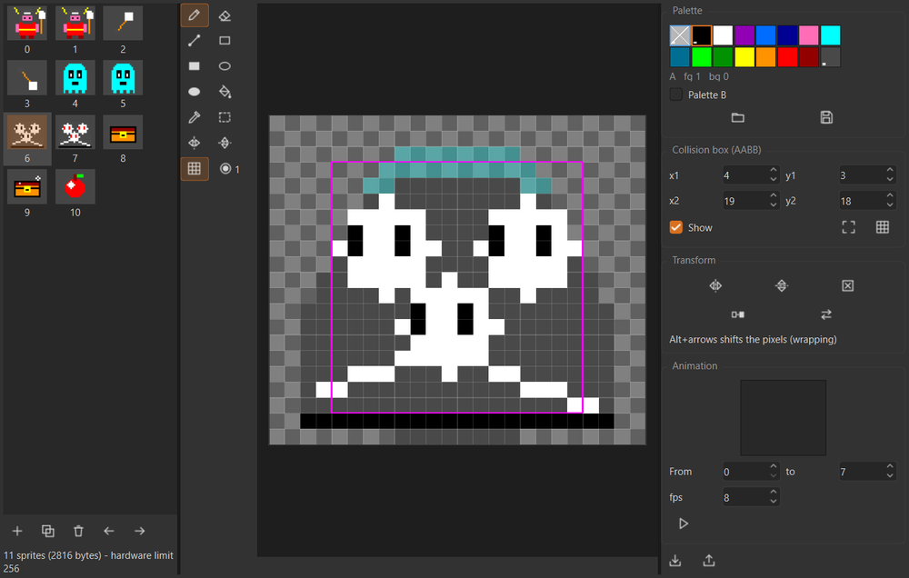

Two habits make the rest of the chapter simple. First, **draw every image centred** in its 24 x 21 canvas and make its box
centred too (each box above has `x1 + x2 = 23` and `y1 + y2 = 21`): then one formula places every sprite on a map cell.
Second, give the warrior and the ghost the **same box**; they are then interchangeable in the wall tests.

The palette is the machine's default one (index 1 black, 2 white, 9 bright green, B yellow, C orange, D red, E dark red, F dark grey...),
which is also what every program starts with. The finished project keeps it. The program loads `HUNT.PLA` and `HUNT.PAL` anyway, so that changing a colour in an
editor is all it takes to change it in the game.

### 5.3. Step 3: the dungeon, with its layers

`File > New Asset > New Tile map` opens the **tile and map editor**. A tile is 16 x 16 pixels, 4 bits a pixel, and a map is a grid
of tile numbers; the screen shows 25 x 15 tiles.

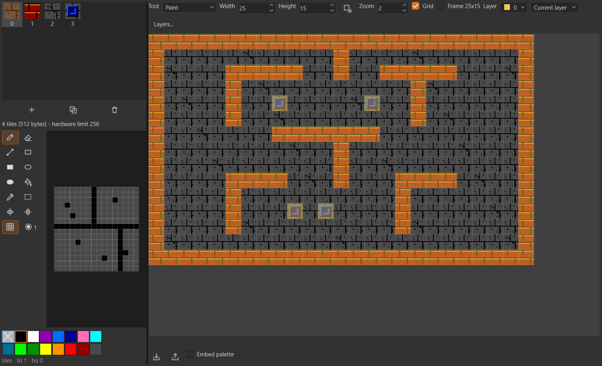

**The tiles.** Use **+** to make four tiles and draw them: `0` the stone floor (dark grey with dark joints and specks), `1` the
wall (dark red bricks with black mortar and a lighter edge), `2` the floor with a crack, `3` a pillar (a blue block). The
palette below the canvas is the tiles palette; the default one is fine.

**The map.** Set the width to 25 and the height to 15 (tick **Frame 25x15** to see the screen's edge), pick a tile in the
list and paint with the map tool (left button paints, right button paints tile 0). Here is the plan to copy: `#` is tile 1, `o` is tile 3,
and every other cell is floor (tile 0, or tile 2 here and there for the cracks). `c`, `g` and `f` are floor cells that will receive a **layer** mark in a moment.

```text
#########################
#...........#...........#
#.c..#####..#..#####..c.#
#....#...........#......#
#g...#..o.....o..#..c..g#
#.c..#...........#......#
#.......#######.........#
#...........#...........#
#.c.........#.......c...#
#....####...#...####....#
#....#..........#.......#
#..c.#...o.o....#...c...#
#...f#..........#.f.....#
#.......................#
#########################
```

**The layers.** A map can carry **8 layers**: eight independent on/off marks per cell, like the machine's own MAPED. The
editor does not decide what a layer *means*: your program does. DUNGEON HUNT uses four:

| Layer | Meaning | Marked cells |
|---|---|---|
| 0 | solid: nothing walks through | the walls and the pillars |
| 1 | a chest lies here | the 8 cells `c` |
| 2 | a ghost generator stands here | the 2 cells `g` |
| 3 | an apple lies here | the 2 cells `f` |

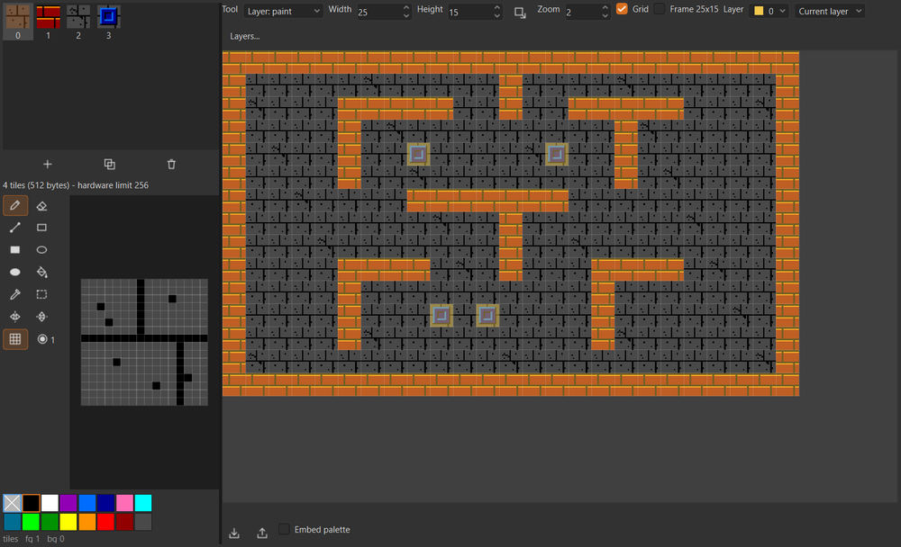

1. Choose **Layer 0** in the layer list. `Layers... > Generate from the tiles...` ticks tiles `1` and `3` and marks every cell holding
   one of them: the whole of layer 0 in one click.
2. Pick layer 1 and the **Layer: paint** tool (the tool list); left-click the eight `c` cells (right button clears a cell).
   Do the same for layer 2 (the two `g` cells) and layer 3 (the two `f` cells).
3. The list next to the layer shows **Current layer**, **All layers** (a small coloured square per layer in each cell) or **Hidden**:
   use *All layers* to check your work. The layer tools are also *erase*, *fill* and *rectangle*.

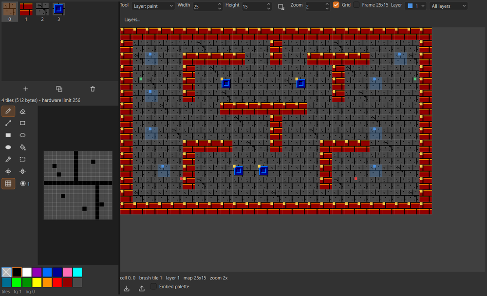

`Ctrl+S` as `HUNT.LVL` writes four files: `HUNT.LVL` (the map: width, height, then one byte a cell), `HUNT.TLS` (the tiles), `HUNT.PAL`
(their palette) and `HUNT.LAY` (the layers: width, height, then one byte a cell, **one bit a layer**). Layers are saved
next to the map and loaded with it. A program reads them with `import`, like the map; `HUNT.LAY` is the same format as the
machine's own MAPED, so a layer file made there opens here and the other way round.

### 5.4. Step 4: load the assets and walk

Everything the program needs is now on the card. Time to show it. Open `HUNT.SRC` and choose `Edit > Insert Micro-8 Library...`: tick **pal**,
**sprites**, **tiles** and **level** and press OK. Lofi has no `#include`, so Studio pastes the ready-made functions
`loadPal`, `loadSprites`, `loadTiles` and `loadLevel` (and only those) after your comments. They return `true` when a file loaded. Add your
own code after them; here is the whole program of this step, `HUNT1.SRC`, apart from the library:

```c
// DUNGEON HUNT, step 1: the dungeon and the warrior
// Code & Music: Benoit (BSM) Saint-Moulin, www.bsm3d.com
// Tutorial project for Micro-8 Studio, OS 0.9

byte level[379];                 // HUNT.LVL: 4 header bytes, then 25x15 tile numbers
byte lay[379];                   // HUNT.LAY: the same shape, one bit a layer (bit 0: solid)
int hx;                          // the hero's sprite position, in 800x480 pixels
int hy;
bool faceLeft;
byte frame;

// is the point (sx,sy) of the screen inside a solid cell?
bool solidAt(int sx,int sy) {
	if(sx<0||sy<0||sx>=800||sy>=480) return true;
	int cell=(sy/32)*25+(sx/32);
	return (lay[4+cell]&1)!=0;
}

// would the hero's box (24x24, at 12,10 inside the sprite) touch a solid cell if the sprite was at px,py?
bool blocked(int px,int py) {
	int x0=px-48+12;
	int y0=py-42+10;
	return solidAt(x0,y0)||solidAt(x0+23,y0)||solidAt(x0,y0+23)||solidAt(x0+23,y0+23);
}

void setup() {
	memSet(0x1200,3200,' ');                       // an empty text screen, white letters, no background
	memSet(0x1E80,3200,0x02);
	poke(0x2F00,0b00011100);                       // text, tiles and sprites on, bitmap off
	loadPal("HUNT.PAL",0x1170);                    // tiles palette
	loadPal("HUNT.PLA",0x11D0);                    // sprites palette A
	loadTiles("HUNT.TLS",0);
	loadSprites("HUNT.SPR",0);
	loadLevel("HUNT.LVL",&level,379);
	loadLevel("HUNT.LAY",&lay,379);
	areaCpy(&level+4,25,0,0,25,15,0x2B00,32,0,0);  // the map into the tile buffer the screen shows
	for(int i=0;i<32;i++) {
		sprPal((byte)i,0);
		sprPrio((byte)i,0);
		sprPos((byte)i,0,0);                       // hidden
	}
	hx=72;                                         // cell (1,1)
	hy=68;
}

void moveHero() {
	byte pad=_padLft;
	int dx=0;
	int dy=0;
	if((pad&0b01000000)!=0) dx=-3;
	if((pad&0b10000000)!=0) dx=3;
	if((pad&0b00010000)!=0) dy=-3;
	if((pad&0b00100000)!=0) dy=3;
	if(dx!=0&&!blocked(hx+dx,hy)) hx+=dx;
	if(dy!=0&&!blocked(hx,hy+dy)) hy+=dy;
	if(dx<0) faceLeft=true;
	if(dx>0) faceLeft=false;
	if(dx!=0||dy!=0) sprRef(0,(byte)((frame>>2)&1));  // walk: the two hero frames
	sprFlip(0,faceLeft,false);
	sprPos(0,hx,hy);
}

setup();
while(_keyDwn!=12) {                             // until ESC
	moveHero();
	vSync();
	sprUpdt();
	frame++;
}
```

Press `F5`, click the screen, and walk with the arrows. The warrior stops at every wall.

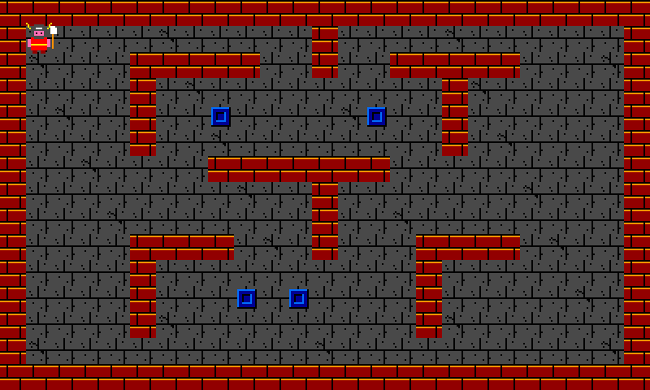

How it works:

**Where things are.** Sprite positions are in the display's full resolution, 800 x 480, and the visible area starts at
(48, 42). Tiles are 16 pixels wide on the half-resolution screen, so a map **cell is 32 units** and the 25 x 15 map fills the
screen exactly. A sprite image is 24 x 21 pixels, so 48 x 42 units. Because every box is centred in its image, the sprite
position that centres a sprite on the cell *(column, row)* is `(40+column*32, 36+row*32)`. The warrior starts in cell (1, 1): position (72, 68).

**Reading layer 0.** `loadLevel("HUNT.LAY",&lay,379)` reads the whole file into `lay`, whose first 4 bytes are the header: the cell
*(column, row)* is at `lay[4+row*25+column]`. `solidAt` turns a screen point into a cell and returns bit 0, the *solid* layer.
`blocked` asks whether the four corners of the warrior's 24 x 24 box would land in a solid cell. That box is the collision box of the
image (6,5 to 17,16, doubled: 12..35 by 10..33 units from the sprite's corner).

**One axis at a time.** `moveHero` tries to move in x, then in y, each on its own. So walking diagonally against a wall *slides* along it,
instead of stopping dead. The pad is read from `_padLft` bit by bit.

**The frame.** `setup()` fills the screen with an empty text layer, turns on text, tiles and sprites (`0x2F00`), loads the palettes into
their registers (`0x1170` tiles, `0x11D0` sprites A), the tiles and sprites into the memory the hardware reads, and **copies the map into the
tile buffer** (`areaCpy` from `&level+4`, skipping the header, into `0x2B00`, the buffer the screen shows). The loop reads the pad,
moves, waits for the frame (`vSync`) and then makes the sprites visible (`sprUpdt`).

Things to try: change the speed `3` to `5` (a wall is 32 units thick, so even 10 units a frame cannot jump over one); set
a breakpoint (`F9`) on `hx+=dx;` and watch `hx` in the **Watch** panel.

### 5.5. Step 5: chests, apples and health

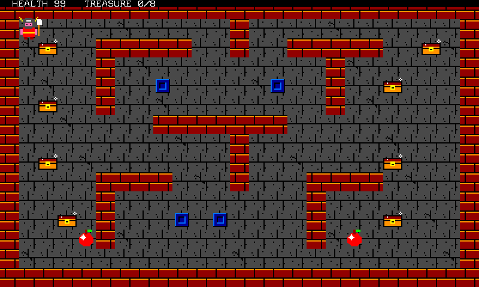

The map says where the objects lie, so the program does not hard-code them: it **scans layers 1 and 3**. Here are the globals that
are new, then the functions (the whole program is `HUNT2.SRC`):

```c
byte level[379];                 // HUNT.LVL: 4 header bytes, then 25x15 tile numbers
byte lay[379];                   // HUNT.LAY: the same shape, one bit a layer: 0 solid, 1 treasure, 3 food
int hx;                          // the warrior's sprite position, in 800x480 pixels
int hy;
bool faceLeft;
byte frame;
byte state;                      // 1 playing, 2 won, 3 dead
int health;                      // drains by 1 a second, 99 at most
nat lastSec;
int treasure;                    // chests opened so far
int tx[8];                       // the 8 chests: sprites 15 to 22
int ty[8];
bool ton[8];
int foodX[2];                    // the 2 apples: sprites 23 and 24
int foodY[2];
bool foodOn[2];
```

```c
// the layers say where things lie: layer 1 for the chests, layer 3 for the apples
void placeItems() {
	int t=0;
	int f=0;
	for(int i=0;i<375;i++) {
		int x=40+(i%25)*32;                            // the sprite position that centres a sprite on the cell
		int y=36+(i/25)*32;
		if((lay[4+i]&2)!=0&&t<8) {
			tx[t]=x;
			ty[t]=y;
			ton[t]=true;
			sprPos((byte)(15+t),x,y);
			t++;
		}
		if((lay[4+i]&8)!=0&&f<2) {
			foodX[f]=x;
			foodY[f]=y;
			foodOn[f]=true;
			sprPos((byte)(23+f),x,y);
			f++;
		}
	}
}

// the warrior against every chest and apple still there
void pickItems() {
	for(int i=0;i<8;i++) {
		if(ton[i]&&isSprSpr(0,(byte)(15+i))) {
			ton[i]=false;
			sprPos((byte)(15+i),0,0);                  // gone
			treasure++;
			showStatus();
			if(treasure==8) {
				state=2;
				banner("YOU WIN!  ENTER: PLAY AGAIN");
			}
		}
	}
	for(int i=0;i<2;i++) {
		if(foodOn[i]&&isSprSpr(0,(byte)(23+i))) {
			foodOn[i]=false;
			sprPos((byte)(23+i),0,0);
			health+=30;
			if(health>99) health=99;
			showStatus();
		}
	}
}

// the dungeon drains one point of health a second
void hunger() {
	if(_time!=lastSec) {
		lastSec=_time;
		health--;
		showStatus();
		if(health<=0) {
			state=3;
			banner("YOU DIED  ENTER: PLAY AGAIN");
		}
	}
}
```

- **Layers drive the objects.** `placeItems` walks the 375 cells; a cell with bit 1 (value 2) gets a chest sprite (15 to 22), a cell with bit 3
  (value 8) an apple (23 and 24). Move a `c` in the map editor, save, run: the chest has moved, with no change to the code.
- **Collisions between sprites.** `isSprSpr(0,id)` is true when the collision boxes of sprite 0 and sprite `id` overlap. It uses the
  positions the hardware *currently shows*, not the ones you just set with `sprPos`.
- **Time.** `_time` counts seconds; when it changes, one second has passed: `hunger` takes a point of health.
- **A trap worth knowing.** A hidden sprite sits at (0,0), and **hidden sprites overlap one another**. Right after a game starts, before the
  first `sprUpdt`, the warrior and every chest are still at (0,0) and would all "touch": the chests would all be picked up in the first frame. `startGame` ends with
  its own `sprUpdt()` for that reason. (The same bug would also make the ghosts hurt the warrior at once in step 6.)

The text is drawn by the system's text layer on top of everything:

```c
void showStatus() {
	memSet(0x1200,80,' ');
	curPos(2,0);
	print("HEALTH ",health,"   TREASURE ",treasure,"/8  ");
	memSet(0x1E80,80,0x12);                        // print paints black on nothing: white on black
}

// a black band with a message on the middle row
void banner(text msg) {
	nat a=0x1200+18*80+20;
	memSet(a,40,' ');
	curPos(24,18);
	print(msg);
	memSet(a+0x0C80,40,0x1B);                      // the colours sit 0xC80 after the glyphs: yellow on black
}
```

`print` paints the cells it writes black on nothing, so after printing the program repaints the colour bytes (the colour buffer lies
`0xC80` bytes after the glyphs: `0x1E80`). `0x12` is white on black, `0x1B` yellow on black. The state variable (`1` playing, `2` won, `3` dead) decides what the loop does:

```c
setup();
startGame();
while(_keyDwn!=12) {                             // until ESC
	if(state==1) {
		moveHero();
		pickItems();
		hunger();
	} else if((_padLft&0b00000100)!=0) {         // Start (Enter)
		startGame();
	}
	glint();
	vSync();
	sprUpdt();
	frame++;
}
```

At the end of a game the loop only waits for Start (`Enter`) to call `startGame()` again. Run it: collect the 8 chests (the banner says YOU WIN),
or stand still for 99 seconds (YOU DIED).

### 5.6. Step 6: axes, ghosts and generators

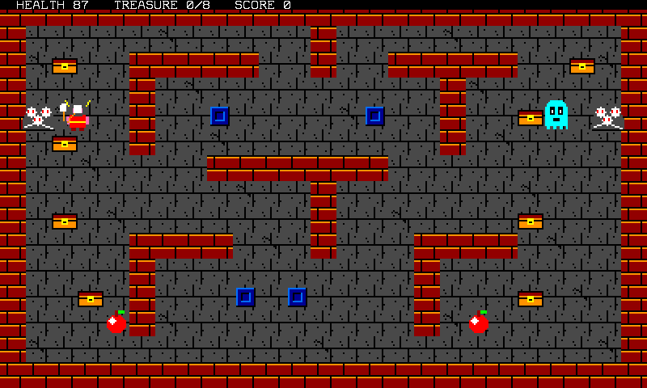

Three new kinds of moving things, all of them sprites: the **axes** (sprites 1 to 4), the **ghosts** (5 to 12) and the **generators** (13 and 14).
The sprite budget is the machine's 32, and it is worth writing down who owns which numbers before coding: the header comment of the
globals does exactly that.

```c
byte level[379];                 // HUNT.LVL: 4 header bytes, then 25x15 tile numbers
byte lay[379];                   // HUNT.LAY: the same shape, one bit a layer: 0 solid, 1 treasure, 2 generator, 3 food
int hx;                          // the warrior's sprite position, in 800x480 pixels
int hy;
int fdx;                         // where he faces, and where an axe flies: -1, 0 or 1 on each axis
int fdy;
bool faceLeft;
byte frame;
byte state;                      // 1 playing, 2 won, 3 dead
int health;                      // drains by 1 a second, 99 at most
nat lastSec;
int treasure;                    // chests opened so far
int score;
int tx[8];                       // the 8 chests: sprites 15 to 22
int ty[8];
bool ton[8];
int foodX[2];                    // the 2 apples: sprites 23 and 24
int foodY[2];
bool foodOn[2];
int fire;                        // frames before the next axe can be thrown
int ax[4];                       // the 4 axes in flight: sprites 1 to 4
int ay[4];
int adx[4];
int ady[4];
bool aon[4];
int gx[8];                       // the 8 ghosts: sprites 5 to 12
int gy[8];
bool gon[8];
int genX[2];                     // the 2 generators: sprites 13 and 14
int genY[2];
int genHp[2];                    // 3 axes destroy one
int genWait[2];                  // frames before the next ghost
```

**Throwing.** The axe flies where the warrior last walked (`fdx`, `fdy`, set in `moveHero`, so diagonals work), 7 units a frame, at most 4 at a time, one every 12 frames:

```c
// button A (the Z key) throws an axe, one every 12 frames, 4 in the air at most
void throwAxe() {
	if(fire>0) {
		fire--;
		return;
	}
	if((_padLft&0b00000001)==0) return;
	for(int i=0;i<4;i++) {
		if(!aon[i]) {
			aon[i]=true;
			ax[i]=hx;
			ay[i]=hy;
			adx[i]=fdx*7;
			ady[i]=fdy*7;
			fire=12;
			return;
		}
	}
}

void killAxe(int i) {
	aon[i]=false;
	sprPos((byte)(1+i),0,0);
}

// axes fly straight, kill a ghost, wear a generator down, and break on a wall (the hits are tested first: a generator
// can stand right against a wall)
void moveAxes() {
	for(int i=0;i<4;i++) {
		if(aon[i]) {
			ax[i]+=adx[i];
			ay[i]+=ady[i];
			sprRef((byte)(1+i),(byte)(2+((frame>>1)&1)));
			sprPos((byte)(1+i),ax[i],ay[i]);
			for(int g=0;g<8;g++) {
				if(aon[i]&&gon[g]&&isSprSpr((byte)(1+i),(byte)(5+g))) {
					gon[g]=false;
					sprPos((byte)(5+g),0,0);
					killAxe(i);
					score+=10;
					showStatus();
				}
			}
			for(int g=0;g<2;g++) {
				if(aon[i]&&genHp[g]>0&&isSprSpr((byte)(1+i),(byte)(13+g))) {
					genHp[g]--;
					killAxe(i);
					if(genHp[g]==0) {
						sprPos((byte)(13+g),0,0);
						score+=100;
						showStatus();
					}
				}
			}
			if(aon[i]&&solidAt(ax[i]-48+24,ay[i]-42+21)) killAxe(i);
		}
	}
}
```

Read `moveAxes` in order: *move*, *show*, *test against the ghosts*, *test against the generators*, **then** the wall. That last order matters: a generator can stand against a wall,
and an axe that is tested against the wall first dies before it ever touches the generator (this really happened while the game was written: the left generator is against the wall, and the automated test that shoots at it found the bug).

**The enemies.** Every generator that still stands (`genHp>0`) sends a ghost every 100 frames while a slot is free; a ghost walks toward the warrior, one axis at a time, and slides along walls:

```c
// a generator that still stands sends a ghost every 100 frames, if there is room for one
void spawn() {
	for(int g=0;g<2;g++) {
		if(genHp[g]>0) {
			genWait[g]--;
			if(genWait[g]<=0) {
				genWait[g]=100;
				for(int i=0;i<8;i++) {
					if(!gon[i]) {
						gon[i]=true;
						gx[i]=genX[g];
						gy[i]=genY[g];
						break;
					}
				}
			}
		}
	}
}

// a ghost walks to the warrior, slides along the walls, and costs him 10 health when it touches him
void moveGhosts() {
	for(int i=0;i<8;i++) {
		if(gon[i]) {
			int dx=0;
			int dy=0;
			if(hx-gx[i]>2) dx=2;
			if(hx-gx[i]<-2) dx=-2;
			if(hy-gy[i]>2) dy=2;
			if(hy-gy[i]<-2) dy=-2;
			if(dx!=0&&!blocked(gx[i]+dx,gy[i])) gx[i]+=dx;
			if(dy!=0&&!blocked(gx[i],gy[i]+dy)) gy[i]+=dy;
			sprRef((byte)(5+i),(byte)(4+((frame>>3)&1)));
			sprPos((byte)(5+i),gx[i],gy[i]);
			if(isSprSpr(0,(byte)(5+i))) {
				gon[i]=false;
				sprPos((byte)(5+i),0,0);
				health-=10;
				checkDeath();
			}
		}
	}
}
```

A ghost that touches the warrior (`isSprSpr(0, ghost)`) costs him 10 health and is gone. The score goes up by 10 for a ghost,
100 for a generator, 50 for a chest, and `showStatus` now shows it. Death moved into one function, `checkDeath`, because hunger and ghosts can both cause it.

The main loop calls the new steps in this order:

```c
setup();
startGame();
while(_keyDwn!=12) {                             // until ESC
	if(state==1) {
		moveHero();
		throwAxe();
		moveAxes();
		spawn();
		moveGhosts();
		if(state==1) pickItems();
		if(state==1) hunger();
	} else if((_padLft&0b00000100)!=0) {         // Start (Enter)
		startGame();
	}
	glint();
	vSync();
	sprUpdt();
	frame++;
}
```

Try: stand in front of a generator and hold `Z`; walk away from a ghost (it moves 2 units a frame, you move 3); eat an apple when health is low.
Open the **Hardware** panel while the game runs: the **sprites** table lists the 32 sprites, their images, positions and priorities, live.

### 5.7. Step 7: title screen, music and sound

The game plays; it needs a face and a voice.

**The title screen.** `File > New Asset > New Screen design` opens the **screen designer**: an 80 x 40 text screen where each cell has a glyph (one of the
256 of the machine's font) and a paper and ink colour. Pick a glyph in the palette, a colour in the bar, and use paint, box, fill, or the **write** tool (click, then type).
The title is built from `#` characters, orange `DUNGEON` over red `HUNT`, with the instructions in white and cyan; the finished one is `HUNT.SCR`.

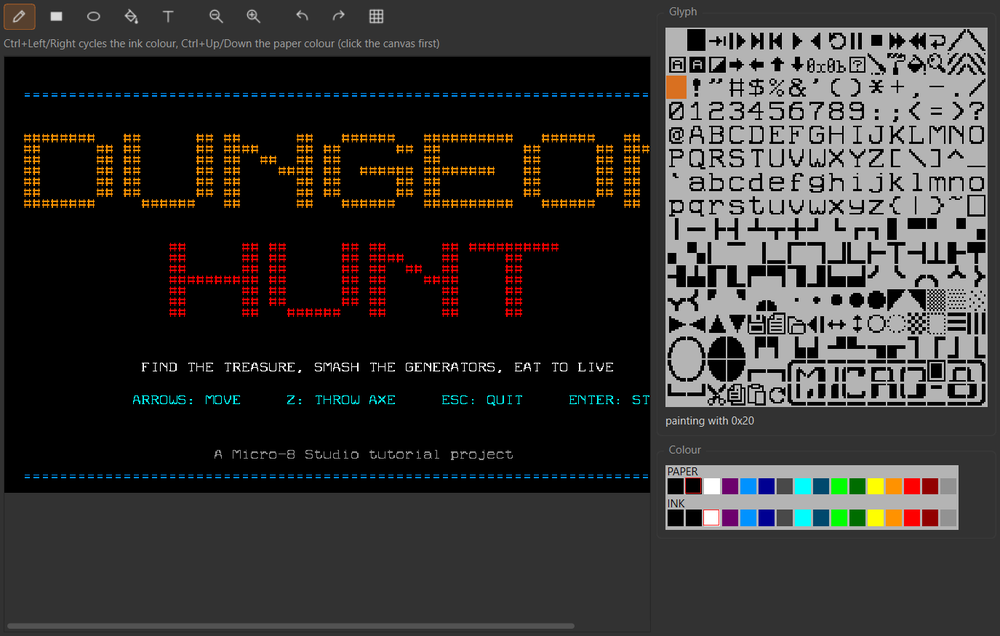

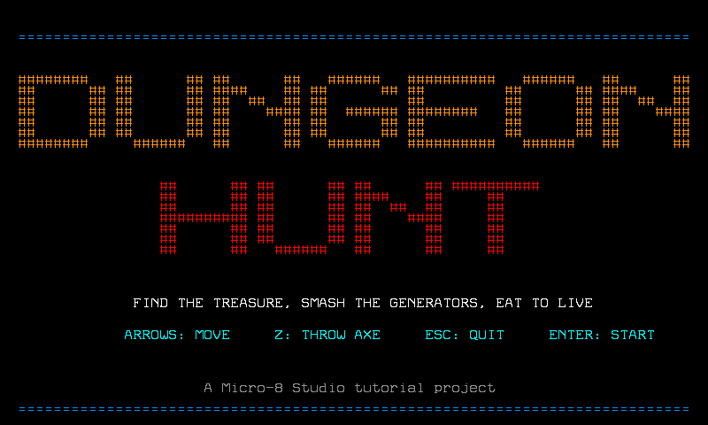

A `.SCR` is 6400 bytes: the 3200 glyphs then the 3200 colours, exactly as the machine keeps its text screen in memory (`0x1200` and `0x1E80`), plus a 2-byte checksum.

**The music.** `File > New Asset > New Tracker project` opens the **tracker**: a grid of 16 steps by 8 tracks (six FM voices, a drum track, a synth track). Each cell holds a note,
an instrument and a velocity. DUNGEON HUNT's tune is four patterns of 16 steps in A minor, 108 beats per minute, played in a loop (`SONG` band at the bottom: four cards, one per pattern):

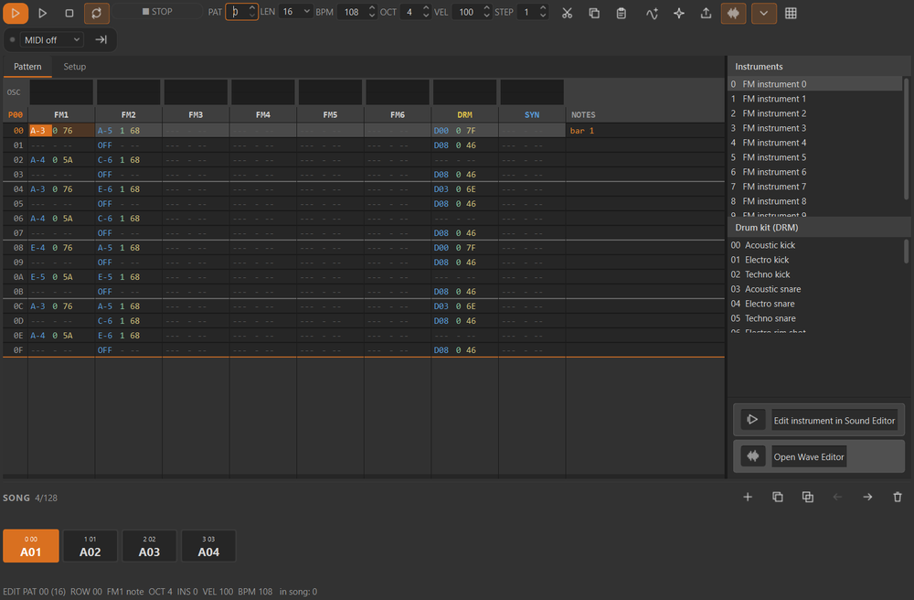

- **FM1, the bass.** Right-click the instrument slot 0 and choose *Load .INS into slot 0...*: `TOOLS\SOUNDED\SOUNDS\BASS01.INS`. One note on every beat (steps 0, 4, 8, 12), as root, root, fifth, root of the chord, and the octave above of that note two steps later. The chords are Am, F, G and E, so pattern 1 is **A-3 A-3 E-4 A-3**, pattern 2 **F-3 F-3 C-4 F-3**, pattern 3 **G-3 G-3 D-4 G-3**, pattern 4 **E-3 E-3 B-3 E-3** (the tracker counts octaves one higher than the usual MIDI names: its A-3 is the A of 110 Hz).
- **FM2, the lead.** Slot 1 gets `LEAD02.INS`. Each pattern is an arpeggio of the chord, then a turn: pattern 1 `A-5 C-6 E-6 C-6 A-5 E-5 A-5 C-6 E-6`, pattern 2 `F-5 A-5 C-6 A-5 F-5 C-5 F-5 A-5 C-6`,
  pattern 3 `G-5 B-5 D-6 B-5 G-5 D-5 G-5 B-5 D-6 B-5`, pattern 4 `E-5 G#5 B-5 G#5 E-6 D-6 B-5 G#5`. The notes sit on steps 0, 2, 4... with a few on the odd steps at the end of the bar; an `OFF` cell ends a note.
- **DRM, the drums.** The digital synth's DPCM kit: a kick (entry 0) on steps 0 and 8, a snare (entry 3) on steps 4 and 12, a closed hat (entry 8) on every odd step.
- Play with `Space`, then save as `HUNT.M8S`.

You can enter notes with the computer keyboard (the Z S X D C V... row is the white and black keys of one octave, Q 2 W 3 E R... the octave above) or by clicking a cell; the **Generate** button of the toolbar writes a bass, a drum or an arpeggio pattern for you.
The tracker is described in section 9.6. **Leave FM6 (the sixth FM track) empty**: the game uses that voice for sound effects, and the music must not step on it.

**Playing it from the program.** Insert the library again and tick **screen** and **song**: `loadScreen` shows the `.SCR`; `songLoad`, `songStart` and `songTick` play the `.M8S`:
the tracker's own player, written in Lofi, which reads the song's events and drives the same voices as the tracker. Call `songTick()` once a frame.

**Sound effects.** A short sound on a voice the music does not use:

```c
// a short sound on FM voice 6, the one the song leaves alone
void sfx(byte note) {
	ymVoice(5,1,5,3,110);
	ymNoteOn(5,note,127);
}

// the title picture drawn in the Screen designer
void title() {
	poke(0x2F00,0b00010000);                       // the text layer alone
	loadScreen("HUNT.SCR");
	state=0;
}
```

and calls to it where things happen: throwing an axe (note 72), killing a ghost (60), destroying a generator (48), being hit (40), a chest (88), an apple (80), winning (96), dying (33).
Notes are MIDI numbers. `title()` shows only the text layer; `startGame()` turns tiles and sprites on. The finished main loop, `HUNT.SRC`, has three more parts:
the song, the title, and a clean exit.

```c
setup();
if(songLoad("HUNT")) songStart();                // the music of HUNT.M8S, played by M8LIB's player
title();
while(_keyDwn!=12) {                             // until ESC
	songTick();
	if(state==1) {
		moveHero();
		throwAxe();
		moveAxes();
		spawn();
		moveGhosts();
		if(state==1) pickItems();
		if(state==1) hunger();
	} else if((_padLft&0b00000100)!=0) {         // Start (Enter): the title or an end screen leads to a new game
		startGame();
	}
	if(state!=0) glint();
	vSync();
	sprUpdt();
	frame++;
}
songStop();                                      // leave the machine as it was found
ymNoteOff(5);
poke(0x2F00,0b00010001);
memSet(0x1200,3200,' ');
memSet(0x1E80,3200,0x12);
curPos(0,0);
```

Run the whole game with `F5`. The music starts on the title screen and goes on while you play. `Esc` stops everything, silences the voices, and gives the screen back as it was found.

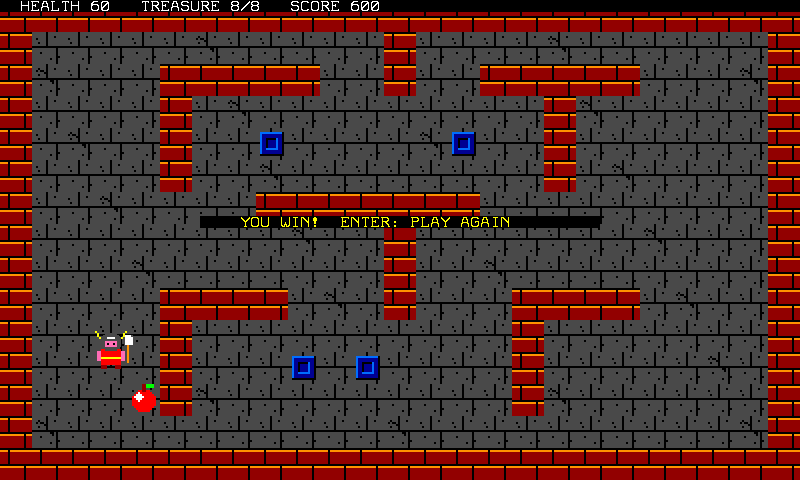

### 5.8. Step 8: debug and measure

Studio runs the program on an emulator of the machine, so you can stop it and look inside.

1. **Breakpoint.** Click in the gutter next to `health-=10;` in `moveGhosts` (or `F9`). Run, let a ghost touch the warrior: the program stops on that line, highlighted.
2. **Variables and Watch.** The **Variables** panel lists the call stack, the locals (`i`, `dx`, `dy`) and the globals (`health`, `score`, `state`, `treasure`); changed values show in orange.
   Add an expression to **Watch**, for instance `gx[0]-hx`, to see the first ghost's distance.
3. **Step.** `F10` steps over, `F11` into, `Shift+F11` out; `F5` goes on. Right-click a breakpoint to give it a condition, such as `i==2`.
4. **Memory breakpoint.** `Run > Add Memory Breakpoint...`, or right-click a byte in the **Memory** panel: the program stops when that byte changes, whoever wrote it.
   Try address `0x2F00`, the layer register, and start a game: it stops where `startGame` writes it.
5. **Hardware panel.** Layers, scroll, palettes and the 32 sprites, live. Compare the sprite table with the map: sprite 13 sits at the cell of the left generator.
6. **Memory Map.** The program is compiled to bytecode, and the machine gives it **32 KB of code and 16 KB of data**. For DUNGEON HUNT the estimate is about **8.5 KB of code
   and 2 KB of data**: a quarter of the budget, with the library, the player and the sound effects. The estimate comes from a model fitted on the card's own compiled programs (within 5%).
7. **Speed.** By default the emulator runs as fast as the PC. `Run > Hardware Speed (X1)` runs at the real machine's speed: every VM operation costs a fixed time, so a program does
   as much work per frame as on the console. If the game slows down in X1, a frame has too much to do (here: up to eight ghosts chasing, four axes tested against ten targets); that is the thing to check before sending a game to a real machine.

### 5.9. Step 9: check, export, and run on the machine

- **`File > Project > Check Project`.** It reports what the real machine would refuse: names that are not 8.3, compile errors, code over 32 KB, project files that are missing,
  and the files your strings name that are not in the folder. A clean project says so.
- **`File > Project > Export Project to SD Card...`** copies the manifest, the program and every asset into `FOLDER\` on a card (it asks before replacing). If the machine is connected by MIDI,
  **Send Project to Machine...** does the same without taking the card out (section 9.10).
- **On the machine.** Put the folder on the card, switch the console on, and at the prompt:

```text
cd HUNT
compile HUNT.SRC
run HUNT.BIN
```

`cd` changes to the folder (the program opens its files from there), `compile` turns the source into bytecode and reports the code and data sizes, and `run` starts it. The game
loads `HUNT.SPR`, `HUNT.LVL`, `HUNT.LAY`, `HUNT.SCR` and `HUNT.M8S` from the current folder.

### 5.10. Where to go from here

- **More levels.** Make `LEVEL2.LVL` and `LEVEL2.LAY` in the map editor, and load them when the last chest is gone. The program does not change except for two file names.
- **A bigger dungeon.** Make the map 80 x 24 and scroll it with the hardware registers `0x2F01` and `0x2F02` (the `TILES` demo shows how).
- **Doors and keys.** Layer 4 marks doors; a key flag lets the warrior through; the wall test checks it.
- **Faster ghosts, better ghosts.** A ghost type with 2 hit points; ghosts that cannot see you if a wall is between.
- **Two players.** The right pad register is `_padRght`.
- **A real tune.** Open the tracker's generators, or play your instruments from the sound editor into the wave editor and build your own sounds (section 9.5).

You now know the whole path: **assets with the editors, a program that loads them, layers that say where things are, a project that holds them, and a test on the machine.**

## 6. Editor

- No document open: a double click in the empty editor area opens the Open dialog (same as File > Open, `Ctrl+O`).

- Tabs, line numbers, Lofi syntax highlighting (types, keywords, API, `_xxx` built-in variables, numbers, text,
  comments), cut / copy / paste / undo / redo, current-line highlight, matching parentheses, occurrences of the
  word under the cursor.

- Find `Ctrl+F` (count, case, whole word, regex), replace `Ctrl+H`, `F3` / `Shift+F3`, find in files
  `Ctrl+Shift+F`, go to line `Ctrl+G`, bookmarks `F2` / `Ctrl+F2`.

- Auto-indent, auto-close `( [ { "`, `Tab` / `Shift+Tab` on a selection, comment `Ctrl+/`, duplicate line
  `Ctrl+D`, delete line `Ctrl+Shift+K`, move lines `Alt+↑/↓`.

- **Completion** (as you type, or `Ctrl+Space`): your functions, variables and types, the whole API (with the
  manual's own signatures), built-in variables, keywords, **members** after `variable.` or `array[i].` for your
  custom types, and **snippets** (`for`, `while`, `if`, `ifelse`, `main`, `func`, `type`, `loop`, `sprite`,
  `import`: name + `Tab`, or from the list). Picking a function adds its parentheses. **Parameter hints**: inside
  a call, the signature is shown with the current parameter in bold (API and program functions alike).

- **Navigation and refactoring**: go to definition `F12` or `Ctrl+click` (function, type, variable; for the API,
  its signature), rename a symbol `Ctrl+R` (whole-word occurrences outside text and comments, one single undo),
  format the document `Ctrl+Alt+L` (brace-based indentation, the file's own style: real sources use tabs), zoom
  `Ctrl+wheel`.

- **Preferences** (`Ctrl+,`): theme, **language** (English / Français, restart to apply), font and size, tab
  width or tabs, pair auto-close, completion and hints, analysis delay, format on save. The interface (menus,
  toolbar, Preferences) is translated through the standard Qt Linguist mechanism.

- **Live analysis** (0.5 s after typing): errors and warnings underlined, a gutter marker, the Problems panel,
  the program outline. A program with errors does not run. The analysis also knows the real compiler's rules
  found on the machine (a `<<` `>>` shift is by a `byte`, never an `int`) and estimates the bytecode size (a
  model fitted on the SD card's own `.BIN` files, within 5%): shown in the memory map, with a warning past the
  32 KB code segment.

- **Bytes preserved**: a file is saved byte for byte (CR LF or LF line endings kept as they were). The Micro-8's
  own control codes inside text literals (newline 0x0D, colors…) show as control pictures (␍ ␐…); Edit > Insert
  Control Glyph inserts one.

## 7. Run & Debug

`F5` runs the program on the emulated Micro-8 (screen in the *Micro-8 screen* dock: click it to give it keyboard
focus; mouse; gamepad: arrows, Z=A, X=B, Enter=Start, Tab=Select). Sound plays live (FM via Nuked-OPN2). A
run-time error stops the program on its line with a plain message, also when it comes from an impossible
argument (`5 >> -1`, `sqrt(-1.0)`, a pow() with no real result, an address out of range); a real passed where
the machine expects an integer is truncated as `int()` does.

| Action | Key |
|---|---|
| Run / continue | `F5` (run without breakpoints: `Ctrl+F5`) |
| Stop / restart | `Shift+F5` / `Ctrl+Shift+F5` |
| Pause | `F6` |
| Step out / into / over | `Shift+F11` / `F11` / `F10` |
| Breakpoint | `F9` or click the gutter (right-click: a condition, e.g. `i==2`) |
| Memory breakpoint | Debug > Add Memory Breakpoint, or right-click a byte in Memory: the program stops as soon as that byte (or range, RAM or external SRAM) changes, whatever wrote it (an assignment, `poke`, an API function, the raster handler); Output shows the address, old -> new value and the line that wrote |

Panels: **Variables** (call stack, locals and globals, changed values in orange), **Watch** (Lofi expressions
evaluated while paused, e.g. `data[i]*10`), **Breakpoints** (lines and memory), **Memory** (a hex dump of RAM or
external SRAM, changed bytes highlighted, shortcuts to the useful zones), **Hardware** (layers, scrolling,
pages, raster, palettes, sprites, synth registers).

### 7.1. Emulation speed

- **Default**: the program runs as fast as the PC allows; machine time follows the real clock (excluding time
  spent paused).

- **Run > Hardware Speed (X1)**: the program runs at the real Micro-8's speed. Every VM operation (an expression
  node, a loop test, a jump) costs a fixed time; machine time is the sum of those costs, and the emulator waits
  for the real clock whenever it is ahead. A program therefore does as much work per frame as on the machine.
  Remembered, can be switched while running; the status bar shows `Running (X1)`.

- **Speed**: Preferences > Emulation > Hardware speed (X1), 1000 kHz by default (VM ≈ 1 MHz). To calibrate: run
  `dev/X1BENCH.SRC` on the real machine and enter the measured total in Preferences to get the value to use.

- **PC too slow**: if the PC cannot keep up, the whole run slows down (clock and sound included) instead of
  skipping machine time; the status bar says so.

Limitation: this is a cost model, not a cycle-exact emulation of the ATmega128 and its firmware, API calls
(memory copies, drawing) cost the same whatever their size.

Tools menu: array-index checking (disabled like the real machine / warn in Output / stop), sound, the synth's
note convention, PNG screenshot, exporting the session's sound as WAV.

## 8. Image Converter

`Ctrl+Shift+I` opens the *Image tools* window: drag and drop an image (PNG, JPG, GIF, TGA…).

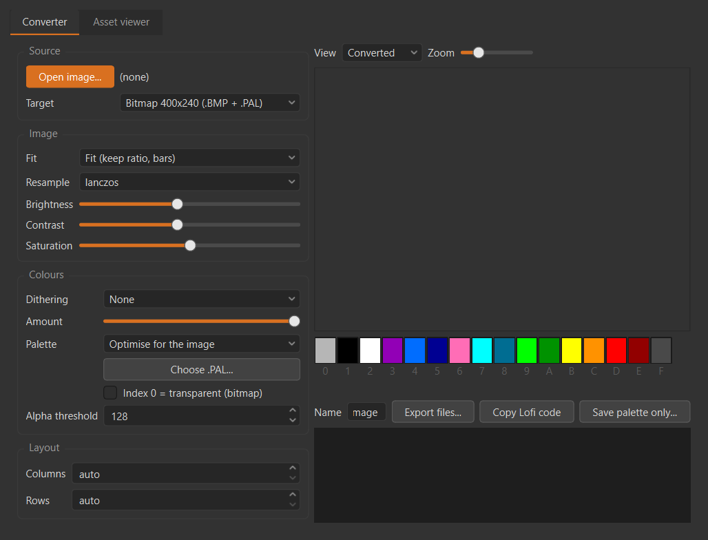

- **400×240 bitmap** → `.BMP` (48000 bytes, 4 bits/pixel) + `.PAL` (48 bytes, 3 bits per component).

- **24×21 sprites** → `.SPR` (252 pixel bytes + a computed AABB collision box) + `.PAL`.

- **16×16 tiles** → `.TLS` + `.PAL`; **tiles + map**: the image is sliced, identical tiles merged, `.TLS` +
  `.LVL` (one byte per cell) + `.PAL`. A warning past 256 tiles / 256 sprites.

- Fit (fit / fill / stretch / 1:1), resampling, brightness / contrast / saturation, a palette optimized for the
  image, or one loaded from a `.PAL`, or a hand-edited palette (click a color: 512 colors), dithering (none,
  Floyd-Steinberg, Bayer 4×4), index-0 transparency, before/after comparison, zoom.

- Export to a chosen folder plus **ready-to-paste Lofi code** (`import(...)`, palette addresses, layer
  activation).

- **Asset viewer** tab: opens existing `.BMP`, `.SPR`, `.TLS` files with their palette (found automatically),
  collision boxes in magenta, PNG export.

## 9. Asset Editors

The desktop equivalents of the SD card's own tools (SPRITED, MAPED, IMAGED, SOUNDED, SCREENED, the built-in
tracker).

Each editor opens in a tab next to the code: toolbar, Tools or File > New Asset, double-click a file in the
tree, or drag and drop. Save `Ctrl+S`, undo/redo/copy/paste from the Edit menu. All of them read then write back
the real SD-card files **byte for byte**.

### 9.1. Sprite editor

`.SPR` + `.PLA` / `.PLB`: up to 256 24×21 sprites.

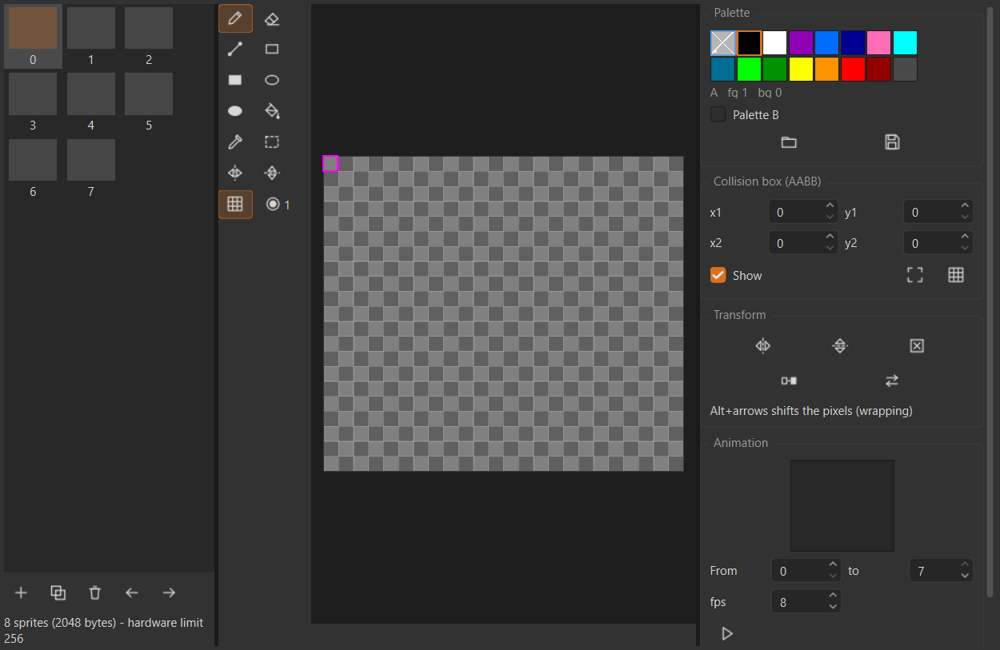

- A thumbnail list (new, duplicate, delete, move).
- Pixel-by-pixel drawing: pencil, eraser, line, rectangle, oval, fill, eyedropper, selection with move / copy /
  paste, X/Y mirror, brush sizes 1-4, wheel zoom, grid, onion skin (the previous sprite shown transparently).
- Per-sprite undo, a palette editor (512 colors, palettes A and B).
- An **AABB collision box** (fields, auto-fit), flips, color replace/swap.
- An **animation preview** (range, frames per second), importing a PNG sheet, PNG export.

### 9.2. Tile / map editor

`.TLS` + `.PAL` + `.LVL`: up to 256 16×16 tiles.

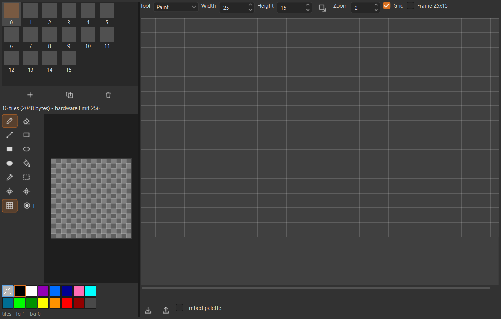

- Tiles edited pixel by pixel, a map painted with paint, fill, eyedropper, selection copy / paste.
- Map resizing, a 25×15 screen frame guide, grid, zoom.
- Deleting a tile renumbers the map automatically.
- Importing an image into tiles + a map (identical tiles merged), PNG export.
- Formats: raw `.TLS` (+ `.PAL`) or the tile editor's own shape (a 48-byte palette in front); `.LVL` with a
  4-byte header (width, height) or raw (width is asked for, as with the TILES demo's 80×24 level).
- **8 layers** over the map, like the machine's own MAPED (collision, paths, triggers: what a layer means is up to your
  program). Pick the layer in the **Layer** list (each has its own color), then use the four layer tools: paint,
  erase, fill and rectangle (left button sets the cell, right button clears it). The list next to it shows the current layer,
  all of them as small squares, or none. The **Layers...** menu generates a layer from the tiles you tick (every cell
  holding one of them), inverts or clears the layer, and loads or saves a `.LAY` file. Layers follow the map when it is
  resized, and undo and redo bring them back with the tiles.
- A `.LAY` is the MAPED format (width, height, then one byte per cell, one bit per layer). It is saved next to the map
  (`LEVEL.LVL` gives `LEVEL.LAY`) and loaded with it. A program reads it with `import`, like the map.

### 9.3. Bitmap editor

`.BMP` 400×240 + `.PAL`: the same tools as the sprite editor, across the whole image.

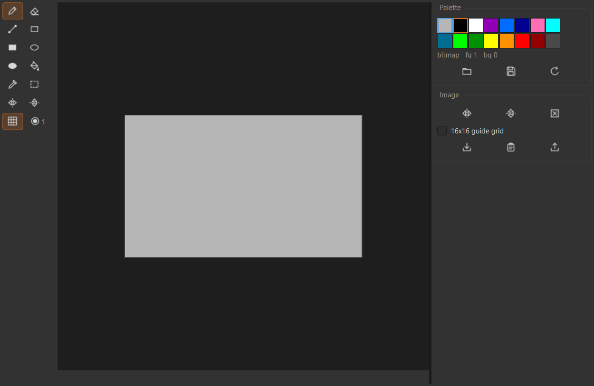

- A 16-color palette, a 16×16 guide grid.
- Importing an image with fitting, dithering and an optimized palette.
- Pasting an image from the clipboard, PNG export.

### 9.4. Sound editor

`.INS` 54 bytes, `.SYN` 16 bytes: a bank of 10 YM2612 instruments.

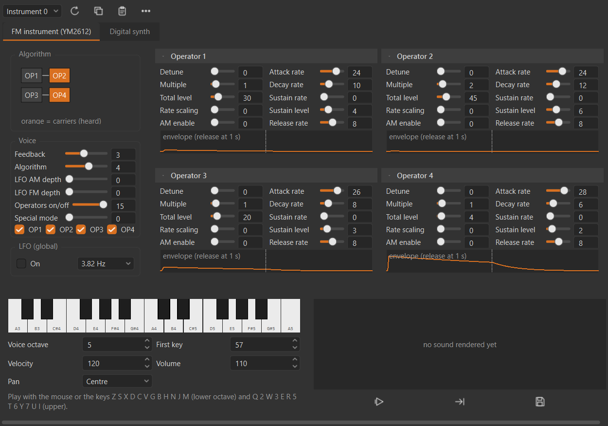

- The 54 parameters (4 operators: detune, multiplier, total level, rate scaling, attack, AM, decay, sustain
  rate, sustain level, release).
- The algorithm with a **diagram** (carriers in orange), feedback, LFO, active operators.
- An **envelope curve** per operator, a **test keyboard** (mouse or Z S X D C V… / Q 2 W 3 E R… keys) played
  live through Nuked-OPN2, the sound's waveform and spectrum.
- Copy / paste / init / randomize / mutate, loading an `.INS` into a slot, a bank of 10 files.
- A **digital synth** tab: oscillators, DPCM drums (20 sounds), envelopes, LFO, SVF filter, gains and panning,
  the 16 registers at 0x1110. The preset saves as `.SYN` (16 bytes, the studio's own format).

### 9.5. Wave editor

`.wav`: waveform with a selection, zoom, scrolling, a spectrum view.

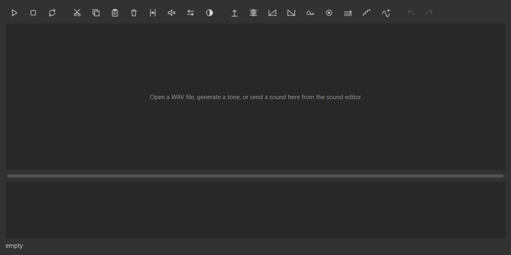

- Cut / copy / paste / delete / trim, silence, reverse, gain, normalize, fades, DC-offset removal, mono.
- Resampling (8-48 kHz), N-bit clipping (the synth's DPCM drums are 4-bit), signal generators, looped playback,
  WAV export.
- **Instrument to sample**: the send button of the sound editor (FM instrument or digital synth) asks for the
  note, how long it is held, how long the whole sound is, and the format it opens in: PCM at 44.1, 32 or 16 kHz,
  or **converted to the Micro-8's own DPCM** (below). Tools > Sound of this Run feeds the wave editor with a
  program's sound the same way.
- **Micro-8 DPCM (4-bit)**: the drum kit's format. The sound is resampled to the kit's rate (32 kHz, 16 kHz for
  the kicks), mixed down to mono and normalised, then turned into 4-bit codes: each code is one of the 16 steps
  the hardware adds to an 8-bit accumulator (the accumulator is the audio), so what the editor then shows and
  plays is what the codes sound like. The signal to noise ratio is shown, and the Undo button gives the original
  back. **Save as `.DPC`** writes the codes (two a byte, the high one first, no header); a `.DPC` opens again in
  the wave editor at 32 kHz (Resample for a kick). The machine's own drum kit lives in the FPGA's ROM, so no
  program loads a `.DPC` into it: the file is the format, for your own player or tools.

### 9.6. Tracker

One `.M8S` file compressed the C64 way (tracks as event lists, repeated or transposed tracks stored as
references; format described in the Tracker documentation): the Micro-8's built-in music sequencer.

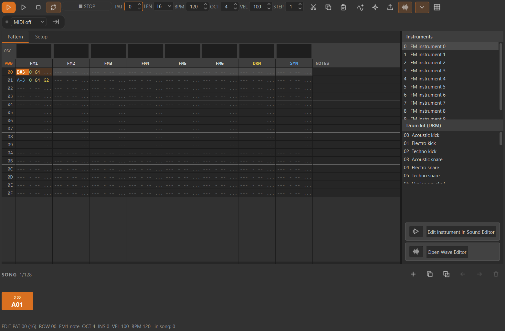

- 8 tracks: 6 FM voices, a drum/oscillator track "DRM", a "SYN" track.
- Note/instrument/velocity cells, patterns from 16 to 256 steps (blocks claimed/released).
- A song (a loopable sequence of transposable patterns), a page or continuous view. While the song plays, the
  grid follows the pattern playing; picking another one by hand shows it until the next entry.
- **SONG band**: one card per entry, 2 rows of 16 (like Elektron banks). The pattern reads as a bank
  (`A01`…`D16`, 16 patterns a bank) with its number in hex; an entry that repeats is one card "×N" (Elektron's
  REP: `Ctrl`+wheel or the copy button to add or remove one, right-click for an exact count), and the card
  playing shows which repeat ("2/3"). Past 32 cards, page buttons ("0-31", "32-63"...); the page follows
  playback, and hovering a page button while dragging a card opens it. Wheel: pattern, `Shift`+wheel: transpose,
  drag: move (with its repeats), double-click: play from here.
- OctaMED-style editing: range selection by Shift+arrows or mouse, transpose, copy/cut/paste a range, reverse,
  expand/shrink, fixed/ramp/random velocity.
- A scope per track, mute (click) / solo (double-click), **instant**: the sounding note is cut.
- While a pattern plays, picking another one plays it **at once**, at the same step of the bar (Elektron's
  direct jump), instead of waiting for the end of the pattern. The on-device trackers and player do the same on
  the machine.

**Generators**: Euclidean rhythms, polyrhythms, 20 drum presets, bass/pad/arp/random presets, 12 FM presets,
they only *write notes*, so they are 100% compatible with the real machine.

**Studio FX** (arp, retrigger, delay, cut, probability, YM LFO, swing, glide, track lengths): preview-only in
Studio, can be turned off, playback on the machine stays the on-device tracker's own. MIDI, WAV and stems export.
`.EXT.json`: a sidecar file for pattern lengths and FX, not read by the machine.

Tested byte-exact against the on-device trackers (the two versions of the on-device tracker, and the player): a
project made here opens unchanged on the real machine and back.

### 9.7. Screen designer

`.SCR` files: a generic 80×40 text-screen editor (glyphs + colors), in the style of the system tools
(SPRITED/SOUNDED/MAPED).

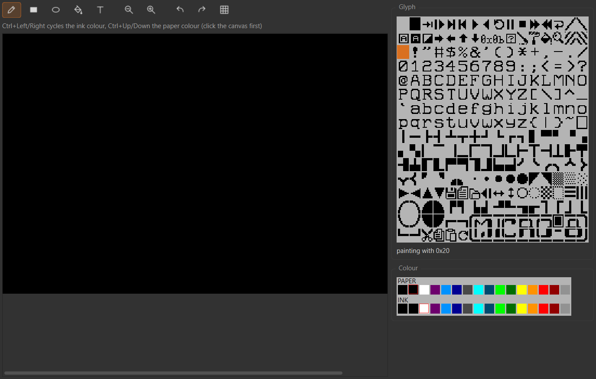

- A glyph palette (all 256 of the real font), a paper/ink color bar (the machine's own default text palette).
- Paint / box / circle / fill / write tools (a typewriter: click places a cursor, then you type), an eyedropper,
  zoom, undo/redo.
- `Ctrl+←/→` cycles the ink color, `Ctrl+↑/↓` the paper color.

A `.SCR` file is 6400 bytes (3200 glyphs then 3200 colors). A plain `import(name,0x1200,6400)` displays it
from any Lofi program. A corrupted file is refused on load.

### 9.8. Micro-8 Library

Edit > Insert Micro-8 Library... pastes ready-made Lofi functions into the current program to read and write,
**on the machine**, the files the Studio editors produce (`lib/M8LIB.SRC`). Lofi has no `#include` and compiles
in one pass: the ticked blocks, plus the ones they need, go after the opening comments, in the library's order.
A block already in the program is not copied again, and a single undo removes the insert.

| Block | Functions | File |
|---|---|---|
| `pal` | `loadPal` / `savePal` | 48-byte `.PAL` (16 R, 16 G, 16 B, 0-7) to a palette address |
| `bitmap` | `loadBitmap` / `saveBitmap` | 48000-byte `.BMP`, the displayed bitmap page (0x2F05) |
| `sprites` | `loadSprites` / `saveSprites` | `.SPR`, 256 bytes a sprite, from a given number |
| `tiles` | `loadTiles` / `saveTiles` | `.TLS`, 128 bytes a 16x16 tile |
| `level` | `loadLevel` / `saveLevel` | `.LVL`, one tile number a cell, in a byte array |
| `screen` | `loadScreen` / `saveScreen` | `.SCR` 3200 glyphs + 3200 colours (the Screen designer's) |
| `song` | `songLoad` / `songStart` / `songTick` / `songStop` | tracker project `.M8S`, played by the PLAYER core |

All return `true` on success (`_fError` is 0). A damaged `.SCR` is refused. The end of `M8LIB.SRC` (`//@main`) is a self-test to run as is (F5): it writes and reads back every
kind of file and plays `NEWSONG.M8S` when there is one.

### 9.9. Projects

File > Project: a project is **one folder of the SD card** holding a program and its assets, described by a
small JSON manifest `NAME.M8P` (an 8.3 name, so it can travel on the card harmlessly). The manifest keeps the
main program, the project's files, the open tabs, the current tab and the X1 setting.

- **New Project...**: pick the folder and the name (1 to 8 letters, digits or `_`); creates `NAME.SRC` when
  missing, and the assets already in the folder join the project. **Open Project...** (`Ctrl+Shift+O`) reopens
  the tabs and X1 mode; Studio reopens at startup the project that was open when it closed.
- **Save Project** (`Ctrl+Alt+Shift+S`) saves every open file and the manifest; a file opened from the project
  folder joins it (or **Add Current File to Project**). A new file is offered in the project folder by default.
  **Close Project** closes only the project's tabs.
- **F5** with an asset editor in front runs the project's program.
- **Check Project**: what the real machine would refuse (names that are not 8.3 for its FAT32, compile errors,
  code over the 32 KB segment, missing project files) and the files the program names in its strings that are
  not in the folder (only a note: the program may write them itself).
- **Export Project to SD Card...**: copies the manifest, the program and its files into `CARD/FOLDER/` (asks
  before replacing). **Send Project to Machine...**: the same, over MIDI (§9.10).
- **Tools > Write System to SD Card...**: writes the card shipped with Studio (system files, examples and their
  compiled programs) onto a real SD card for the machine. A summary lists the new, replaced and identical files
  before writing, and the machine's clipboard or undo already on the card are kept. The target must be a
  removable drive (never a fixed disk nor Studio's own folder).
- The project folder must sit under the Files tree's root (the emulated card) for the program's paths to
  resolve as on the machine: when it does not, the root moves up to its parent.

### 9.10. Transfer with the Machine (MIDI)

Tools > Transfer with Machine...: send, fetch and list the files on a real Micro-8's SD card, through its MIDI
ports and any USB-MIDI interface. Run `LINK.SRC` on the machine (copy it to the card first, with the **Copy
LINK.SRC to the SD Card** button or by hand), cable the PC's MIDI OUT to the Micro-8's MIDI IN and the Micro-8's
MIDI OUT to the PC's MIDI IN, then pick the ports, **Test Connection**, and use **List**, **Send Files...**,
**Send Project** or **Fetch Selected...**.

Without the machine: pick **Emulator**, **Start LINK in the Emulator**; everything works the same against the
emulator.

Speed is about 1.3 KB/s, so a 48000-byte picture takes about 40 s. Files up to 64 KB, 8.3 names. A received
file replaces the target only once complete: an interruption never damages it.

The MIDI keyboard chosen in Tools > MIDI Input also plays into the running program, as on the machine.

## 10. Small Windows

Every editor and panel adapts to a narrower window instead of being cut off: toolbars wrap onto several lines,
the sound editor stacks its areas (voices, operators, keyboard, oscilloscope) to fit the width, and the bottom
panels scroll. `Ctrl+Shift+M` (Focus Mode) hides every panel to get more room.

## 11. Known Limitations

The debugger works at line granularity (one statement at a time); `for(a;b;c)` does not stop on its three parts
separately.

## Appendix A. Keyboard shortcuts

| Action | Key |
|---|---|
| New, open, save, save as, save all | `Ctrl+N`, `Ctrl+O`, `Ctrl+S`, `Ctrl+Shift+S`, `Ctrl+Alt+S` |
| Open an example | `Ctrl+Shift+E` |
| Close the tab, detach the editor | `Ctrl+W`, `Ctrl+Shift+D` |
| Open a project, save the project | `Ctrl+Shift+O`, `Ctrl+Alt+Shift+S` |
| Undo, redo | `Ctrl+Z`, `Ctrl+Y` |
| Cut, copy, paste, select all | `Ctrl+X`, `Ctrl+C`, `Ctrl+V`, `Ctrl+A` |
| Find, replace, next, previous | `Ctrl+F`, `Ctrl+H`, `F3`, `Shift+F3` |
| Find in files, go to line | `Ctrl+Shift+F`, `Ctrl+G` |
| Comment, duplicate line, delete line | `Ctrl+/`, `Ctrl+D`, `Ctrl+Shift+K` |
| Move lines | `Alt+Up`, `Alt+Down` |
| Indent, unindent a selection | `Tab`, `Shift+Tab` |
| Completion | as you type, or `Ctrl+Space` |
| Go to definition, rename, format | `F12` (or `Ctrl+click`), `Ctrl+R`, `Ctrl+Alt+L` |
| Bookmarks: toggle, next, previous | `F2`, `Ctrl+F2`, `Ctrl+Shift+F2` |
| Zoom the editor | `Ctrl+wheel`, `Ctrl+=`, `Ctrl+-` |
| Preferences | `Ctrl+,` |
| Focus mode (hide every panel) | `Ctrl+Shift+M` |
| Run, run without breakpoints | `F5`, `Ctrl+F5` |
| Stop, restart, pause, continue | `Shift+F5`, `Ctrl+Shift+F5`, `F6`, `F8` |
| Step over, into, out | `F10`, `F11`, `Shift+F11` |
| Toggle a breakpoint | `F9` (or click the gutter) |
| Check the program | `Ctrl+Shift+B` |
| Image converter | `Ctrl+Shift+I` |
| The machine's manual | `F1` |

In the game pad of the emulated machine: arrows, `Z` (A), `X` (B), `Enter` (Start), `Tab` (Select). In the editors: `Ctrl+Z` and
`Ctrl+Y` undo and redo, `Ctrl+C`, `Ctrl+X`, `Ctrl+V` copy, cut and paste, `Ctrl+S` saves. The tracker has its own keys, listed in
its tooltips (`Space` plays, the keyboard rows play notes, `,` and `.` change the pattern).

## Appendix B. File formats

Every file below is the machine's own format, read and written byte for byte: what Studio saves opens on the console, and back.

| File | Size and layout |
|---|---|
| `.SRC` | Lofi source text, one byte a character (Latin-1). Line endings kept as they were. |
| `.BIN` | compiled bytecode, made by the machine's `compile` command |
| `.PAL`, `.PLA`, `.PLB` | 48 bytes: 16 red, 16 green, 16 blue values, 0 to 7 each. `.PAL` is a tiles or bitmap palette, `.PLA` and `.PLB` the sprite palettes A and B |
| `.SPR` | 256 bytes a sprite: 252 bytes of pixels (24 x 21, 4 bits a pixel, two pixels a byte with the left one in the high nibble, row by row), then 4 bytes for the collision box: x1, y1, x2, y2 in sprite pixels |
| `.TLS` | 128 bytes a tile (16 x 16, 4 bits a pixel as above); up to 256 tiles. Studio also reads a file with a 48-byte palette in front |
| `.LVL`, `.MAP` | the map: width (2 bytes, little endian), height (2 bytes), then one byte a cell, the tile number. A file without the 4-byte header is read as a raw grid (Studio asks for its width) |
| `.LAY` | the layers of a map, same header as `.LVL`, then one byte a cell, **one bit a layer** (bit 0 is layer 0, up to 8 layers) |
| `.BMP` | 48000 bytes: the 400 x 240 picture, 4 bits a pixel |
| `.SCR` | 6400 bytes: 3200 glyphs then 3200 colours (high nibble paper, low nibble ink) of the 80 x 40 text screen, optionally followed by 2 bytes of checksum (Fletcher-16) |
| `.INS` | 54 bytes: one YM2612 instrument |
| `.SYN` | 16 bytes: the digital synth's registers (Studio's own format) |
| `.M8S` | a tracker project: starts with `M8S1`, then the song settings, the patterns (tracks as lists of events, repeated or transposed tracks stored as references) and the instrument bank |
| `.DPC` | raw Micro-8 DPCM: 4-bit codes, two a byte, the high one first, 32 kHz or 16 kHz |
| `.WAV` | PCM audio |
| `.EXT.json`, `.NOTES.json` | Studio's own companions of an `.M8S`: pattern lengths and effects, step notes. The machine ignores them |
| `.M8P` | a Studio project: a small JSON manifest, with an 8.3 name |

## Appendix C. Troubleshooting

**The program does not run, F5 does nothing.** The **Problems** panel lists what the machine's compiler would refuse; click an entry to go to the line.
Studio will not run a program the real machine would reject.

**The arrows do not move anything.** Click the Micro-8 screen once: the keyboard goes to the panel that has the focus.

**A sprite is not on the screen.** Check, in this order: the sprites layer is on (`poke(0x2F00,...)` with bit 2 set), `sprUpdt()` was called after `sprPos`,
the position is inside the visible area (X 48 to 847, Y 42 to 521; (0,0) hides a sprite), the image number exists, and the sprite's palette holds the colours you think (index 0 is transparent).
The **Hardware** panel shows the real registers.

**Two sprites "collide" at the start of the game.** Hidden sprites sit at (0,0), where they overlap each other. Make sure a sprite has been placed and shown
(`sprUpdt()`) before you test it, as the tutorial does at the end of `startGame`.

**The colours are wrong.** The sprite, tile and bitmap palettes start with the machine's default values, which is not what your picture uses. Load a `.PAL` or `.PLA`
(`loadPal`) or set the values with `poke` to `0x1170` (tiles), `0x11A0` (bitmap), `0x11D0` and `0x2FA0` (sprites).

**A number goes negative, or wraps, for no reason.** Integers are 16 bits: 200 * 200 is -25536. Keep products under 32767 or scale the values (a shift is cheaper than a division).

**"int to byte needs an explicit (byte) cast".** Add the cast: `sprPos((byte)(3+i),x,y)`. The machine's compiler refuses it and so does Studio.

**Printed text is black.** `print` writes black on transparent. Set the colour bytes (`0x1E80`) after printing, or use the colour control glyphs of the machine's `print`.

**A file is not found on the machine.** Names are 8.3 (`HUNT.SPR`), the program must be run from the folder that holds the files (`cd HUNT`), and
`Check Project` reports names the card's file system would refuse.

**The source size turns red in the status bar.** It is the limit of the machine's own text editor (8 KB by default, changeable in Preferences). A bigger program still compiles
and runs; to edit it on the console itself, split it into several files.

**The game is slow in Hardware Speed (X1).** A frame does too much. Move work out of the loop (precompute tables, test fewer things), and use `byte` and `int`, not `real`.

**There is no sound.** `Tools > Sound` must be on. For FM sounds a program has to call `ymInit()` and `ymVoice()` before `ymNoteOn()`; for songs, `songLoad()` does it.

**The layer colours are hard to see on my map.** Each layer has a fixed colour (yellow, blue, green, red, purple, teal, orange, white). Use *All layers* to see
small squares, or another layer for the same data.

**Where are Studio's settings?** In the `data` folder next to `Micro8Studio.exe`: nothing is written outside it, so the whole folder moves to another PC as it is.
