# Micro-8 Studio : mode d'emploi

Micro-8 Studio est l'atelier de bureau de la console Micro-8 : un éditeur de code qui connaît le langage Lofi, un émulateur
avec débogueur, et les éditeurs de tout ce qu'un programme charge (sprites, tuiles, cartes, images, sons, musique, écrans
de texte). Il est fait d'abord pour le Micro-8, mais ses outils ne sont pas liés à une seule machine : les éditeurs de sprites, de
cartes de tuiles et de wave et le tracker écrivent aussi les formats que lisent les autres outils (planches PNG avec atlas JSON, cartes
Tiled, en-têtes C, WAV, MIDI) et l'éditeur de code ouvre les fichiers Python, C et C++ : Studio sert donc aussi à d'autres
projets de jeux rétro. Ce manuel comporte trois parties :

- **Prise en main** (chapitres 1 à 4) : installation, visite de la fenêtre, premier programme, et le langage Lofi en dix minutes.
- **Tutoriel** (chapitre 5) : un jeu complet, DUNGEON HUNT, construit pas à pas avec tous les éditeurs, testé, puis envoyé sur la carte.
- **Référence** (chapitres 6 à 11) et **annexes** (raccourcis, formats de fichiers, dépannage) : ce que fait chaque partie de Studio, en détail.

Le Micro-8 et son langage, Lofi, ont été créés par Franck Sauer. Le Micro-8 lui-même (son matériel, ses commandes, toute l'API Lofi) est décrit dans le *Micro-8 User's Manual*, que Studio
ouvre avec `F1`. Ce manuel parle de Studio et renvoie à l'autre pour la machine.

Studio embarque sa propre **aide IA** : l'AI Assistant répond à partir du manuel du Micro-8 et, avec votre accord à chaque fois,
peut travailler dans Studio (lire le code, écrire, composer, dessiner, lancer). **Il n'y a aucune télémétrie :** Studio n'envoie rien
sur vous ni sur votre travail, il n'a ni compte ni vérification de mise à jour, et tout reste sur votre ordinateur. La seule exception
est un service d'IA distant que vous choisissez vous-même dans l'assistant, Mistral (une société européenne, soumise au RGPD) ou
Anthropic : votre question, les sections du manuel trouvées pour elle et, si vous l'incluez, votre fichier ouvert sont alors envoyés
à ce service, selon ses propres conditions. Avec un modèle de votre ordinateur (llama.cpp), rien ne le quitte.

Pour en savoir plus sur le Micro-8, suivre son développement ou en acheter un, rendez-vous sur le site de son concepteur, Franck Sauer : **[www.micro-8.com](https://www.micro-8.com)**.

## Sommaire

- [Sommaire](#sommaire)
- [1. Aperçu](#1-apercu)
- [2. Visite de la fenêtre](#2-visite-de-la-fenetre)
- [3. Votre premier programme](#3-votre-premier-programme)
- [4. Lofi en dix minutes](#4-lofi-en-dix-minutes)
- [5. Tutoriel : DUNGEON HUNT](#5-tutoriel-dungeon-hunt)
  - [5.1. Étape 1 : créer le projet](#51-etape-1-creer-le-projet)
  - [5.2. Étape 2 : les sprites](#52-etape-2-les-sprites)
  - [5.3. Étape 3 : le donjon et ses calques](#53-etape-3-le-donjon-et-ses-calques)
  - [5.4. Étape 4 : charger les assets et marcher](#54-etape-4-charger-les-assets-et-marcher)
  - [5.5. Étape 5 : coffres, pommes et santé](#55-etape-5-coffres-pommes-et-sante)
  - [5.6. Étape 6 : haches, fantômes et générateurs](#56-etape-6-haches-fantomes-et-generateurs)
  - [5.7. Étape 7 : écran de titre, musique et sons](#57-etape-7-ecran-de-titre-musique-et-sons)
  - [5.8. Étape 8 : déboguer et mesurer](#58-etape-8-deboguer-et-mesurer)
  - [5.9. Étape 9 : vérifier, exporter, et lancer sur la machine](#59-etape-9-verifier-exporter-et-lancer-sur-la-machine)
  - [5.10. Et ensuite](#510-et-ensuite)
- [6. Éditeur](#6-editeur)
- [7. Exécution et débogage](#7-execution-et-debogage)
- [8. Convertisseur d'images](#8-convertisseur-dimages)
- [9. Éditeurs d'assets](#9-editeurs-dassets)
  - [9.1. Sprite editor](#91-sprite-editor)
  - [9.2. Tile / map editor](#92-tile-map-editor)
  - [9.3. Bitmap editor](#93-bitmap-editor)
  - [9.4. Sound editor](#94-sound-editor)
  - [9.5. Wave editor](#95-wave-editor)
  - [9.6. Tracker](#96-tracker)
  - [9.7. Screen designer](#97-screen-designer)
  - [9.8. Bibliothèque Micro-8](#98-bibliotheque-micro-8)
  - [9.9. Projets](#99-projets)
  - [9.10. Transfert avec la machine (MIDI)](#910-transfert-avec-la-machine-midi)
  - [9.11. Table d'entités](#911-table-dentites)
- [10. Petites fenêtres](#10-petites-fenetres)
- [11. Limites connues](#11-limites-connues)
- [Annexe A. Raccourcis clavier](#annexe-a-raccourcis-clavier)
- [Annexe B. Formats de fichiers](#annexe-b-formats-de-fichiers)
- [Annexe C. Dépannage](#annexe-c-depannage)

---

## 1. Aperçu

Studio réunit quatre outils dans une seule fenêtre :

- un **éditeur** à analyse en direct : les erreurs sont soulignées pendant la frappe, avec les mêmes règles que le vrai compilateur ;
- un **émulateur** du Micro-8 avec débogueur (points d'arrêt, pas à pas, variables, mémoire, registres matériels) ;
- des **éditeurs d'assets** équivalents aux outils de la carte SD, plus un tracker et un éditeur de wave : ils lisent et écrivent
  les vrais fichiers octet pour octet, donc ce que vous enregistrez ici s'ouvre sur la machine, et inversement ;
- un système de **projets** qui garde un programme et ses fichiers ensemble, les vérifie, et les envoie sur une carte ou vers la machine ;
- des **exports pour d'autres machines et moteurs** : les sprites en planche PNG avec son atlas (§9.1), les cartes en texte, CSV, JSON
  Tiled ou C (§9.2), la musique en WAV, MIDI, VGM ou événements de notes (§9.6, avec un guide pour porter un morceau vers un autre système),
  les images en PNG, GIF, ICO, Amiga IFF, fichiers C64, ZX Spectrum, NES, SNES et Mega Drive (§8, §9.3), des imports de planches et de
  cartes d'Aseprite, Unity, Godot et Tiled (§9.1, §9.2), et un éditeur de code qui colore aussi Python, C, C++, l'assembleur et JSON (§6).

**Installation.** Décompressez la version portable n'importe où (disque, clé USB) et lancez `Micro8Studio.exe`, sans rien installer ;
l'installeur place les mêmes fichiers dans Program Files ou le dossier de votre choix. Le dossier contient `Examples\` (le
mode d'emploi du Micro-8 et `OS\`, la carte SD par défaut) et `runtime\`. Studio garde ses réglages dans `data\` à côté de
l'`.exe` (rien dans le registre), et le dossier se copie tel quel sur un autre PC. Le cœur de l'émulateur est compilé pour
le processeur : x86-64, AVX2 ou AVX-512, choisi au lancement (affiché dans Help > About).

**La carte.** Les fichiers de la machine vivent sur une carte SD. Studio l'émule avec un dossier : la **racine**, par défaut
`Examples\OS` à côté de l'application. Tout ce qu'un programme ouvre (`import`, `export`, `fOpen`…) est cherché là, exactement
comme sur la carte. `Root...` dans le panneau Files choisit un autre dossier, par exemple une copie de votre propre carte. Les noms de
fichiers suivent les règles FAT de la carte : 8 caractères et une extension de 3 lettres (`HUNT.SRC`, `LEVEL1.LVL`).

**Le firmware.** Studio cible l'**OS 0.9 du Micro-8** (affiché dans la barre d'état et dans About). L'analyseur, l'émulateur et
l'estimation de taille suivent les règles exactes de ce firmware, trouvées en compilant de vrais programmes sur la console.

Thèmes (View > Dark / Light Theme, ou Preferences), langue de l'interface (anglais ou français, Preferences, redémarrage pour
l'appliquer), et un écran de démarrage à étapes réelles (`--no-splash` pour le supprimer).

## 2. Visite de la fenêtre

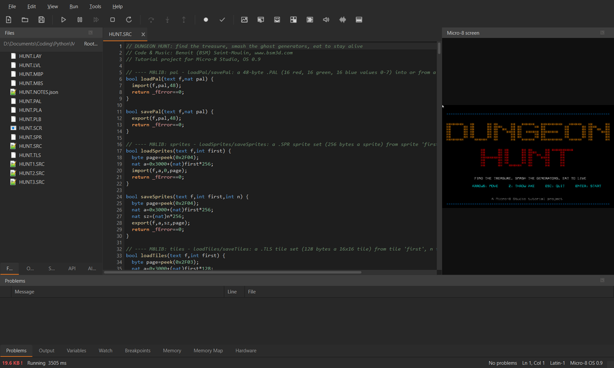

- **Barre de menus.** `File` (nouveau, ouvrir, récents, exemples, **New Asset** pour chaque éditeur, **Project**, enregistrer), `Edit`
  (édition, recherche, renommage, mise en forme, **Insert Micro-8 Library**, préférences), `View` (afficher ou masquer chaque panneau,
  thèmes, zoom), `Run`, `Tools` (les éditeurs, le convertisseur d'images, options de son, transfert vers la machine) et `Help`.
- **Barre d'outils.** De gauche à droite : nouveau, ouvrir, enregistrer ; exécuter, pause, continuer, arrêter, relancer ; pas à pas
  sur, dans, hors ; point d'arrêt, vérifier le programme ; puis le **Image Converter** et les sept éditeurs : screen designer, sprites,
  tiles, bitmap, sound, wave, tracker. Survolez une icône pour son nom et son raccourci.
- **La zone d'édition**, au milieu : un onglet par fichier. Les éditeurs de code et d'assets partagent les onglets, un programme, ses
  sprites et sa carte sont donc à un clic. Un clic change d'onglet ; un double clic dans la zone vide ouvre un fichier.
- **L'écran Micro-8** (à droite) : l'affichage émulé de 800 x 480. `F5` y exécute le programme. Cliquez-le une fois pour lui donner le
  clavier : flèches, `Z` et `X` (les boutons A et B), `Enter` (Start), `Tab` (Select) forment la manette.
- **Panneaux de gauche** (onglets en bas de la colonne) : **Files** (la carte en arbre : un double clic ouvre un fichier dans le bon
  éditeur, un clic droit crée un dossier), **Assets** (tous les fichiers qu'utilise le programme au premier plan, ou le projet ouvert,
  groupés par genre, avec ce que contient chacun et une petite image : §9.9), **Outline** (les fonctions et variables du programme), **Search**, **API** (chaque fonction
  de la machine avec sa signature) et l'**AI Assistant**.
- **Fournisseurs de l'AI Assistant.** Anthropic et Mistral (une clé d'API, gardée dans les réglages de Studio) ou un modèle de votre
  ordinateur avec **llama.cpp**. Pour llama.cpp, choisissez *llama.cpp (local)* et appuyez sur **Server...** : Studio démarre et arrête
  `llama-server` pour vous. Donnez-lui le programme (`llama-server`, trouvé dans le PATH ou choisi avec *Browse*) et un fichier modèle
  (`.gguf`), puis réglez ce que vous voulez (le contexte `-c`, les slots `-np`, les couches GPU `-ngl`, la flash attention, les outils
  avec `--jinja`, la réflexion coupée, d'autres arguments ; la ligne de commande qui sera lancée est affichée sous les réglages).
  *Start* le lance, avec sa sortie dans la fenêtre ; il s'arrête avec *Stop* ou quand vous quittez Studio. Cochez *Start the server
  when I ask the assistant a question* et l'assistant le démarre tout seul. Studio ne démarre un serveur que sur cet ordinateur
  (`http://127.0.0.1:8080` par défaut) ; un serveur lancé à la main à cette adresse est utilisé et jamais arrêté par Studio. Un
  contexte de 16384 est un bon début : plus il est grand, plus le manuel accompagne chaque question. Rien ne quitte l'ordinateur.
  llama.cpp n'a pas de recherche web.

  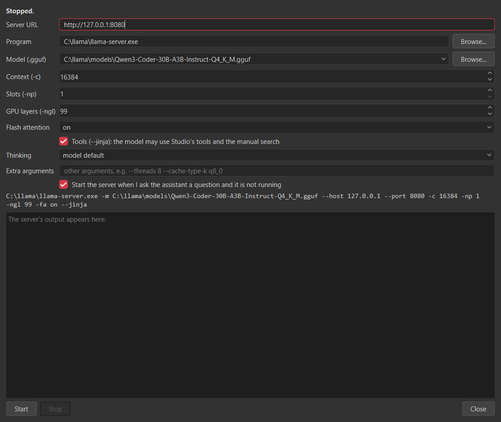
- **Panneaux du bas :** **Problems** (erreurs et avertissements, un clic y mène), **Output** (messages du programme et de Studio),
  **Variables**, **Watch** et **Breakpoints** (le débogueur), **Memory** (un dump hexadécimal), **Memory Map** (ce que le programme
  occupe en code, données et mémoire externe) et **Hardware** (calques, défilement, palettes, sprites, registres du synthé).
- **Barre d'état.** L'état (`Ready`, `Running`, `Paused`), la taille du fichier source (elle devient rouge au-delà de la limite de
  l'éditeur de texte de la machine, 8 Ko par défaut, ce qui n'empêche pas la compilation), les problèmes, la position du curseur et le firmware.

`View > Focus Mode` (`Ctrl+Shift+M`) masque tous les panneaux quand il faut de la place. Un panneau peut être détaché de la fenêtre, ou
posé sur un autre écran, puis remis en place.

## 3. Votre premier programme

**Bonjour.** `File > New` (`Ctrl+N`) ouvre un onglet vide. Tapez :

```c
// hello
print("Hello, Micro-8!");
```

Appuyez sur `F5`. Le texte apparaît sur l'écran Micro-8. Un programme Lofi est une liste d'instructions exécutées depuis le haut, il n'y a pas
de `main` à écrire (une fonction nommée `main` n'est qu'une habitude). Les instructions finissent par `;` et `//` commence un commentaire.

**Une boucle.** Remplacez le programme par :

```c
// five lines
for(int i=1;i<=5;i++) print("Line ",i,"␍");
```

`␍` représente le caractère de contrôle « nouvelle ligne » (code 13) qu'obéit `print`. On ne le tape pas au clavier : utilisez
`Edit > Insert Control Glyph > New line`. Studio garde ces caractères sous forme d'images pour qu'un fichier soit enregistré octet pour octet.

**Quelque chose qui bouge.** Les sprites sont de petites images que le matériel dessine pour vous. Ce programme fabrique un carré blanc (une
image de sprite fait 24 x 21 pixels de 4 bits, soit 256 octets) et le déplace avec les flèches. Il n'a besoin d'aucun fichier, vous pouvez le taper tel quel :

```c
// a sprite you move
nat gfxModes=0x2F00;
poke(gfxModes,peek(gfxModes)|0b00000100);       // sprites on
memSet(0x3000+256,252,0x22,0x20);               // image number 1 of the sprite set: all pixels colour 2 (white)
sprPal(0,0);                                    // sprite 0 uses palette A
sprRef(0,1);                                    // and shows image 1
int x=400;
int y=240;
while(_keyDwn!=12) {                             // until ESC
	if((_padLft&0b01000000)!=0) x-=2;            // left
	if((_padLft&0b10000000)!=0) x+=2;            // right
	if((_padLft&0b00010000)!=0) y-=2;            // up
	if((_padLft&0b00100000)!=0) y+=2;            // down
	sprPos(0,x,y);
	vSync();                                     // wait for the screen to be drawn
	sprUpdt();                                   // show the sprites where they now are
}
```

Lancez-le (`F5`), cliquez l'écran, utilisez les flèches, `Esc` pour arrêter. Ce que vous venez de rencontrer :

- `peek` et `poke` lisent et écrivent la mémoire et les registres de la machine ; `0x2F00` décide des calques affichés.
- `_padLft` contient les huit boutons de la manette sous forme de bits : Right 128, Left 64, Down 32, Up 16, Select 8, Start 4, B 2, A 1.
  Studio associe le clavier à la manette (flèches, `Z`, `X`, `Enter`, `Tab`).
- `sprPos` ne fait que *noter* la position ; `sprUpdt` la recopie dans le matériel une fois l'image finie (`vSync` attend ce moment).
  Toute boucle de jeu sur le Micro-8 a cette forme : **lire la manette, déplacer, attendre l'image, afficher**.

**Arrêter et trouver les erreurs.** `Shift+F5` arrête, `Ctrl+Shift+F5` relance. Tapez `prnt("x");` : la ligne est soulignée aussitôt, le
panneau **Problems** dit pourquoi, et `F5` refuse de lancer tant que ce n'est pas corrigé : la vraie machine le refuserait aussi.

**Enregistrer.** `Ctrl+S` demande un nom sur la carte : 8 lettres au plus, puis `.SRC`. Studio garde le fichier exactement comme tapé
(tabulations, fins de ligne), l'éditeur de la machine l'ouvre donc sans surprise.

## 4. Lofi en dix minutes

Lofi est un petit langage proche du C. Tout ce qui suit s'exécute dans Studio et sur la machine. La description complète est le
chapitre 6 du *Micro-8 User's Manual* ; voici ce qu'il faut pour le chapitre 5.

### 4.1. Variables et types

```c
byte lives=3;            // 0 to 255
nat address=0x1200;      // 0 to 65535, made for addresses
int score=-120;          // -32768 to 32767
real speed=1.5;          // half-precision float: slow and imprecise, keep it for tables
bool alive=true;
text name="BSM";
```

**Les entiers font 16 bits.** `int a=200; int b=a*200;` ne donne pas 40000 : le résultat boucle sur -25536, sans erreur. Un produit doit
rester sous 32767 : réduisez les valeurs (`>>7` plutôt que `/128`) ou gardez-les petites. C'est la surprise numéro un sur cette machine, et la
raison pour laquelle le jeu du tutoriel garde des nombres petits.

Une valeur d'un autre type demande un **cast** : `byte b=(byte)(x+3);`. Le compilateur refuse un `int` là où un `byte` est attendu, c'est
pourquoi le tutoriel écrit `sprPos((byte)(3+i),x,y)`.

### 4.2. Opérateurs

```c
int a=7;
int b=a*3+1;             // + - * / %
bool big=(a>5)&&(b!=0);  // == != < > <= >=  and  && || !
int bits=a&0b0101;       // & | ^ ~ on bits (binary and hex literals: 0b0101, 0xFF)
int up=a<<2;             // shifts: by a byte, never by an int
a+=2;                    // also -= *= /= and a++ a--
print(b," ",big," ",bits,"␍");
```

### 4.3. Choix et boucles

```c
int n=0;
while(n<10) {            // while and for, with break and continue
	n++;
	if(n==3) continue;   // skip the rest of this turn
	if(n>6) break;       // leave the loop
	print(n," ");
}
if(n>6) print("stopped","␍"); else print("never","␍");
```

### 4.4. Fonctions

Une fonction s'écrit une fois, **avant** la ligne qui l'appelle (Lofi compile en une passe). `void` signifie qu'elle ne renvoie rien.

```c
int square(int v) {
	return v*v;
}
void show(text label,int value) {
	print(label,": ",value,"␍");
}
show("seven squared",square(7));
```

Les fonctions ne s'imbriquent pas, mais elles peuvent s'appeler entre elles et elles-mêmes. La profondeur d'appel est limitée à 64.

### 4.5. Tableaux et types à vous

```c
int table[5]={10,20,30,40,50};    // a size is a constant; the first index is 0
table[2]=99;                      // there is no bounds check: stay inside
int total=0;
for(int i=0;i<5;i++) total+=table[i];
print(total,"␍");

type pt { int x; int y; };        // a group of values
pt p={4,7};
p.x+=1;
print(p.x,",",p.y,"␍");
```

Les tableaux de `byte` servent à garder une carte, un écran ou les octets d'un fichier. Le tutoriel lit son niveau dans
`byte level[379];` et l'indexe par `level[4+row*25+column]`.

### 4.6. Parler à la machine

Presque tout ce que fait le matériel s'atteint par quelques appels et quelques adresses :

| Vous voulez | Utilisez |
|---|---|
| écrire du texte | `print(...)`, `curPos(x,y)` ; l'écran de texte fait 80 x 40 caractères à `0x1200` (glyphes) et `0x1E80` (couleurs) |
| lire la manette, le clavier, la souris | `_padLft`, `_padRght`, `_keyDwn`, `_mouseX`, `_mouseY`, `_mouse` |
| dessiner des sprites | `sprRef`, `sprPos`, `sprFlip`, `sprPal`, `sprPrio`, puis `sprUpdt` |
| tester une collision | `isSprSpr`, `isSprBox`, `isSprPoint`, `isSprTile`, `sprOther` |
| afficher des tuiles | une carte dans le tampon de tuiles (`areaCpy`), les registres de défilement `0x2F01`, `0x2F02` |
| allumer des calques | registre `0x2F00` (bit 4 texte, 3 tuiles, 2 sprites, 0 bitmap) |
| attendre l'image suivante | `vSync()` |
| jouer du son | `ymVoice` et `ymNoteOn` (six voix FM), `synVoice` et `synNoteOn` (le synthé numérique) |
| lire un fichier | `import(file, address, size)` et la famille `fOpen` |
| mesurer le temps | `_time` (secondes), `clkSet()` et `_mSec` (millisecondes) |

Le panneau **API** liste chaque fonction avec sa signature, et `F1` ouvre le manuel de la machine. La **complétion** de Studio (`Ctrl+Space`) et les
**indices de paramètres** montrent les signatures pendant la frappe.

Deux choses à savoir avant le tutoriel :

- **Un sprite caché est en (0,0)**, et tous les sprites en (0,0) se chevauchent : un test de collision entre deux sprites cachés est vrai.
  Le jeu du tutoriel rencontre ce bug et le traite.
- **`print` repeint** les couleurs des cellules qu'il écrit (noir sur transparent par défaut). Pour un texte blanc, réglez le tampon de couleurs
  après l'impression, comme le fait le tutoriel.

## 5. Tutoriel : DUNGEON HUNT

Ce chapitre construit un jeu complet à partir de rien : **DUNGEON HUNT**, un donjon d'arcade en vue de dessus dans l'esprit des classiques
des années 1980. Un guerrier casqué de cornes parcourt un donjon, lance des haches dans la direction où il regarde, ouvre des coffres, mange des
pommes pour rester en vie, et doit détruire les **générateurs** (des tas d'ossements qui envoient des fantômes à sa poursuite) avant d'être submergé.

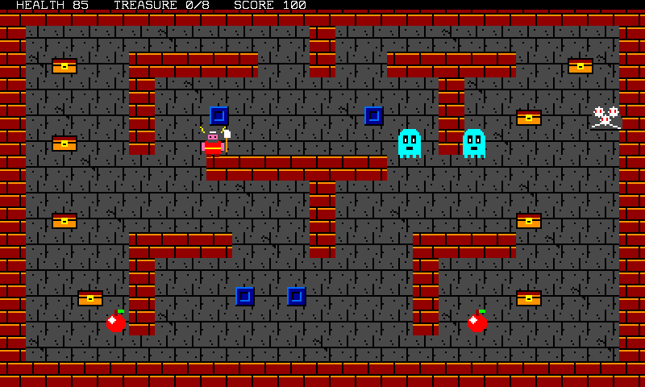

Vous allez utiliser chaque partie de Studio : le système de projets, l'éditeur de sprites, l'éditeur de tuiles et de cartes avec ses **calques**,
l'éditeur de programme et son analyse en direct, le screen designer, le tracker, le débogueur, et le transfert vers la carte.
Comptez environ deux heures, moins si vous ouvrez les fichiers terminés au lieu de les dessiner.

**Les règles.** Les flèches déplacent le guerrier, `Z` (bouton A) lance une hache, `Enter` démarre, `Esc` quitte. La santé commence à 99 et baisse d'un point
par seconde ; une pomme en rend 30 (jamais plus de 99). Un fantôme qui touche le guerrier lui coûte 10 et disparaît. Une hache tue un fantôme (10 points),
trois haches détruisent un générateur (100 points), et chaque coffre vaut 50 points. **Ouvrez les 8 coffres pour gagner ; à 0 de santé, vous mourez.**

**De quoi le jeu est fait.** Un programme et six sortes de fichiers, chacun fait avec son propre éditeur :

| Fichier | Fait avec | Contient |
|---|---|---|
| `HUNT.SRC` | l'éditeur de code | le programme |
| `HUNT.SPR` (+ `.PLA`, `.PLB`) | éditeur de sprites | 11 images de sprites, leurs boîtes de collision, les palettes |
| `HUNT.TLS` (+ `.PAL`) | éditeur de tuiles | 4 tuiles de 16 x 16 pixels, et leur palette |
| `HUNT.LVL` | éditeur de tuiles | la carte de 25 x 15 : un numéro de tuile par cellule |
| `HUNT.LAY` | éditeur de tuiles (calques) | les 8 calques de la carte : ce qui est solide, où sont les coffres, les générateurs et les pommes |
| `HUNT.SCR` | screen designer | l'écran de titre |
| `HUNT.M8S` | tracker | la musique |
| `HUNT.M8P` | Studio | le projet : la liste de tout ce qui précède |

**Deux façons de suivre.** Vous pouvez *construire* le jeu dans votre propre dossier, en dessinant les assets et en tapant le code, ou le *lire* dans le
projet terminé livré avec Studio : le dossier `TUTORIAL` de la carte (`File > Project > Open Project...`, `TUTORIAL\HUNT.M8P`) contient tous les fichiers, plus trois
**points de reprise**, `HUNT1.SRC`, `HUNT2.SRC` et `HUNT3.SRC`, qui sont le programme complet à la fin des étapes 4, 5 et 6. Si une étape ne marche pas, ouvrez son
point de reprise et comparez. Les quatre programmes sont joués du début à la fin par un test automatique qui vérifie les règles ci-dessus.

| Étape | Ce que vous faites | Résultat |
|---|---|---|
| 1 | créer le projet | un programme vide qui s'exécute |
| 2 | dessiner les sprites | `HUNT.SPR` |
| 3 | construire le donjon et ses calques | `HUNT.TLS`, `HUNT.LVL`, `HUNT.LAY` |
| 4 | charger les assets, marcher, ne jamais traverser un mur | `HUNT1.SRC` |
| 5 | coffres, pommes, santé, victoire et défaite | `HUNT2.SRC` |
| 6 | haches, fantômes, générateurs | `HUNT3.SRC` |
| 7 | écran de titre, musique, sons | `HUNT.SRC`, `HUNT.SCR`, `HUNT.M8S` |
| 8 | déboguer et mesurer | ce que la machine fera du jeu |
| 9 | vérifier, exporter, lancer sur la machine | un jeu sur la carte |

### 5.1. Étape 1 : créer le projet

Un projet est **un dossier de la carte** qui contient un programme et ses assets, décrit par un petit manifeste `NOM.M8P`.

1. Dans le panneau **Files**, clic droit sur la racine puis **New folder...** ; appelez-le `MYHUNT` (8 caractères au plus).
2. `File > Project > New Project...` : choisissez ce dossier, et donnez le nom `HUNT` (1 à 8 lettres, chiffres ou `_`).
3. Studio écrit `HUNT.M8P` et `HUNT.SRC` et ouvre le programme :

```c
// HUNT
// Micro-8 Studio project: the assets live next to this file on the SD card.

void main()
{
	print("HUNT␍");
}

main();
```

Appuyez sur `F5` : l'écran affiche `HUNT`.

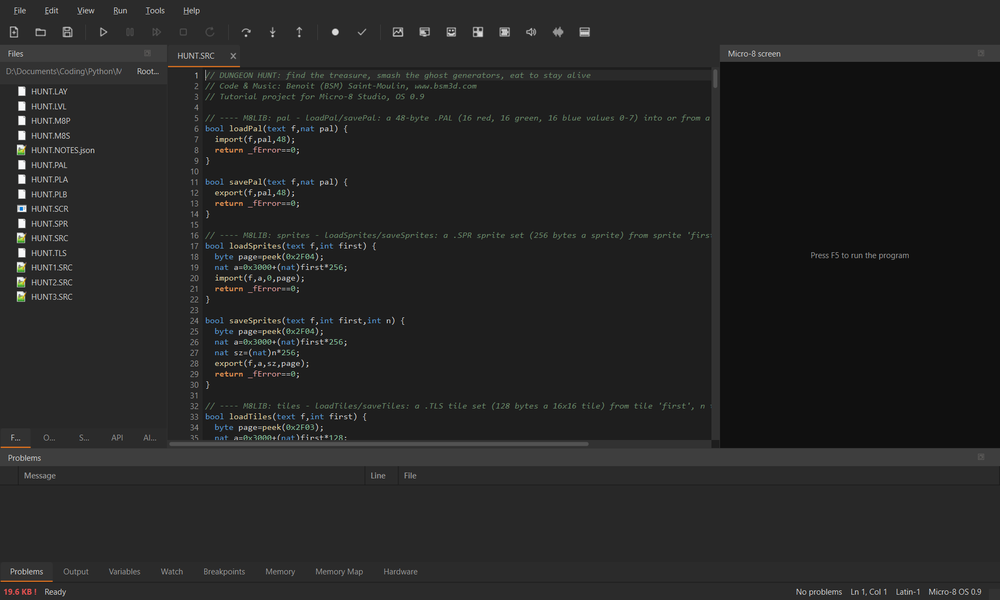

Désormais `Ctrl+S` enregistre le fichier, et `File > Project > Save Project` (`Ctrl+Alt+Shift+S`) enregistre tout ce qui est ouvert plus le manifeste. Les fichiers que
vous créez dans le dossier du projet le rejoignent d'eux-mêmes (ou utilisez **Add Current File to Project**).

> Si vous voulez seulement lire le jeu terminé, passez le dessin et la frappe : ouvrez `TUTORIAL\HUNT.M8P` et continuez à l'étape 4.

### 5.2. Étape 2 : les sprites

Un sprite matériel est une image de **24 x 21 pixels, 4 bits par pixel** (16 couleurs, la première transparente), et la machine en affiche jusqu'à 32 à la fois.
`File > New Asset > New Sprite set` ouvre l'**éditeur de sprites** :

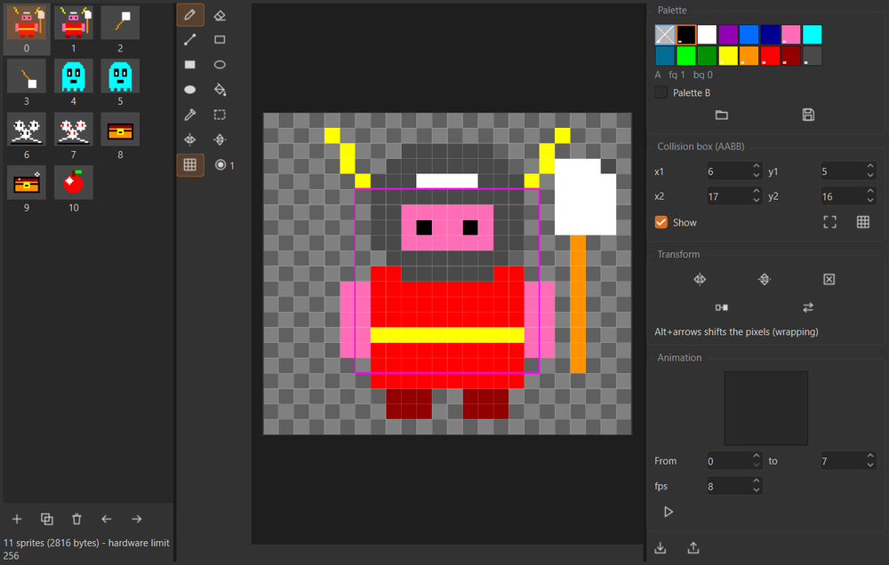

- La liste de gauche contient les images ; **+** en ajoute une, les autres boutons la dupliquent, la suppriment ou la déplacent. Le canevas est l'image
  sélectionnée, la palette est au-dessus (l'indice 0 est transparent). Utilisez le crayon, la ligne, le rectangle, l'ovale, le remplissage et la
  pipette ; `Alt` plus les flèches décale les pixels ; la grille et l'onion skin aident.
- La **boîte de collision** (le cadre magenta, les quatre champs *x1 y1 x2 y2*) est le rectangle que le matériel utilise dans `isSprSpr`, `isSprBox` et
  compagnie. Elle est enregistrée dans les 4 derniers octets de l'image. Les boutons **fit** la réduisent aux pixels opaques.
- `Ctrl+S` demande un nom : `HUNT.SPR`. Studio écrit aussi les deux palettes, `HUNT.PLA` (palette A) et `HUNT.PLB`.

Dessinez ces 11 images, dans cet ordre, et donnez à chacune la boîte ci-dessous (ces nombres sont ce sur quoi le programme compte) :

| # | Image | Boîte x1 y1 x2 y2 | Sert à |
|---|---|---|---|
| 0, 1 | le guerrier, deux images de marche | 6 5 17 16 | le joueur |
| 2, 3 | une hache, deux images qui tournent | 8 6 15 15 | une hache lancée |
| 4, 5 | un fantôme, deux images | 6 5 17 16 | les ennemis |
| 6, 7 | un tas d'ossements, yeux éteints puis rougeoyants | 4 3 19 18 | un générateur de fantômes |
| 8, 9 | un coffre, simple puis scintillant | 6 6 17 15 | le trésor |
| 10 | une pomme | 6 6 17 15 | la nourriture |

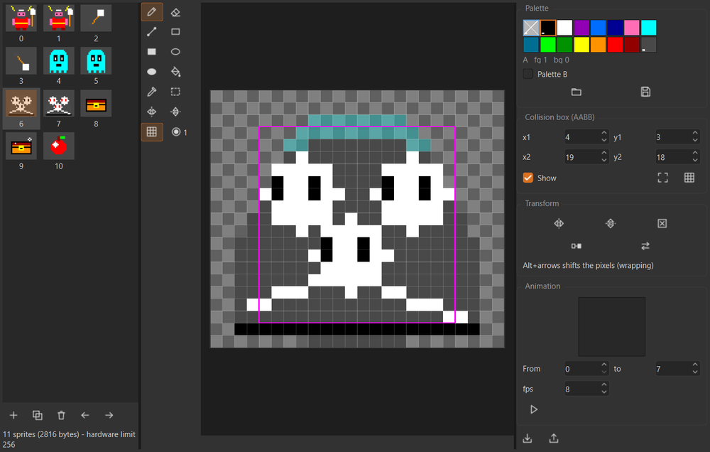

Deux habitudes simplifient la suite du chapitre. D'abord, **dessinez chaque image centrée** dans son canevas de 24 x 21 et centrez aussi sa boîte (chaque boîte
ci-dessus a `x1 + x2 = 23` et `y1 + y2 = 21`) : une seule formule place alors chaque sprite sur une cellule de la carte. Ensuite, donnez au guerrier et au
fantôme la **même boîte** : ils sont alors interchangeables dans les tests de murs.

La palette est celle par défaut de la machine (indice 1 noir, 2 blanc, 9 vert vif, B jaune, C orange, D rouge, E rouge sombre, F gris sombre...), qui est aussi celle
de départ de tout programme. Le projet terminé la garde. Le programme charge quand même `HUNT.PLA` et `HUNT.PAL`, pour qu'il suffise de changer une couleur dans
un éditeur pour la changer dans le jeu.

### 5.3. Étape 3 : le donjon et ses calques

`File > New Asset > New Tile map` ouvre l'**éditeur de tuiles et de cartes**. Une tuile fait 16 x 16 pixels, 4 bits par pixel, et une carte est une grille de
numéros de tuiles ; l'écran montre 25 x 15 tuiles.

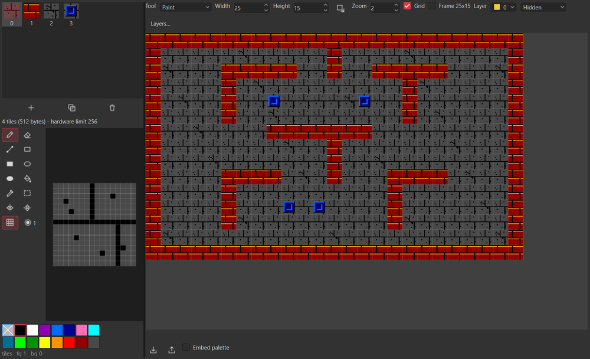

**Les tuiles.** Utilisez **+** pour faire quatre tuiles et dessinez-les : `0` le sol de pierre (gris sombre avec des joints et des points sombres), `1` le mur
(briques rouge sombre, mortier noir, un bord plus clair), `2` le sol fissuré, `3` un pilier (un bloc bleu). La palette sous le canevas est celle des tuiles ; celle par défaut convient.

**La carte.** Réglez la largeur à 25 et la hauteur à 15 (cochez **Frame 25x15** pour voir le bord de l'écran), choisissez une tuile dans la liste et peignez avec
l'outil de carte (le bouton gauche peint, le bouton droit peint la tuile 0). Voici le plan à recopier : `#` est la tuile 1, `o` la tuile 3, et toute autre cellule est du sol
(tuile 0, ou tuile 2 çà et là pour les fissures). `c`, `g` et `f` sont des cellules de sol qui recevront tout à l'heure une marque de **calque**.

```text
#########################
#...........#...........#
#.c..#####..#..#####..c.#
#....#...........#......#
#g...#..o.....o..#..c..g#
#.c..#...........#......#
#.......#######.........#
#...........#...........#
#.c.........#.......c...#
#....####...#...####....#
#....#..........#.......#
#..c.#...o.o....#...c...#
#...f#..........#.f.....#
#.......................#
#########################
```

**Les calques.** Une carte peut porter **8 calques** : huit marques indépendantes, actives ou non, par cellule, comme le MAPED de la machine. L'éditeur ne décide
pas de ce qu'un calque *signifie* : c'est votre programme qui le fait. DUNGEON HUNT en utilise quatre :

| Calque | Signification | Cellules marquées |
|---|---|---|
| 0 | solide : rien ne traverse | les murs et les piliers |
| 1 | un coffre est ici | les 8 cellules `c` |
| 2 | un générateur de fantômes se dresse ici | les 2 cellules `g` |
| 3 | une pomme est ici | les 2 cellules `f` |

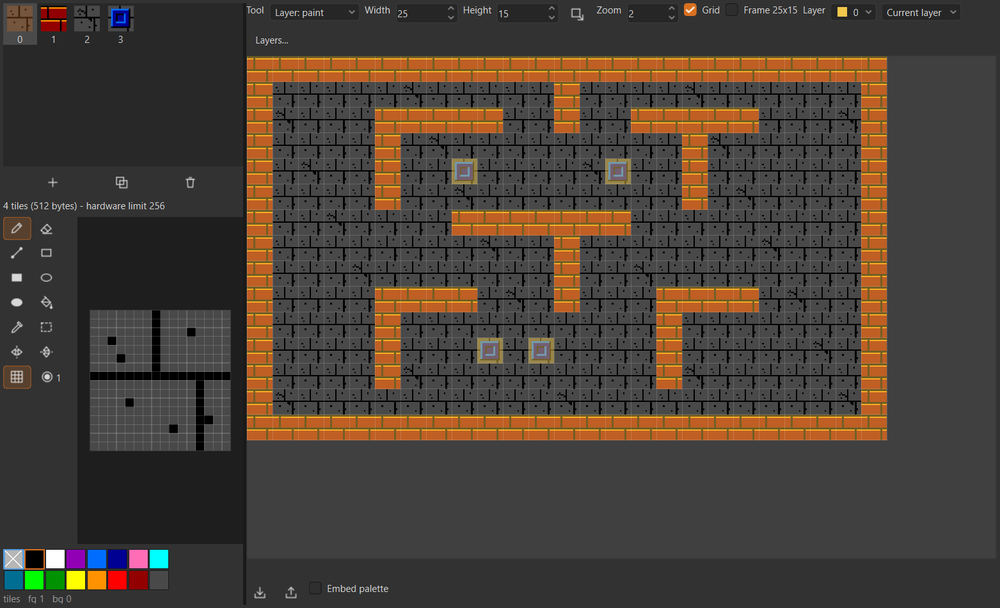

1. Choisissez le **calque 0** dans la liste des calques. `Layers... > Generate from the tiles...` coche les tuiles `1` et `3` et marque chaque cellule qui en contient une :
   tout le calque 0 en un clic.
2. Choisissez le calque 1 et l'outil **Layer: paint** (la liste d'outils) ; cliquez à gauche sur les huit cellules `c` (le bouton droit efface une cellule).
   Faites de même pour le calque 2 (les deux cellules `g`) et le calque 3 (les deux cellules `f`).
3. La liste à côté du calque montre **Current layer**, **All layers** (un petit carré coloré par calque dans chaque cellule) ou **Hidden** :
   utilisez *All layers* pour vérifier votre travail. Les outils de calque sont aussi *erase*, *fill* et *rectangle*.

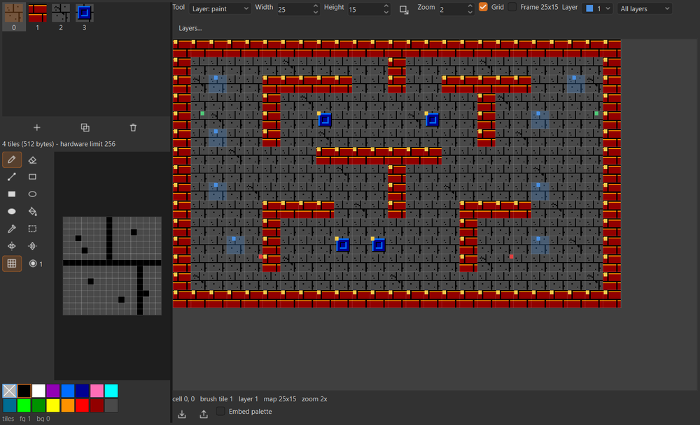

`Ctrl+S` sous le nom `HUNT.LVL` écrit quatre fichiers : `HUNT.LVL` (la carte : largeur, hauteur, puis un octet par cellule), `HUNT.TLS` (les tuiles), `HUNT.PAL`
(leur palette) et `HUNT.LAY` (les calques : largeur, hauteur, puis un octet par cellule, **un bit par calque**). Les calques sont enregistrés à côté de la carte et
chargés avec elle. Un programme les lit avec `import`, comme la carte ; `HUNT.LAY` a le même format que le MAPED de la machine, un fichier de calques fait là-bas
s'ouvre donc ici, et inversement.

### 5.4. Étape 4 : charger les assets et marcher

Tout ce dont le programme a besoin est maintenant sur la carte. Il est temps de l'afficher. Ouvrez `HUNT.SRC` et choisissez `Edit > Insert Micro-8 Library...` : cochez
**pal**, **sprites**, **tiles** et **level** puis OK. Lofi n'a pas de `#include`, alors Studio colle les fonctions toutes faites `loadPal`, `loadSprites`, `loadTiles` et
`loadLevel` (et seulement celles-là) après vos commentaires. Elles renvoient `true` quand un fichier est chargé. Ajoutez votre code après elles ; voici le programme entier de cette étape,
`HUNT1.SRC`, bibliothèque mise à part :

```c
// DUNGEON HUNT, step 1: the dungeon and the warrior
// Created by Benoit (BSM) Saint-Moulin, www.bsm3d.com
// Tutorial project for Micro-8 Studio, OS 0.9

byte level[379];                 // HUNT.LVL: 4 header bytes, then 25x15 tile numbers
byte lay[379];                   // HUNT.LAY: the same shape, one bit a layer (bit 0: solid)
int hx;                          // the hero's sprite position, in 800x480 pixels
int hy;
bool faceLeft;
byte frame;

// is the point (sx,sy) of the screen inside a solid cell?
bool solidAt(int sx,int sy) {
	if(sx<0||sy<0||sx>=800||sy>=480) return true;
	int cell=(sy/32)*25+(sx/32);
	return (lay[4+cell]&1)!=0;
}

// would the hero's box (24x24, at 12,10 inside the sprite) touch a solid cell if the sprite was at px,py?
bool blocked(int px,int py) {
	int x0=px-48+12;
	int y0=py-42+10;
	return solidAt(x0,y0)||solidAt(x0+23,y0)||solidAt(x0,y0+23)||solidAt(x0+23,y0+23);
}

void setup() {
	memSet(0x1200,3200,' ');                       // an empty text screen, white letters, no background
	memSet(0x1E80,3200,0x02);
	poke(0x2F00,0b00011100);                       // text, tiles and sprites on, bitmap off
	loadPal("HUNT.PAL",0x1170);                    // tiles palette
	loadPal("HUNT.PLA",0x11D0);                    // sprites palette A
	loadTiles("HUNT.TLS",0);
	loadSprites("HUNT.SPR",0);
	loadLevel("HUNT.LVL",&level,379);
	loadLevel("HUNT.LAY",&lay,379);
	areaCpy(&level+4,25,0,0,25,15,0x2B00,32,0,0);  // the map into the tile buffer the screen shows
	for(int i=0;i<32;i++) {
		sprPal((byte)i,0);
		sprPrio((byte)i,0);
		sprPos((byte)i,0,0);                       // hidden
	}
	hx=72;                                         // cell (1,1)
	hy=68;
}

void moveHero() {
	byte pad=_padLft;
	int dx=0;
	int dy=0;
	if((pad&0b01000000)!=0) dx=-3;
	if((pad&0b10000000)!=0) dx=3;
	if((pad&0b00010000)!=0) dy=-3;
	if((pad&0b00100000)!=0) dy=3;
	if(dx!=0&&!blocked(hx+dx,hy)) hx+=dx;
	if(dy!=0&&!blocked(hx,hy+dy)) hy+=dy;
	if(dx<0) faceLeft=true;
	if(dx>0) faceLeft=false;
	if(dx!=0||dy!=0) sprRef(0,(byte)((frame>>2)&1));  // walk: the two hero frames
	sprFlip(0,faceLeft,false);
	sprPos(0,hx,hy);
}

setup();
while(_keyDwn!=12) {                             // until ESC
	moveHero();
	vSync();
	sprUpdt();
	frame++;
}
```

Appuyez sur `F5`, cliquez l'écran, et marchez avec les flèches. Le guerrier s'arrête à chaque mur.

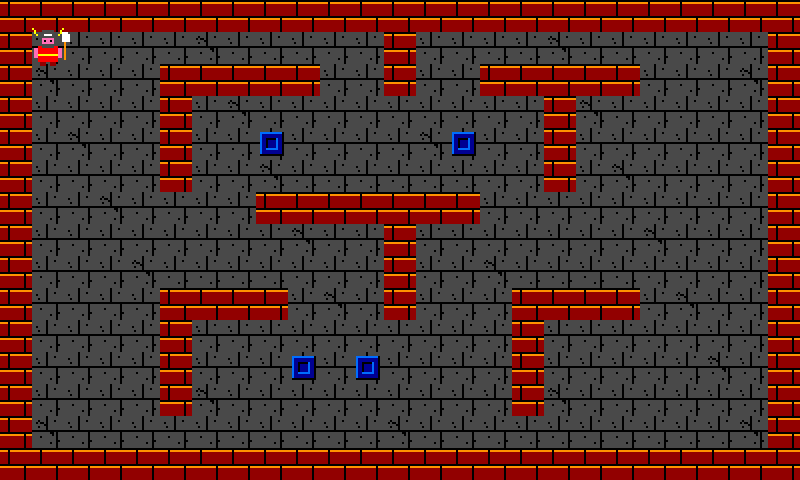

Comment ça marche :

**Où sont les choses.** Les positions de sprites sont dans la pleine résolution de l'affichage, 800 x 480, et la zone visible commence en (48, 42). Les tuiles font 16 pixels de large
sur l'écran en demi-résolution, donc une **cellule de la carte fait 32 unités** et la carte de 25 x 15 remplit exactement l'écran. Une image de sprite fait 24 x 21 pixels, soit 48 x 42 unités.
Comme chaque boîte est centrée dans son image, la position de sprite qui centre un sprite sur la cellule *(colonne, ligne)* est `(40+colonne*32, 36+ligne*32)`. Le guerrier part de la
cellule (1, 1) : position (72, 68).

**Lire le calque 0.** `loadLevel("HUNT.LAY",&lay,379)` lit tout le fichier dans `lay`, dont les 4 premiers octets sont l'en-tête : la cellule *(colonne, ligne)* est en `lay[4+ligne*25+colonne]`.
`solidAt` convertit un point de l'écran en cellule et renvoie le bit 0, le calque *solide*. `blocked` demande si les quatre coins de la boîte de 24 x 24 du guerrier tomberaient dans une cellule solide.
Cette boîte est la boîte de collision de l'image (6,5 à 17,16, doublée : 12..35 sur 10..33 unités depuis le coin du sprite).

**Une direction à la fois.** `moveHero` essaie de bouger en x, puis en y, chacun séparément. Marcher en diagonale contre un mur le fait donc *glisser* le long du mur, au lieu de
s'arrêter net. La manette est lue dans `_padLft`, bit par bit.

**L'image.** `setup()` remplit l'écran d'un calque de texte vide, allume texte, tuiles et sprites (`0x2F00`), charge les palettes dans leurs registres (`0x1170` tuiles, `0x11D0` sprites A),
les tuiles et les sprites dans la mémoire que lit le matériel, et **copie la carte dans le tampon de tuiles** (`areaCpy` depuis `&level+4`, en sautant l'en-tête, vers `0x2B00`, le tampon que
l'écran montre). La boucle lit la manette, déplace, attend l'image (`vSync`) puis rend les sprites visibles (`sprUpdt`).

À essayer : changez la vitesse `3` en `5` (un mur fait 32 unités d'épaisseur, même 10 unités par image ne peuvent pas en sauter un) ; posez un point d'arrêt (`F9`) sur `hx+=dx;` et suivez `hx`
dans le panneau **Watch**.

### 5.5. Étape 5 : coffres, pommes et santé

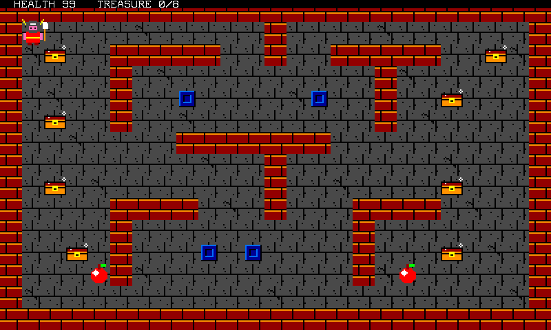

La carte dit où sont les objets, le programme ne les écrit donc pas en dur : il **parcourt les calques 1 et 3**. Voici les globales qui sont nouvelles, puis les fonctions (le programme entier est `HUNT2.SRC`) :

```c
byte level[379];                 // HUNT.LVL: 4 header bytes, then 25x15 tile numbers
byte lay[379];                   // HUNT.LAY: the same shape, one bit a layer: 0 solid, 1 treasure, 3 food
int hx;                          // the warrior's sprite position, in 800x480 pixels
int hy;
bool faceLeft;
byte frame;
byte state;                      // 1 playing, 2 won, 3 dead
int health;                      // drains by 1 a second, 99 at most
nat lastSec;
int treasure;                    // chests opened so far
int tx[8];                       // the 8 chests: sprites 15 to 22
int ty[8];
bool ton[8];
int foodX[2];                    // the 2 apples: sprites 23 and 24
int foodY[2];
bool foodOn[2];
```

```c
// the layers say where things lie: layer 1 for the chests, layer 3 for the apples
void placeItems() {
	int t=0;
	int f=0;
	for(int i=0;i<375;i++) {
		int x=40+(i%25)*32;                            // the sprite position that centres a sprite on the cell
		int y=36+(i/25)*32;
		if((lay[4+i]&2)!=0&&t<8) {
			tx[t]=x;
			ty[t]=y;
			ton[t]=true;
			sprPos((byte)(15+t),x,y);
			t++;
		}
		if((lay[4+i]&8)!=0&&f<2) {
			foodX[f]=x;
			foodY[f]=y;
			foodOn[f]=true;
			sprPos((byte)(23+f),x,y);
			f++;
		}
	}
}

// the warrior against every chest and apple still there
void pickItems() {
	for(int i=0;i<8;i++) {
		if(ton[i]&&isSprSpr(0,(byte)(15+i))) {
			ton[i]=false;
			sprPos((byte)(15+i),0,0);                  // gone
			treasure++;
			showStatus();
			if(treasure==8) {
				state=2;
				banner("YOU WIN!  ENTER: PLAY AGAIN");
			}
		}
	}
	for(int i=0;i<2;i++) {
		if(foodOn[i]&&isSprSpr(0,(byte)(23+i))) {
			foodOn[i]=false;
			sprPos((byte)(23+i),0,0);
			health+=30;
			if(health>99) health=99;
			showStatus();
		}
	}
}

// the dungeon drains one point of health a second
void hunger() {
	if(_time!=lastSec) {
		lastSec=_time;
		health--;
		showStatus();
		if(health<=0) {
			state=3;
			banner("YOU DIED  ENTER: PLAY AGAIN");
		}
	}
}
```

- **Les calques pilotent les objets.** `placeItems` parcourt les 375 cellules ; une cellule au bit 1 (valeur 2) reçoit un sprite de coffre (15 à 22), une cellule au bit 3
  (valeur 8) une pomme (23 et 24). Déplacez un `c` dans l'éditeur de cartes, enregistrez, lancez : le coffre a bougé, sans toucher au code.
- **Collisions entre sprites.** `isSprSpr(0,id)` est vrai quand les boîtes de collision du sprite 0 et du sprite `id` se recouvrent. Elle utilise les positions que le matériel *montre actuellement*,
  pas celles que vous venez de régler avec `sprPos`.
- **Le temps.** `_time` compte les secondes ; quand il change, une seconde a passé : `hunger` retire un point de santé.
- **Un piège à connaître.** Un sprite caché est en (0,0), et **les sprites cachés se chevauchent**. Juste après le début d'une partie, avant le premier `sprUpdt`, le guerrier et tous les coffres
  sont encore en (0,0) et se « toucheraient » tous : tous les coffres seraient ramassés dès la première image. `startGame` se termine donc par son propre `sprUpdt()`. (Le même bug ferait aussi que les fantômes blessent
  aussitôt le guerrier à l'étape 6.)

Le texte est dessiné par le calque de texte du système, au-dessus de tout :

```c
void showStatus() {
	memSet(0x1200,80,' ');
	curPos(2,0);
	print("HEALTH ",health,"   TREASURE ",treasure,"/8  ");
	memSet(0x1E80,80,0x12);                        // print paints black on nothing: white on black
}

// a black band with a message on the middle row
void banner(text msg) {
	nat a=0x1200+18*80+20;
	memSet(a,40,' ');
	curPos(24,18);
	print(msg);
	memSet(a+0x0C80,40,0x1B);                      // the colours sit 0xC80 after the glyphs: yellow on black
}
```

`print` peint les cellules qu'il écrit en noir sur rien, le programme repeint donc les octets de couleur après l'impression (le tampon de couleurs se trouve `0xC80` octets après les glyphes : `0x1E80`).
`0x12` est blanc sur noir, `0x1B` jaune sur noir. La variable d'état (`1` en jeu, `2` gagné, `3` mort) décide de ce que fait la boucle :

```c
setup();
startGame();
while(_keyDwn!=12) {                             // until ESC
	if(state==1) {
		moveHero();
		pickItems();
		hunger();
	} else if((_padLft&0b00000100)!=0) {         // Start (Enter)
		startGame();
	}
	glint();
	vSync();
	sprUpdt();
	frame++;
}
```

À la fin d'une partie la boucle attend seulement Start (`Enter`) pour rappeler `startGame()`. Lancez : ramassez les 8 coffres (la bannière dit YOU WIN), ou restez immobile 99 secondes (YOU DIED).

### 5.6. Étape 6 : haches, fantômes et générateurs

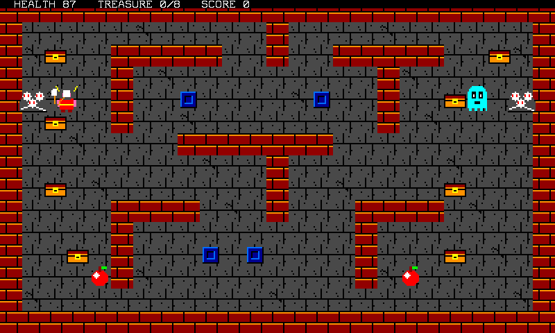

Trois nouvelles sortes de choses mobiles, toutes des sprites : les **haches** (sprites 1 à 4), les **fantômes** (5 à 12) et les **générateurs** (13 et 14). Le budget de sprites est celui de la machine, 32,
et il vaut mieux noter qui possède quels numéros avant de coder : le commentaire des globales fait exactement cela.

```c
byte level[379];                 // HUNT.LVL: 4 header bytes, then 25x15 tile numbers
byte lay[379];                   // HUNT.LAY: the same shape, one bit a layer: 0 solid, 1 treasure, 2 generator, 3 food
int hx;                          // the warrior's sprite position, in 800x480 pixels
int hy;
int fdx;                         // where he faces, and where an axe flies: -1, 0 or 1 on each axis
int fdy;
bool faceLeft;
byte frame;
byte state;                      // 1 playing, 2 won, 3 dead
int health;                      // drains by 1 a second, 99 at most
nat lastSec;
int treasure;                    // chests opened so far
int score;
int tx[8];                       // the 8 chests: sprites 15 to 22
int ty[8];
bool ton[8];
int foodX[2];                    // the 2 apples: sprites 23 and 24
int foodY[2];
bool foodOn[2];
int fire;                        // frames before the next axe can be thrown
int ax[4];                       // the 4 axes in flight: sprites 1 to 4
int ay[4];
int adx[4];
int ady[4];
bool aon[4];
int gx[8];                       // the 8 ghosts: sprites 5 to 12
int gy[8];
bool gon[8];
int genX[2];                     // the 2 generators: sprites 13 and 14
int genY[2];
int genHp[2];                    // 3 axes destroy one
int genWait[2];                  // frames before the next ghost
```

**Lancer.** La hache vole là où le guerrier a marché en dernier (`fdx`, `fdy`, réglés dans `moveHero`, donc les diagonales marchent), de 7 unités par image, 4 au plus en même temps, une toutes les 12 images :

```c
// button A (the Z key) throws an axe, one every 12 frames, 4 in the air at most
void throwAxe() {
	if(fire>0) {
		fire--;
		return;
	}
	if((_padLft&0b00000001)==0) return;
	for(int i=0;i<4;i++) {
		if(!aon[i]) {
			aon[i]=true;
			ax[i]=hx;
			ay[i]=hy;
			adx[i]=fdx*7;
			ady[i]=fdy*7;
			fire=12;
			return;
		}
	}
}

void killAxe(int i) {
	aon[i]=false;
	sprPos((byte)(1+i),0,0);
}

// axes fly straight, kill a ghost, wear a generator down, and break on a wall (the hits are tested first: a generator
// can stand right against a wall)
void moveAxes() {
	for(int i=0;i<4;i++) {
		if(aon[i]) {
			ax[i]+=adx[i];
			ay[i]+=ady[i];
			sprRef((byte)(1+i),(byte)(2+((frame>>1)&1)));
			sprPos((byte)(1+i),ax[i],ay[i]);
			for(int g=0;g<8;g++) {
				if(aon[i]&&gon[g]&&isSprSpr((byte)(1+i),(byte)(5+g))) {
					gon[g]=false;
					sprPos((byte)(5+g),0,0);
					killAxe(i);
					score+=10;
					showStatus();
				}
			}
			for(int g=0;g<2;g++) {
				if(aon[i]&&genHp[g]>0&&isSprSpr((byte)(1+i),(byte)(13+g))) {
					genHp[g]--;
					killAxe(i);
					if(genHp[g]==0) {
						sprPos((byte)(13+g),0,0);
						score+=100;
						showStatus();
					}
				}
			}
			if(aon[i]&&solidAt(ax[i]-48+24,ay[i]-42+21)) killAxe(i);
		}
	}
}
```

Lisez `moveAxes` dans l'ordre : *déplacer*, *afficher*, *tester contre les fantômes*, *tester contre les générateurs*, **puis** le mur. Cet ordre compte : un générateur peut se dresser contre un mur,
et une hache testée d'abord contre le mur meurt avant d'avoir touché le générateur (c'est arrivé pendant l'écriture du jeu : le générateur de gauche est contre le mur, et le test automatique qui lui tire dessus a trouvé le bug).

**Les ennemis.** Chaque générateur encore debout (`genHp>0`) envoie un fantôme toutes les 100 images tant qu'il reste une place ; un fantôme marche vers le guerrier, une direction à la fois, et glisse le long des murs :

```c
// a generator that still stands sends a ghost every 100 frames, if there is room for one
void spawn() {
	for(int g=0;g<2;g++) {
		if(genHp[g]>0) {
			genWait[g]--;
			if(genWait[g]<=0) {
				genWait[g]=100;
				for(int i=0;i<8;i++) {
					if(!gon[i]) {
						gon[i]=true;
						gx[i]=genX[g];
						gy[i]=genY[g];
						break;
					}
				}
			}
		}
	}
}

// a ghost walks to the warrior, slides along the walls, and costs him 10 health when it touches him
void moveGhosts() {
	for(int i=0;i<8;i++) {
		if(gon[i]) {
			int dx=0;
			int dy=0;
			if(hx-gx[i]>2) dx=2;
			if(hx-gx[i]<-2) dx=-2;
			if(hy-gy[i]>2) dy=2;
			if(hy-gy[i]<-2) dy=-2;
			if(dx!=0&&!blocked(gx[i]+dx,gy[i])) gx[i]+=dx;
			if(dy!=0&&!blocked(gx[i],gy[i]+dy)) gy[i]+=dy;
			sprRef((byte)(5+i),(byte)(4+((frame>>3)&1)));
			sprPos((byte)(5+i),gx[i],gy[i]);
			if(isSprSpr(0,(byte)(5+i))) {
				gon[i]=false;
				sprPos((byte)(5+i),0,0);
				health-=10;
				checkDeath();
			}
		}
	}
}
```

Un fantôme qui touche le guerrier (`isSprSpr(0, ghost)`) lui coûte 10 de santé et disparaît. Le score monte de 10 pour un fantôme, 100 pour un générateur, 50 pour un coffre, et `showStatus` l'affiche désormais.
La mort est passée dans une seule fonction, `checkDeath`, parce que la faim comme les fantômes peuvent la causer.

La boucle principale appelle les nouvelles étapes dans cet ordre :

```c
setup();
startGame();
while(_keyDwn!=12) {                             // until ESC
	if(state==1) {
		moveHero();
		throwAxe();
		moveAxes();
		spawn();
		moveGhosts();
		if(state==1) pickItems();
		if(state==1) hunger();
	} else if((_padLft&0b00000100)!=0) {         // Start (Enter)
		startGame();
	}
	glint();
	vSync();
	sprUpdt();
	frame++;
}
```

Essayez : placez-vous devant un générateur et maintenez `Z` ; éloignez-vous d'un fantôme (il avance de 2 unités par image, vous de 3) ; mangez une pomme quand la santé est basse.
Ouvrez le panneau **Hardware** pendant que le jeu tourne : le tableau **sprites** liste les 32 sprites, leurs images, positions et priorités, en direct.

### 5.7. Étape 7 : écran de titre, musique et sons

Le jeu se joue ; il lui faut un visage et une voix.

**L'écran de titre.** `File > New Asset > New Screen design` ouvre le **screen designer** : un écran de texte de 80 x 40 où chaque cellule a un glyphe (l'un des 256 de la police de la machine) et une couleur de papier et d'encre.
Choisissez un glyphe dans la palette, une couleur dans la barre, et utilisez peindre, boîte, remplir, ou l'outil **write** (cliquez, puis tapez). Le titre est fait de caractères `#`, `DUNGEON` orange au-dessus de `HUNT`
rouge, avec les consignes en blanc et cyan ; le résultat est `HUNT.SCR`.

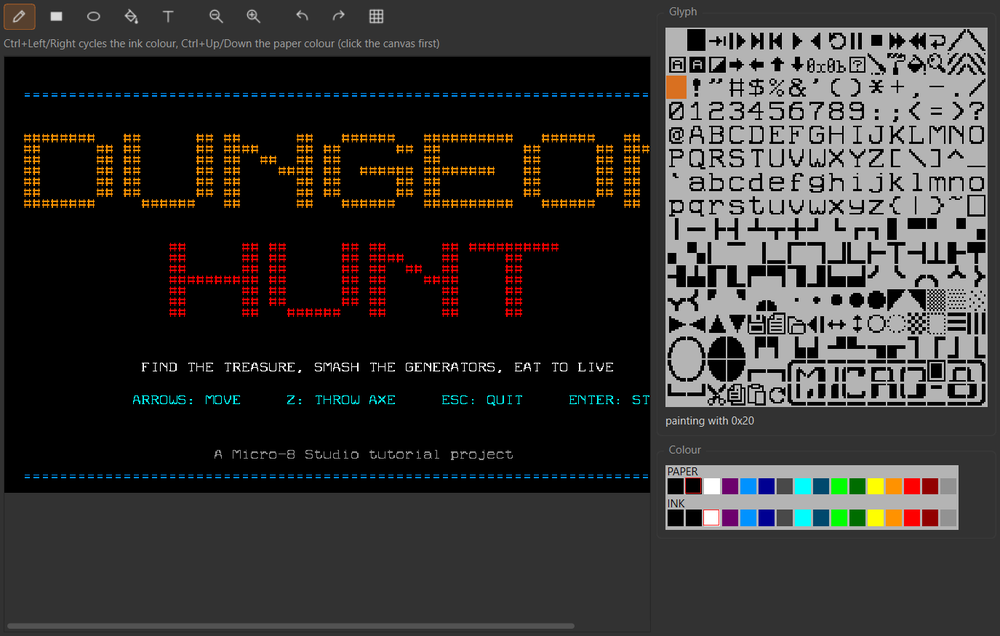

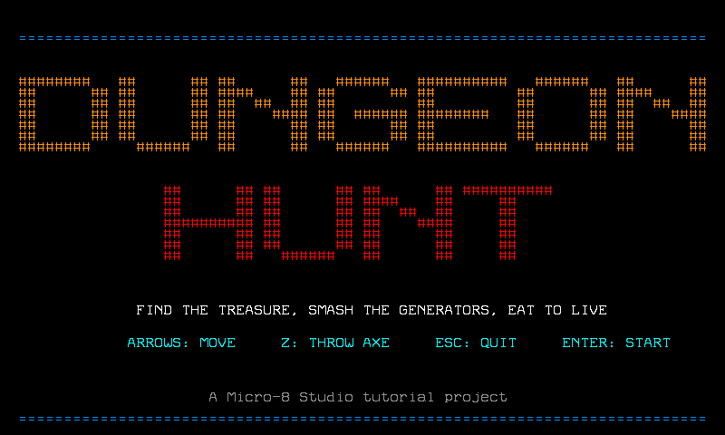

Un `.SCR` fait 6400 octets : les 3200 glyphes puis les 3200 couleurs, exactement comme la machine garde son écran de texte en mémoire (`0x1200` et `0x1E80`), plus une somme de contrôle de 2 octets.

**La musique.** `File > New Asset > New Tracker project` ouvre le **tracker** : une grille de 16 pas par 8 pistes (six voix FM, une piste de batterie, une piste de synthé). Chaque cellule contient une note,
un instrument et une vélocité. La musique de DUNGEON HUNT tient en quatre patterns de 16 pas en la mineur, à 108 battements par minute, jouée en boucle (la bande `SONG` en bas : quatre cartes, une par pattern) :

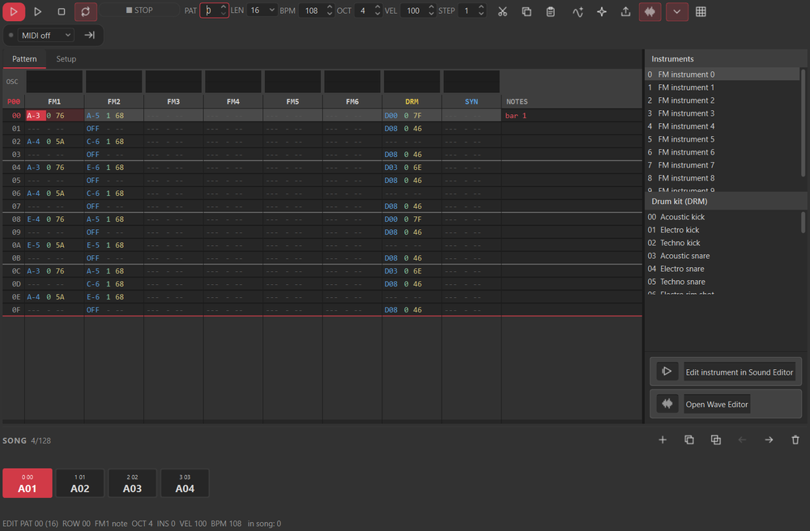

- **FM1, la basse.** Clic droit sur l'emplacement d'instrument 0 puis *Load .INS into slot 0...* : `TOOLS\SOUNDED\SOUNDS\BASS01.INS`. Une note à chaque temps (pas 0, 4, 8, 12), en fondamentale, fondamentale, quinte, fondamentale de l'accord, et l'octave au-dessus de cette note deux pas plus tard. Les accords sont La mineur, Fa, Sol et Mi, donc le pattern 1 est **A-3 A-3 E-4 A-3**, le pattern 2 **F-3 F-3 C-4 F-3**, le pattern 3 **G-3 G-3 D-4 G-3**, le pattern 4 **E-3 E-3 B-3 E-3** (le tracker compte les octaves une de plus que les noms MIDI usuels : son A-3 est le la de 110 Hz).
- **FM2, le lead.** L'emplacement 1 reçoit `LEAD02.INS`. Chaque pattern est un arpège de l'accord, puis une tournure : pattern 1 `A-5 C-6 E-6 C-6 A-5 E-5 A-5 C-6 E-6`, pattern 2 `F-5 A-5 C-6 A-5 F-5 C-5 F-5 A-5 C-6`,
  pattern 3 `G-5 B-5 D-6 B-5 G-5 D-5 G-5 B-5 D-6 B-5`, pattern 4 `E-5 G#5 B-5 G#5 E-6 D-6 B-5 G#5`. Les notes tombent sur les pas 0, 2, 4... avec quelques-unes sur les pas impairs en fin de mesure ; une cellule `OFF` termine une note.
- **DRM, la batterie.** Le kit DPCM du synthé numérique : une grosse caisse (entrée 0) sur les pas 0 et 8, une caisse claire (entrée 3) sur les pas 4 et 12, un charleston fermé (entrée 8) sur chaque pas impair.
- Jouez avec `Space`, puis enregistrez sous `HUNT.M8S`.

Vous pouvez entrer des notes au clavier de l'ordinateur (la rangée Z S X D C V... donne les touches blanches et noires d'une octave, Q 2 W 3 E R... l'octave au-dessus) ou en cliquant une cellule ; le bouton **Generate** de la barre d'outils écrit pour vous un pattern de basse, de batterie ou d'arpège.
Le tracker est décrit à la section 9.6. **Laissez FM6 (la sixième piste FM) vide** : le jeu utilise cette voix pour les effets sonores, et la musique ne doit pas lui marcher dessus.

**La jouer depuis le programme.** Insérez de nouveau la bibliothèque et cochez **screen** et **song** : `loadScreen` affiche le `.SCR` ; `songLoad`, `songStart` et `songTick` jouent le `.M8S` : le lecteur du tracker lui-même, écrit en Lofi, qui lit les événements du morceau et pilote les
mêmes voix que le tracker. Appelez `songTick()` une fois par image.

**Effets sonores.** Un son bref sur une voix que la musique n'utilise pas :

```c
// a short sound on FM voice 6, the one the song leaves alone
void sfx(byte note) {
	ymVoice(5,1,5,3,110);
	ymNoteOn(5,note,127);
}

// the title picture drawn in the Screen designer
void title() {
	poke(0x2F00,0b00010000);                       // the text layer alone
	loadScreen("HUNT.SCR");
	state=0;
}
```

et des appels à cette fonction là où les choses arrivent : lancer une hache (note 72), tuer un fantôme (60), détruire un générateur (48), être touché (40), un coffre (88), une pomme (80), gagner (96), mourir (33).
Les notes sont des numéros MIDI. `title()` n'affiche que le calque de texte ; `startGame()` allume les tuiles et les sprites. La boucle principale terminée, `HUNT.SRC`, a trois parties de plus : la musique, le titre,
et une sortie propre.

```c
setup();
if(songLoad("HUNT")) songStart();                // the music of HUNT.M8S, played by M8LIB's player
title();
while(_keyDwn!=12) {                             // until ESC
	songTick();
	if(state==1) {
		moveHero();
		throwAxe();
		moveAxes();
		spawn();
		moveGhosts();
		if(state==1) pickItems();
		if(state==1) hunger();
	} else if((_padLft&0b00000100)!=0) {         // Start (Enter): the title or an end screen leads to a new game
		startGame();
	}
	if(state!=0) glint();
	vSync();
	sprUpdt();
	frame++;
}
songStop();                                      // leave the machine as it was found
ymNoteOff(5);
poke(0x2F00,0b00010001);
memSet(0x1200,3200,' ');
memSet(0x1E80,3200,0x12);
curPos(0,0);
```

Lancez tout le jeu avec `F5`. La musique démarre sur l'écran de titre et continue pendant que vous jouez. `Esc` arrête tout, fait taire les voix, et rend l'écran comme on l'a trouvé.

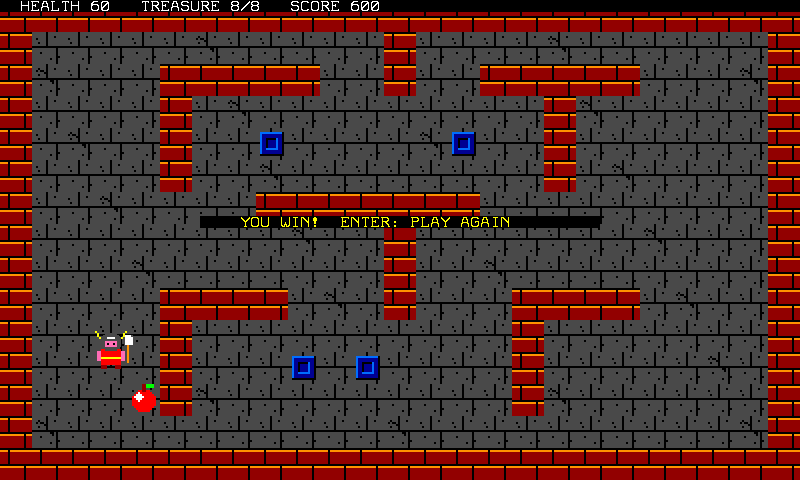

### 5.8. Étape 8 : déboguer et mesurer

Studio exécute le programme sur un émulateur de la machine, vous pouvez donc l'arrêter et regarder dedans.

1. **Point d'arrêt.** Cliquez dans la gouttière à côté de `health-=10;` dans `moveGhosts` (ou `F9`). Lancez, laissez un fantôme toucher le guerrier : le programme s'arrête sur cette ligne, surlignée.
2. **Variables et Watch.** Le panneau **Variables** liste la pile d'appels, les locales (`i`, `dx`, `dy`) et les globales (`health`, `score`, `state`, `treasure`) ; les valeurs modifiées sont en orange.
   Ajoutez une expression à **Watch**, par exemple `gx[0]-hx`, pour voir la distance du premier fantôme.
3. **Pas à pas.** `F10` passe par-dessus, `F11` entre dans, `Shift+F11` sort ; `F5` continue. Clic droit sur un point d'arrêt pour lui donner une condition, comme `i==2`.
4. **Point d'arrêt mémoire.** `Run > Add Memory Breakpoint...`, ou clic droit sur un octet du panneau **Memory** : le programme s'arrête quand cet octet change, quel que soit celui qui l'écrit.
   Essayez l'adresse `0x2F00`, le registre des calques, et démarrez une partie : il s'arrête là où `startGame` l'écrit.
5. **Panneau Hardware.** Calques, défilement, palettes et les 32 sprites, en direct. Comparez le tableau des sprites à la carte : le sprite 13 est sur la cellule du générateur de gauche.
6. **Memory Map.** Le programme est compilé en bytecode, et la machine lui donne **32 Ko de code et 16 Ko de données**. Pour DUNGEON HUNT l'estimation est d'environ **8,5 Ko de code et 2 Ko de données** :
   un quart du budget, avec la bibliothèque, le lecteur et les effets sonores. L'estimation vient d'un modèle ajusté sur les programmes compilés de la carte elle-même (à 5 % près).
7. **Vitesse.** Par défaut l'émulateur va aussi vite que le PC. `Run > Hardware Speed (X1)` tourne à la vitesse de la vraie machine : chaque opération de la VM coûte un temps fixe, un programme fait donc autant de travail par image
   que sur la console. Si le jeu ralentit en X1, une image a trop à faire (ici : jusqu'à huit fantômes à la poursuite, quatre haches testées contre dix cibles) ; c'est à vérifier avant d'envoyer un jeu sur une vraie machine.
8. **Superpositions.** `Affichage > Superpositions` (et `F7`, qui les montre ou les cache toutes) dessine sur l'écran ce que le programme ne peut pas montrer de lui-même, en marche ou en pause : les **boîtes des sprites**, rouges tant qu'elles touchent
   un autre sprite, les sprites **rangés en 0,0**, la **grille de tuiles**, les **calques de collision** de `HUNT.LAY`, et sous le pointeur le pixel, la tuile, le sprite et ses calques. Dans un combat, la boîte d'un générateur
   devient rouge quand une hache l'atteint : c'est le test que fait `isSprSpr` (section 7.2).

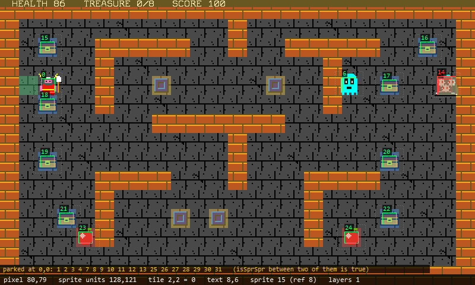

### 5.9. Étape 9 : vérifier, exporter, et lancer sur la machine

- **`File > Project > Check Project`.** Il signale ce que la vraie machine refuserait : des noms qui ne sont pas en 8.3, des erreurs de compilation, un code de plus de 32 Ko, des fichiers de projet manquants, et les
  fichiers que vos chaînes nomment et qui ne sont pas dans le dossier. Un projet propre le dit.
- **`File > Project > Export Project to SD Card...`** copie le manifeste, le programme et chaque asset dans `DOSSIER\` sur une carte (il demande avant de remplacer). Si la machine est reliée en MIDI,
  **Send Project to Machine...** fait la même chose sans sortir la carte (section 9.10).
- **Sur la machine.** Mettez le dossier sur la carte, allumez la console, et à l'invite :

```text
cd HUNT
compile HUNT.SRC
run HUNT.BIN
```

`cd` change de dossier (le programme ouvre ses fichiers à partir de là), `compile` transforme la source en bytecode et indique les tailles de code et de données, et `run` le démarre. Le jeu charge `HUNT.SPR`,
`HUNT.LVL`, `HUNT.LAY`, `HUNT.SCR` et `HUNT.M8S` depuis le dossier courant.

### 5.10. Et ensuite

- **Plus de niveaux.** Faites `LEVEL2.LVL` et `LEVEL2.LAY` dans l'éditeur de cartes, et chargez-les quand le dernier coffre a disparu. Le programme ne change que par deux noms de fichiers.
- **Un donjon plus grand.** Faites une carte de 80 x 24 et faites-la défiler avec les registres matériels `0x2F01` et `0x2F02` (la démo `TILES` montre comment).
- **Portes et clés.** Le calque 4 marque les portes ; un indicateur de clé laisse passer le guerrier ; le test de mur le consulte.
- **Des fantômes plus rapides, plus malins.** Un type de fantôme à 2 points de vie ; des fantômes qui ne vous voient pas si un mur est entre vous.
- **Deux joueurs.** Le registre de la manette droite est `_padRght`.
- **Une vraie mélodie.** Ouvrez les générateurs du tracker, ou jouez vos instruments de l'éditeur de sons vers l'éditeur de wave et construisez vos propres sons (section 9.5).

Vous connaissez maintenant tout le chemin : **des assets avec les éditeurs, un programme qui les charge, des calques qui disent où sont les choses, un projet qui les réunit, et un essai sur la machine.**

## 6. Éditeur

- Aucun document ouvert : un double clic dans la zone vide de l'éditeur ouvre la boîte Open (comme File > Open,
  `Ctrl+O`).

- Onglets, numéros de ligne, coloration Lofi (types, mots-clés, API, variables `_xxx`, nombres, textes,
  commentaires), copier / couper / coller / annuler / rétablir, ligne courante, parenthèses appariées, occurrences
  du mot sous le curseur.

- Recherche `Ctrl+F` (compteur, casse, mot entier, regex), remplacement `Ctrl+H`, `F3` / `Maj+F3`, recherche dans
  les fichiers `Ctrl+Maj+F`, aller à la ligne `Ctrl+G`, signets `F2` / `Ctrl+F2`.

- Auto-indentation, fermeture automatique des `( [ { "`, `Tab` / `Maj+Tab` sur une sélection, commentaire `Ctrl+/`,
  dupliquer `Ctrl+D`, supprimer la ligne `Ctrl+Maj+K`, déplacer les lignes `Alt+↑/↓`.

- **Complétion** (à la frappe, ou `Ctrl+Espace`) : vos fonctions, variables et types, toute l'API (avec la
  signature du manuel), variables intégrées, mots-clés, **membres** après `variable.` ou `tableau[i].` pour vos
  types personnalisés, et **snippets** (`for`, `while`, `if`, `ifelse`, `main`, `func`, `type`, `loop`, `sprite`,
  `import` : nom + `Tab`, ou depuis la liste). Choisir une fonction ajoute les parenthèses. **Aide aux
  paramètres** : dans un appel, la signature s'affiche avec le paramètre courant en gras (API et fonctions du
  programme).

- **Navigation et refactoring** : aller à la définition `F12` ou `Ctrl+clic` (fonction, type, variable ; pour
  l'API, la signature), renommer un symbole `Ctrl+R` (occurrences entières hors textes et commentaires, une seule
  annulation), formater le document `Ctrl+Alt+L` (indentation par accolades, style du fichier : les sources
  réelles utilisent des tabulations), zoom `Ctrl+molette`.

- **Préférences** (`Ctrl+,`) : thème, **langue** (English / Français, redémarrer pour appliquer), police et taille,
  largeur de tabulation ou tabulations, fermeture automatique des paires, complétion et aides, délai d'analyse,
  mise en forme à l'enregistrement. L'interface (menus, barre d'outils, Préférences) est traduite via le mécanisme
  Qt Linguist standard.

- **Analyse en direct** (0,5 s après la frappe) : erreurs et avertissements soulignés, marqueur dans la marge,
  panneau Problems, plan du programme (Outline). Un programme avec erreurs ne démarre pas. L'analyse connaît aussi
  les règles du vrai compilateur trouvées sur la machine (un décalage `<<` `>>` se fait d'un `byte`, jamais d'un
  `int`) et estime la taille du bytecode (modèle ajusté sur les `.BIN` de la carte SD, à 5 % près) : affichée
  dans la carte mémoire, avec un avertissement au-delà des 32 Ko du segment de code.

- **Autres langages** : l'éditeur ouvre aussi les `.txt`, `.md`, `.py`, `.c`, `.h`, `.cpp`, `.hpp`, `.cs`, `.js`, `.asm`, `.s`, `.json`
  et tout autre fichier texte. L'extension décide : un `.SRC` est un programme Lofi, les autres reçoivent les couleurs de leur langage
  (mots-clés, types, nombres, textes, commentaires de ligne et de bloc), une complétion faite des mots-clés et des mots du fichier,
  `Ctrl+/` avec la marque de commentaire du langage, et aucune des vérifications de Lofi : rien n'est souligné, la limite de taille ne
  s'applique pas et `F5` lance le programme du projet, ou rien. Un tel fichier garde son encodage (UTF-8, avec ou sans marque d'ordre
  d'octets, ou Latin-1) et ses fins de ligne (CR LF ou LF). Le nom du langage s'affiche dans la barre d'état.

- **Octets préservés** : un fichier est enregistré octet pour octet (fins de ligne CR LF ou LF conservées). Les
  codes de contrôle du Micro-8 dans les textes (nouvelle ligne 0x0D, couleurs…) s'affichent comme des « control
  pictures » (␍ ␐…) ; menu Edit > Insert Control Glyph pour en insérer.

## 7. Exécution et débogage

`F5` lance le programme sur le Micro-8 émulé (écran dans le dock *Micro-8 screen* : cliquez dessus pour lui donner
le clavier ; souris ; manette : flèches, Z=A, X=B, Entrée=Start, Tab=Select). Le son est joué en direct (FM par
Nuked-OPN2). Une erreur d'exécution arrête le programme sur sa ligne avec un message clair, y compris quand elle
vient d'un argument impossible (`5 >> -1`, `sqrt(-1.0)`, un pow() sans résultat réel, une adresse hors limites) ;
un réel passé là où la machine attend un entier est tronqué comme par `int()`.

| Action | Touche |
|---|---|
| Lancer / continuer | `F5` (lancer sans points d'arrêt : `Ctrl+F5`) |
| Arrêter / relancer | `Maj+F5` / `Ctrl+Maj+F5` |
| Pause | `F6` |
| Pas à pas sortant / entrant / sur place | `Maj+F11` / `F11` / `F10` |
| Point d'arrêt | `F9` ou clic dans la marge (clic droit : condition, ex. `i==2`) |
| Point d'arrêt mémoire | Debug > Ajouter un point d'arrêt mémoire, ou clic droit sur un octet dans Memory : le programme s'arrête dès que cet octet (ou cette plage, RAM ou SRAM externe) change, quel que soit l'auteur (affectation, `poke`, fonction de l'API, interruption raster) ; Output donne l'adresse, l'ancienne -> la nouvelle valeur et la ligne qui a écrit |

Panneaux : **Variables** (pile d'appels, locaux et globaux, valeurs modifiées en rouge), **Watch** (expressions
Lofi évaluées à l'arrêt, ex. `data[i]*10`), **Breakpoints** (lignes et mémoire), **Memory** (dump hexadécimal de la RAM ou de la SRAM
externe, octets modifiés en surbrillance, raccourcis vers les zones utiles), **Hardware** (couches, défilement,
pages, raster, palettes, sprites, registres du synthé).

### 7.1. Vitesse d'émulation

- **Par défaut** : le programme tourne aussi vite que le PC le permet ; le temps machine suit l'horloge réelle (hors
  temps passé à l'arrêt).

- **Run > Hardware Speed (X1)** : le programme tourne à la vitesse du vrai Micro-8. Chaque opération du VM (un nœud
  d'expression, un test de boucle, un saut) coûte un temps fixe ; le temps machine est la somme de ces coûts, et
  l'émulateur attend l'horloge réelle quand il est en avance. Un programme fait donc autant de travail par image
  que sur la machine. Réglage mémorisé, modifiable pendant l'exécution ; la barre d'état affiche `Running (X1)`.

- **Vitesse** : Preferences > Emulation > Hardware speed (X1), 1000 kHz par défaut (VM ≈ 1 MHz). Calibrage :
  lancer `dev/X1BENCH.SRC` sur la vraie machine, puis saisir le total mesuré dans Preferences pour obtenir la
  valeur à utiliser.

- **PC trop lent** : si le PC ne suit pas, toute l'exécution ralentit (horloge et son compris) au lieu de sauter du
  temps machine ; la barre d'état l'indique.

Limite : c'est un modèle de coût, pas une émulation au cycle près de l'ATmega128 et du firmware, les appels d'API
(copies mémoire, affichage) ont un coût fixe quelle que soit leur taille.

Menu Tools : contrôle des indices de tableau (désactivé comme sur la vraie machine / avertir dans Output /
arrêter), son, convention de notes du synthé, capture d'écran PNG, export du son de la session en WAV.

### 7.2. Superpositions

**Affichage > Superpositions** dessine des repères de débogage sur l'écran émulé. Ils sont lus dans les registres et la mémoire de la machine à chaque affichage de l'écran, et montrent donc aussi bien un programme en marche
qu'un programme en pause : arrêtez-vous sur un point d'arrêt, puis regardez. `F7` les cache tous et ramène ceux que vous aviez choisis. Le choix est mémorisé.

| Superposition | Ce qu'elle montre |
|---|---|
| Boîtes des sprites | La boîte de collision de chaque sprite qui est à l'écran (les quatre octets à la fin de son image, réglés dans l'éditeur de sprites), avec le numéro du sprite, dans le contour pointillé de son image 24 x 21. La boîte est verte, et rouge tant qu'elle touche un autre sprite : c'est exactement ce que répond `isSprSpr`. |
| Sprites rangés en 0,0 | Les sprites laissés en X=0, Y=0, qui est la façon de cacher un sprite, listés dans une bande en bas. Ils sont tous au même endroit, donc un test de collision entre deux d'entre eux est vrai tant que l'un d'eux n'est pas placé (annexe C). |
| Grille de tuiles | Les tuiles 16 x 16 (32 x 32 pixels d'écran, 25 x 15) avec leurs numéros de colonne et de ligne, selon les registres de défilement. |
| Calques de collision | Les calques d'un fichier `.LAY` sur les cases, avec la couleur de chaque calque dans l'éditeur de carte (jaune, bleu, vert, rouge, violet, turquoise, orange, blanc). Studio prend le `.LAY` à côté du programme qui tourne, celui qui porte son nom en premier ; **Fichier de calques** en choisit un autre, et chaque entrée **Calque** active ou coupe un calque. Une case dans plusieurs calques est rayée. |
| Valeurs sous le pointeur | Une barre en bas de l'écran : le pixel, le même point en unités de sprite (X + 48, Y + 42, ce que prend `sprPos`), la case de tuile et son numéro dans le tampon de tuiles, la case de texte (80 x 40), les sprites dont la boîte est sous le pointeur, et les calques de la case. |

Un fichier `.LAY` est une donnée de votre propre programme : Studio ne peut pas savoir où le programme en garde sa copie, les calques sont donc dessinés depuis la première case de tuile et ne suivent que les registres de défilement.
Un programme qui déplace une carte plus grande que l'écran avec son propre décalage montre ses calques au mauvais endroit.

## 8. Convertisseur d'images

`Ctrl+Maj+I` ouvre la fenêtre *Image tools* : glisser-déposer une image (PNG, JPG, GIF, TGA…).

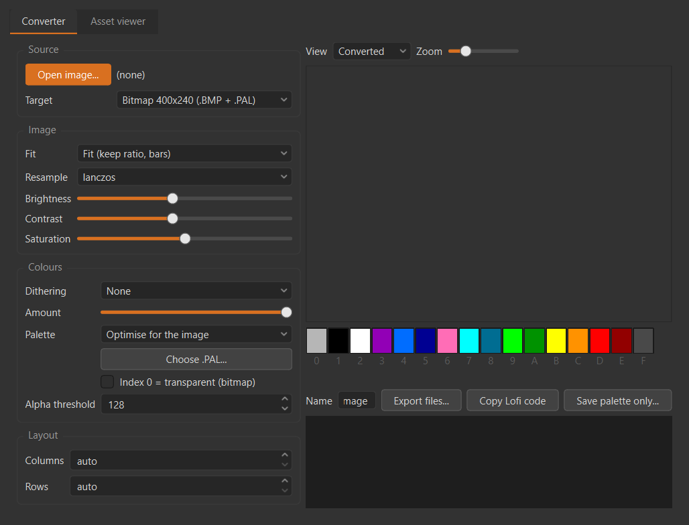

- **Bitmap 400×240** → `.BMP` (48000 octets, 4 bits/pixel) + `.PAL` (48 octets, 3 bits par composante).

- **Sprites 24×21** → `.SPR` (252 octets de pixels + boîte de collision AABB calculée) + `.PAL`.

- **Tuiles 16×16** → `.TLS` + `.PAL` ; **tuiles + carte** : image découpée, tuiles identiques fusionnées, `.TLS` +
  `.LVL` (carte d'un octet par case) + `.PAL`. Avertissement au-delà de 256 tuiles / 256 sprites.

- Ajustement (fit / fill / stretch / 1:1), rééchantillonnage, luminosité / contraste / saturation, palette
  optimisée pour l'image, ou celle d'un `.PAL`, ou la palette éditée à la main (clic sur une couleur : 512
  couleurs), tramage (aucun, Floyd-Steinberg, Bayer 4×4), transparence de l'indice 0, comparaison
  original / converti, zoom.

- Export dans le dossier choisi et **code Lofi prêt à coller** (`import(...)`, adresses de palette, activation des
  couches).

- Onglet **Asset viewer** : ouvre les `.BMP`, `.SPR`, `.TLS` existants avec leur palette (retrouvée
  automatiquement), boîtes de collision en magenta, export PNG. Les formats ont été vérifiés sur les ressources de
  la carte SD : le `.BMP` de MOUNTAIN se reconvertit à l'identique, les sprites de même.

- **Les images d'autres systèmes entrent et sortent.** Outre PNG, JPG, GIF, TGA, PCX, ICO et WebP, le convertisseur ouvre les images
  Amiga IFF (`.iff`), Commodore 64 Koala (`.kla`) et ZX Spectrum (`.scr`). **Export for other systems...** écrit l'image convertie en
  PNG (indexé, avec transparence), GIF, BMP, TGA, PCX, JPEG, en icône **ICO** à plusieurs tailles, en **Amiga IFF ILBM** (32 couleurs au
  plus), en **C64 Koala** (160×200, palette du C64, 4 couleurs par case), en **écran ZX Spectrum** (256×192, conflit de couleurs) ou en
  planches de tuiles pour la **NES** (CHR, 2 bits), la **Game Boy** (2 bits), la **Super Nintendo** (4 bits planaire), la **Mega Drive**
  (4 bits compacté) et la **Master System / Game Gear**, chacune avec sa palette dans les octets du système (les 3 bits par couleur du
  Micro-8 sont la profondeur de la Mega Drive : la palette Mega Drive est exacte). La fenêtre dit avant d'écrire ce qui sera perdu (trop de
  couleurs, côtés qui ne sont pas des multiples de 8, taille du pixel, indice 0 pour les pixels transparents, tramage).

## 9. Éditeurs d'assets

Équivalents des outils de la carte SD (SPRITED, MAPED, IMAGED, SOUNDED, SCREENED, le tracker embarqué).

Chaque éditeur s'ouvre dans un onglet, à côté du code : barre d'outils, Tools ou File > New Asset, double-clic sur
un fichier de l'arborescence, ou glisser-déposer. Enregistrement `Ctrl+S`, annuler/rétablir/copier/coller par le
menu Edit. Tous relisent puis réécrivent **octet pour octet** les fichiers réels de la carte SD (vérifié par les
tests).

### 9.1. Sprite editor

`.SPR` + `.PLA` / `.PLB` : jeu de sprites 24×21, jusqu'à 256.

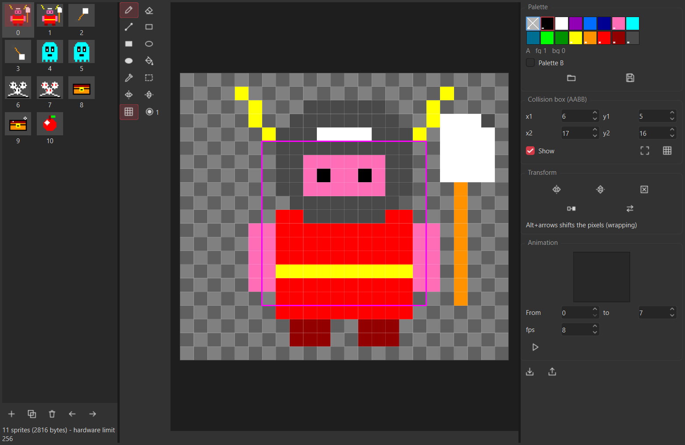

- Liste de vignettes (nouveau, dupliquer, supprimer, déplacer).
- Dessin pixel par pixel : crayon, gomme, ligne, rectangle, ovale, remplissage, pipette, sélection avec
  déplacement / copier / coller, miroir X/Y, pinceau 1-4, zoom molette, grille, papier d'oignon (le sprite
  précédent en transparence).
- Annulation par sprite, éditeur de palette (512 couleurs, palettes A et B).
- **Boîte de collision AABB** (champs, ajustement automatique), retournements, remplacement / échange de couleurs.
- **Aperçu d'animation** (plage, images par seconde), import d'une planche, export PNG.
- **Importer une planche d'un autre outil** (le bouton d'import) : un **fichier Aseprite** (`.ase`, `.aseprite` : ses images, nommées d'après ses tags, calques aplatis), une image (PNG, GIF, ICO, IFF...) avec la description trouvée à côté
  (JSON d'Aseprite ou de TexturePacker, `.png.meta` d'Unity, `.tres` de Godot, `.tsx` de Tiled), une grille régulière, ou le fichier de
  tuiles d'une console (`.chr` NES, `.2bpp` Game Boy, `.4bpp` SNES, `.bin` Mega Drive ou Master System, avec le `.pal` à côté pour les
  couleurs). La fenêtre compte les cellules trouvées et laisse régler la grille (taille de cellule, marge, espacement), omettre les
  cellules vides et ajuster chaque cellule à 24×21 (l'agrandissement par nombres entiers garde les pixels nets).
- **Export pour d'autres outils** (le menu du bouton d'export) : le jeu en **planche PNG transparente avec son atlas JSON**
  (`NOM.png` + `NOM.json`, le format « frames » de TexturePacker et d'Aseprite que lisent les moteurs 2D et leurs importeurs : la
  place de chaque sprite, nommé `NOM_00`, `NOM_01`..., et sa boîte de collision), la même planche **découpée en sprites pour Unity**
  (`NOM.png` + `NOM.png.meta` : mode Multiple, filtre point, sans compression ; copiez les deux fichiers dans le dossier Assets), ou un
  **en-tête C** (pixels, boîtes, palettes). Un pixel peut être agrandi (1 à 16) dans la planche.

### 9.2. Tile / map editor

`.TLS` + `.PAL` + `.LVL` : tuiles 16×16, jusqu'à 256.

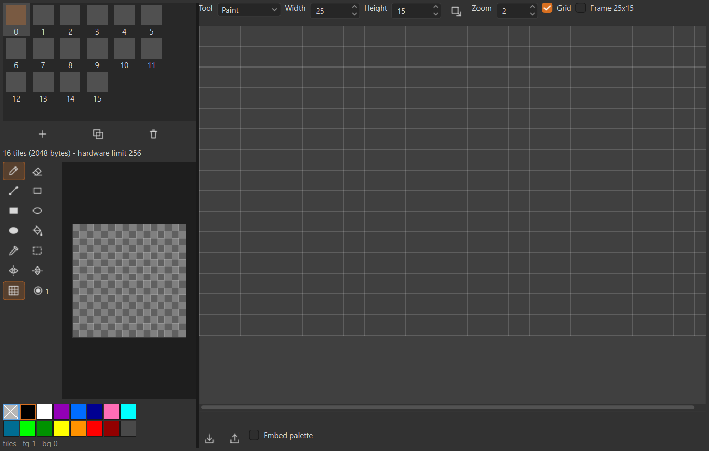

- Tuiles éditées pixel par pixel, carte peinte (peindre, remplir, pipette, sélection copier / coller).
- Redimensionnement de la carte, cadre d'écran 25×15, grille, zoom.
- Supprimer une tuile renumérote la carte automatiquement.
- Import d'une image en tuiles + carte (tuiles identiques fusionnées), export PNG.
- **Export de la carte pour d'autres outils** (le menu du bouton d'export) : **texte** (`.txt`, un caractère par tuile : `.` pour la
  tuile 0, puis `1`-`9`, `A`-`Z`, `a`-`z`), **CSV** (`.csv`, les numéros de tuile), **JSON** (`.json`, le format de carte de l'éditeur
  Tiled, avec les tuiles écrites à côté en planche PNG `NOM_tiles.png` ; le numéro de tuile vaut un de plus que dans Studio, puisque
  0 veut dire pas de tuile pour Tiled, et les couches qui contiennent quelque chose deviennent des couches cachées de 0 et de 1) ou
  **en-tête C** (`.h` : carte, couches, tuiles et palette en tableaux). Le bouton d'import relit une carte depuis du texte, du CSV ou
  du JSON (celui de Studio, ou une carte faite avec Tiled), un `.tmx` de Tiled (couches en CSV, base64, zlib ou gzip) ou un `.tscn` de
  Godot (Godot 4 demande le nombre de colonnes de tuiles de l'image du jeu de tuiles ; Godot 3 stocke les numéros de tuile). **A tile set
  from a sheet...** (le même bouton) fabrique les tuiles depuis une image de jeu de tuiles avec sa description Tiled, Godot ou Unity, une
  grille régulière, ou le fichier de tuiles d'une console ; les tuiles de 8×8 sont doublées en 16×16, ou groupées 2×2 (les métatuiles
  d'une console) ; la carte est conservée.
- Formats : `.TLS` brut (+ `.PAL`) ou forme de l'éditeur de tuiles (palette de 48 octets devant) ; `.LVL` avec
  en-tête de 4 octets (largeur, hauteur) ou brut (largeur demandée, comme le niveau 80×24 de la démo TILES).
- **8 calques** sur la carte, comme le MAPED de la machine (collisions, chemins, déclencheurs : le sens d'un calque
  est celui de votre programme). On choisit le calque dans la liste **Layer** (chacun a sa couleur), puis on utilise
  les quatre outils de calque : peindre, effacer, remplir et rectangle (bouton gauche = cellule posée, bouton droit =
  cellule effacée). La liste à côté affiche le calque courant, tous les calques en petits carrés, ou aucun. Le menu
  **Layers...** génère un calque depuis les tuiles cochées (toutes les cellules qui en contiennent une), inverse ou
  vide le calque, charge ou enregistre un fichier `.LAY`. Les calques suivent la carte quand on la redimensionne, et
  annuler / rétablir les rend avec les tuiles.
- Un `.LAY` suit le format de MAPED (largeur, hauteur, puis un octet par cellule, un bit par calque). Il est
  enregistré à côté de la carte (`LEVEL.LVL` donne `LEVEL.LAY`) et rechargé avec elle. Un programme le lit avec
  `import`, comme la carte.

### 9.3. Bitmap editor

`.BMP` 400×240 + `.PAL` : les mêmes outils que le sprite editor, appliqués à toute l'image.

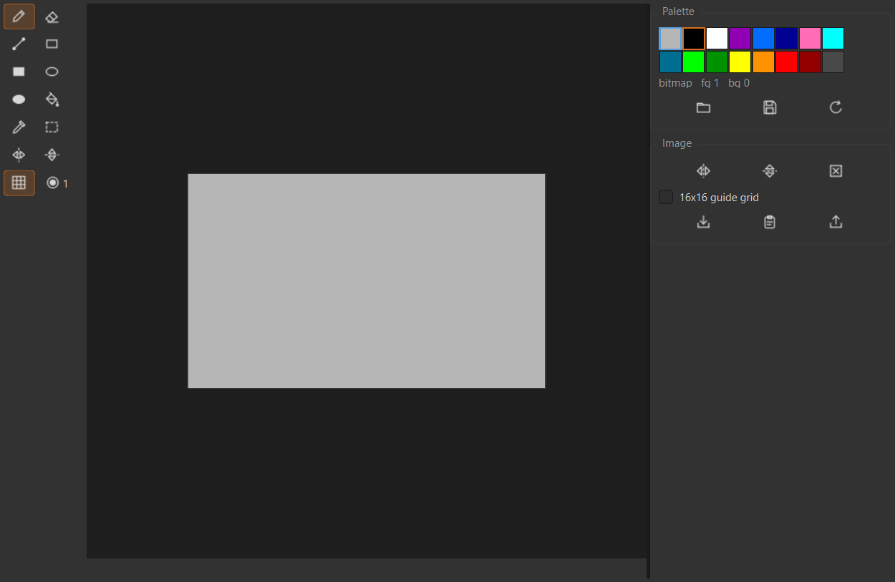

- Palette de 16 couleurs, grille guide 16×16.
- Import d'une image avec ajustement, tramage et palette optimisée.
- Coller une image du presse-papiers, export PNG.
- **Calques.** Le groupe **Layers** tient une liste de calques (le premier est le fond) : nouveau, dupliquer, supprimer, monter,
  descendre, fusionner vers le bas et aplatir ; cochez un calque pour l'afficher ou le masquer, double-cliquez pour le renommer. Les
  outils dessinent sur le calque en cours ; au-dessus du fond la gomme fait des pixels transparents (le damier apparaît) et la pipette
  prend la couleur visible. Sélection, déplacement et collage agissent sur le calque ; chaque changement des calques est une étape
  d'annulation. Le résultat est ce qui s'enregistre : le `.BMP` contient l'image fusionnée (exactement ce que lit la machine), et
  `NOM.LAYERS.json` à côté garde les calques, de sorte que le fichier se rouvre avec eux tant que l'image n'a pas été modifiée par un
  autre outil (la machine l'ignore).
- **Images sur des calques.** *Import > Picture on a new layer...* (ou *Clipboard picture on a new layer*) place un PNG, GIF, ICO, IFF,
  Koala... sur un calque à part, ajusté au canevas, ce qu'il ne couvre pas restant vide : on compose ainsi une image avec plusieurs
  images, puis on les déplace avec l'outil Select. L'image garde la palette actuelle, ou construit les 16 meilleures couleurs (ce qui
  change aussi les autres calques).
- **Icônes et autres tailles.** *Canvas size* règle l'image sur le bitmap Micro-8 (400×240), une icône (tailles officielles seulement : 16, 24, 32, 48, 64, 128, 256 ou 512), un sprite, une tuile
  ou une taille quelconque jusqu'à 1024, et dit si le fond est transparent. Paint ouvre et enregistre l'**ICO** (écrit avec les tailles
  officielles (16, 24, 32, 48, 64, 128, 256) qui tiennent dans l'image, celles du fichier ouvert gardées, centrée sur un carré si elle n'en est pas un ; un ICO s'arrête à 256, une icône
  de 512 s'enregistre donc en PNG ; la transparence est gardée), PNG, GIF, TGA, PCX et Amiga IFF, et ouvre les images C64 Koala et ZX
  Spectrum. Seule une image de 400×240 s'enregistre en `.BMP` Micro-8. Tout ce qui est ouvert est converti en 16 couleurs de 3 bits du
  Micro-8, et l'enregistrement écrit cette version : utilisez Export pour garder le format d'origine.
- **Export for other systems...** écrit l'image dans tous les formats du §8 (PNG, GIF, TGA, PCX, JPEG, ICO avec les tailles cochées, Amiga
  IFF, C64, ZX Spectrum, NES, Game Boy, SNES, Mega Drive, Master System), avec un avertissement sur ce qui sera perdu.

### 9.4. Sound editor

`.INS` 54 octets, `.SYN` 16 octets: banque de 10 instruments YM2612.

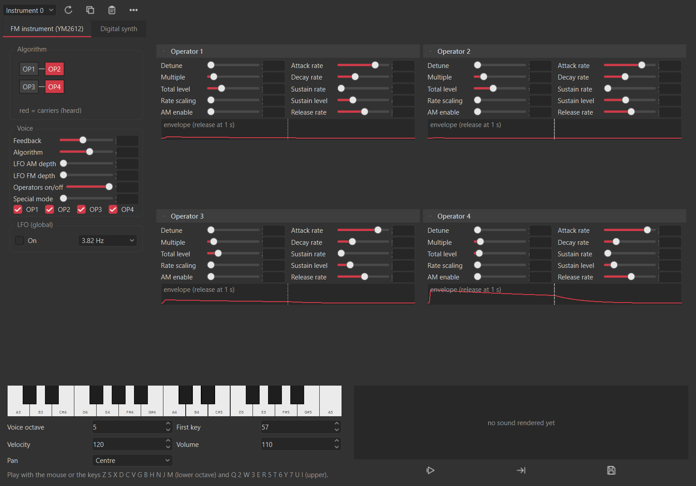

- Les 54 paramètres (4 opérateurs : detune, multiplicateur, niveau total, rate scaling, attaque, AM, decay,
  sustain rate, sustain level, release).
- Algorithme avec **schéma** (porteuses en rouge), feedback, LFO, opérateurs actifs.
- **Courbe d'enveloppe** par opérateur, **clavier de test** (souris ou touches Z S X D C V… / Q 2 W 3 E R…) joué
  en direct par Nuked-OPN2, forme d'onde et spectre du son.
- Copier / coller / initialiser / hasard / mutation, charger un `.INS` dans un emplacement, banque de 10 fichiers.
- Onglet **synthé numérique** : oscillateurs, batterie DPCM (20 sons), enveloppes, LFO, filtre SVF, gains et
  panoramique, les 16 registres de 0x1110. Le préréglage s'enregistre en `.SYN` (16 octets, format du studio).

### 9.5. Wave editor

`.wav` : forme d'onde avec sélection, zoom, défilement, spectre.

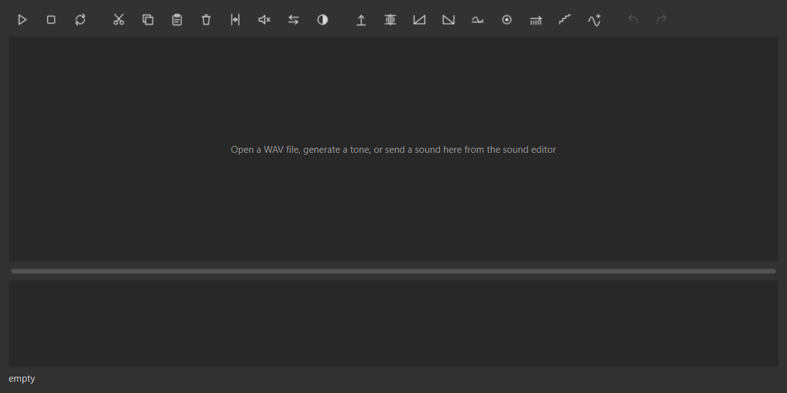

- Couper / copier / coller / supprimer / rogner, silence, inverser, gain, normaliser, fondus, retirer la
  composante continue, mono.
- Ré-échantillonnage (8-48 kHz), écrêtage en N bits (la batterie DPCM du synthé est en 4 bits), génération de
  signaux, lecture avec boucle, export WAV.
- **Instrument vers sample** : le bouton d'envoi de l'éditeur de sons (instrument FM ou synthé numérique)
  demande la note, la durée de la tenue, la durée du son entier et le format d'ouverture : PCM à 44,1, 32 ou
  16 kHz, ou **converti en DPCM du Micro-8** (ci-dessous). Tools > Sound of this Run alimente l'éditeur de
  waves de la même façon avec le son d'un programme.
- **DPCM Micro-8 (4 bits)** : le format de la batterie de la machine. Le son est ré-échantillonné à la fréquence
  du kit (32 kHz, 16 kHz pour les grosses caisses), mis en mono et normalisé, puis transformé en codes de 4 bits :
  chaque code est un des 16 pas que le matériel ajoute à un accumulateur 8 bits (l'accumulateur est le signal),
  donc ce que l'éditeur montre et joue ensuite est ce que les codes donnent à l'oreille. Le rapport signal sur
  bruit est affiché, et Annuler redonne l'original. **Enregistrer en `.DPC`** écrit les codes (deux par octet,
  le fort d'abord, sans en-tête) ; un `.DPC` se rouvre dans l'éditeur de waves à 32 kHz (Resample pour une grosse
  caisse). La batterie de la machine est dans la ROM du FPGA : aucun programme n'y charge un `.DPC`, le fichier
  est le format, pour votre propre lecteur ou vos outils.

### 9.6. Tracker

Un seul fichier `.M8S` compressé comme sur C64 (pistes en listes d'événements, pistes répétées ou transposées
stockées en référence) : le séquenceur musical
intégré du Micro-8.

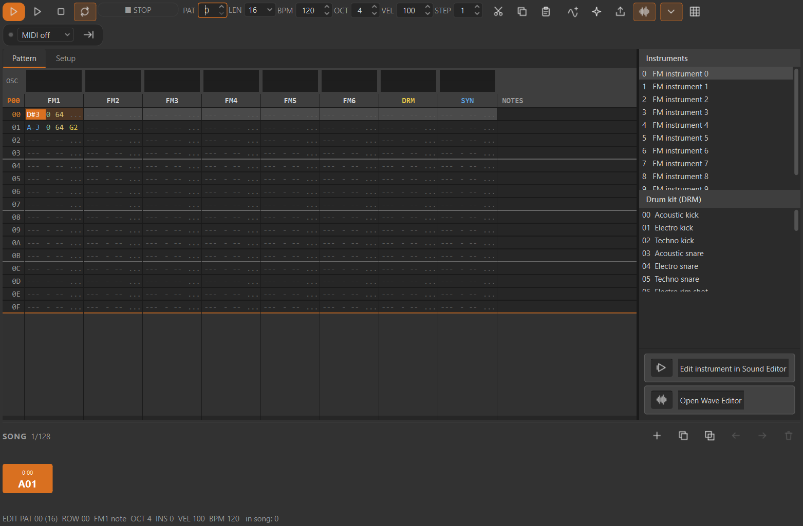

- 8 pistes : 6 voix FM, une piste batterie/oscillateur DRM, une piste SYN.
- Cellules note/instrument/vélocité, patterns de 16 à 256 pas (blocs réclamés/libérés).
- Morceau (séquence de patterns transposables, boucle), vue page ou continue. Pendant la lecture du morceau,
  la grille suit le pattern qui joue ; en choisir un autre à la main l'affiche jusqu'à l'entrée suivante.
- **Bandeau SONG** : une carte par entrée, 2 rangées de 16 (comme les banques Elektron). Le pattern s'y lit en
  banque (`A01`…`D16`, 16 patterns par banque) avec son numéro en hexadécimal ; une entrée qui se répète est une
  seule carte « ×N » (le REP d'Elektron : `Ctrl`+molette ou le bouton de copie pour en ajouter ou retirer, clic
  droit pour le nombre exact), et la carte qui joue indique la répétition en cours (« 2/3 »). Au-delà de 32 cartes,
  des boutons de page (« 0-31 », « 32-63 »…) ; la page suit la lecture, et survoler un bouton de page en glissant
  une carte l'ouvre. Molette : pattern, `Maj`+molette : transposition, glisser : déplacer (avec ses répétitions),
  double-clic : jouer d'ici.
- Édition façon OctaMED : sélection Maj+flèches ou souris, transposer, copier/couper/coller une plage, inverser,
  étendre/réduire, vélocité fixe/rampe/aléatoire.
- Un défilement par piste, mute (clic) / solo (double-clic), **instantanés** : la note en cours est coupée.
- Pendant la lecture d'un pattern, en choisir un autre le joue **tout de suite**, au même pas de la mesure (le saut
  direct des Elektron), au lieu d'attendre la fin du pattern. Les trackers et le lecteur embarqués font de même sur la
  machine.

**Générateurs** : rythmes euclidiens, polyrythmies, 20 préréglages batterie,
presets basse/pad/arpège/aléatoire, 12 presets FM, n'écrivent que des notes, donc 100 % compatibles avec la
machine réelle.

**Effets Studio** (arpège, retrigger, delay, cut, probabilité, LFO YM, swing, glide, longueurs de piste) :
uniquement pour l'aperçu dans Studio, désactivables, la lecture sur machine reste celle du tracker embarqué. Export
MIDI, WAV, pistes séparées (stems). `.EXT.json` : fichier annexe pour les longueurs de pattern et les effets, pas lu
par la machine.

**Exports pour un autre système.** Outre WAV, stems et MIDI (un fichier, ou un par piste), le menu d'export écrit les **événements de
notes** du morceau en JSON ou CSV (le tempo, les pistes, les instruments FM en champs nommés, chaque note avec son instant, sa durée, sa
note MIDI et sa hauteur en Hz ; arpèges et autres effets sont déjà des notes) et un fichier **VGM** : chaque écriture de registre du
YM2612 des six pistes FM, avec un point de boucle, qui se joue tel quel sur une Mega Drive ou dans n'importe quel lecteur de VGM. Le guide
*Porter une musique du tracker Micro-8 vers un autre système* (`PORTING_MUSIC_fr.md`, avec la carte des registres du YM2612 et une
recette pour la Mega Drive, la NES, le C64, la Game Boy, l'Amiga et les moteurs de jeu) dit ce que contient chaque fichier et comment
s'en servir.

Testé octet pour octet contre les trackers embarqués (les deux versions et le lecteur) : un projet fait ici s'ouvre inchangé sur la machine réelle et inversement.

### 9.7. Screen designer

Fichiers `.SCR` : éditeur générique d'écran texte 80×40 (glyphes + couleurs), dans le style des outils
système (SPRITED/SOUNDED/MAPED).

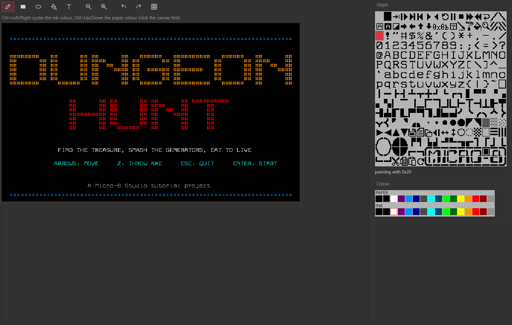

- Palette de glyphes (les 256 de la police réelle), barre de couleurs papier/encre (palette texte par défaut de la
  machine).
- Outils peindre / cadre / cercle / remplir / écrire (machine à écrire : clic place un curseur, on tape), pipette,
  zoom, annuler/rétablir.
- `Ctrl+←/→` fait défiler la couleur d'encre, `Ctrl+↑/↓` la couleur de papier.

Fichier `.SCR` = 6400 octets (3200 glyphes puis 3200 couleurs). Un simple `import(nom,0x1200,6400)` l'affiche
depuis n'importe quel programme Lofi. Un fichier corrompu est refusé au chargement.

### 9.8. Bibliothèque Micro-8

Edit > Insert Micro-8 Library... colle dans le programme courant des fonctions Lofi prêtes à l'emploi pour relire
et écrire, **sur la machine**, les fichiers produits par les éditeurs du Studio (`lib/M8LIB.SRC`).
Lofi n'a pas de `#include` et compile en une passe : les blocs cochés, plus ceux dont ils ont besoin, sont insérés
après les commentaires d'en-tête, dans l'ordre de la bibliothèque. Un bloc déjà présent n'est pas recopié, et une
seule annulation retire l'insertion.

| Bloc | Fonctions | Fichier |
|---|---|---|
| `pal` | `loadPal` / `savePal` | `.PAL` 48 octets (16 R, 16 V, 16 B, 0-7) vers une adresse de palette |
| `bitmap` | `loadBitmap` / `saveBitmap` | `.BMP` 48000 octets, page bitmap affichée (0x2F05) |
| `sprites` | `loadSprites` / `saveSprites` | `.SPR`, 256 octets par sprite, à partir d'un numéro |
| `tiles` | `loadTiles` / `saveTiles` | `.TLS`, 128 octets par tuile 16x16 |
| `level` | `loadLevel` / `saveLevel` | `.LVL`, un numéro de tuile par case, dans un tableau d'octets |
| `screen` | `loadScreen` / `saveScreen` | `.SCR` 3200 glyphes + 3200 couleurs (celle du Screen designer) |
| `song` | `songLoad` / `songStart` / `songTick` / `songStop` | projet tracker `.M8S`, joué par le coeur du PLAYER |

Toutes renvoient `true` en cas de succès (`_fError` à 0). Un `.SCR` abîmé est refusé. La fin de `M8LIB.SRC` (`//@main`) est un auto-test à lancer tel quel (F5) : il écrit puis relit
chaque type de fichier, essaie ceux des blocs de jeu ci-dessous qui n'ont besoin ni de manette ni de son, et joue `NEWSONG.M8S` s'il existe.

**Blocs de jeu.** Le même menu propose des blocs pour ce que presque tout jeu récrit. Lofi n'a pas de structures : leurs données sont dans des tableaux globaux, et chaque nom commence par le préfixe du bloc
(`pad`, `tm`, `st`, `lay`, `ent`, `hud`, `sfx`) pour ne pas entrer en conflit avec les vôtres.

| Bloc | Fonctions | Ce qu'il fait |
|---|---|---|
| `pad` | `padRead` / `padDown` / `padHit` / `padUp` | la manette avec ses fronts : appelez `padRead()` une fois par image, puis testez un masque (A 1, B 2, Start 4, Select 8, Haut 16, Bas 32, Gauche 64, Droite 128) ; `padHit` n'est vrai que sur l'image où un bouton s'enfonce |
| `timer` | `tmSet` / `tmTick` / `tmDone` / `tmEvery` | 8 minuteries en images ; `tmEvery(i,12)` est vrai une fois toutes les 12 images, pour une cadence de tir ou un générateur |
| `state` | `stGo` / `stTick` / `stIs` | l'état du jeu (titre, partie, fin) dans `st`, et le nombre d'images qu'il dure dans `stAge` |
| `layer` | `layLoad` / `layCell` / `layPoint` / `layBox` / `layFind` / `layCount` / `layX` / `layY` | collisions et placement d'après le `.LAY` d'une carte de 25 x 15 (`layCell(col,row)` donne les bits de calques d'une case). `layBox(px,py,12,10,24,24,1)` demande si une boîte de 24 x 24 dans un sprite placé en `px,py` touche le calque 0 (hors de l'écran compte comme un mur) ; `layFind(2,0)` est la première case du calque 1, et `layX`, `layY` donnent la position de sprite qui centre un sprite sur une case |
| `phys` | `physPlace` / `physStep` / `physJump` / `physTouch` / `physBox` / `physBlocked` / `physRebound` | gravité, sauts, murs et rebonds pour des sprites sur un calque du `.LAY` (il amène `layer`). Un corps est un sprite de 0 à 31, sa position et sa vitesse sont en 1/16 de pixel (`physX[i]/16` est la position de `sprPos`). `physStep(i,mask)` applique la gravité et la traînée, puis déplace le corps pixel par pixel et l'arrête aux cases des calques de `mask` : il ne traverse jamais un mur, quelle que soit sa vitesse, et `physGnd[i]` dit s'il repose sur quelque chose. `physJump(i,88)` saute de 38 pixels, depuis le sol seulement ; `physTouch(i,mask)` dit si le corps recouvre un calque (pièces, pointes) ; `physBox` règle la boîte qui heurte les murs. `physGrav`, `physFall`, `physDrag` et `physBounce` (0 à 16) sont de simples globales : `physGrav=0` donne un jeu vu de dessus qui glisse le long des murs. `physBlocked` et `physRebound` sont ses aides. Pas de pentes ni de plateformes mobiles : un corps ne rencontre que des cases entières. `Examples/OS/BSMCODE/GRAVITY/GRAVITY.SRC` en est un jeu : un robot qui marche, saute et vole à travers sept pièces, chacune avec sa gravité (terre, lune, lourd, glace, ressorts, une tempête qui change le monde, l'espace sans aucune), prend les cellules d'énergie, évite des drones faits avec la table d'entités de la section 9.11 et rejoint la sortie (son tutoriel est sur le site web) |
| `ent` | `entNew` / `entKill` / `entStep` / `entTouch` / `entClear` / `entCount` | tirs et ennemis en réserve de sprites, chacun avec une vitesse : `entNew(1,4,2,x,y,7,0)` prend le premier sprite libre de 1 à 4, `entStep` les déplace tous, `entTouch(0,5,8)` est le premier vivant parmi les sprites 5 à 12 qui touche le sprite 0 |
| `hud` | `hudFill` / `hudPrint` | du texte avec sa couleur, puisque `print` peint en noir sur rien : couleur = fond * 16 + lettres |
| `sfx` | `sfxPlay` / `sfxTick` | un son court sur la voix FM 5, coupé après le nombre d'images donné |

Un guerrier qui marche et lance des haches, avec `pad`, `timer` et `ent` cochés :

```c
int hx=100;
int hy=200;
sprPos(0,hx,hy);
while(_keyDwn!=12) {                             // until ESC
	padRead();
	tmTick();
	if(padDown(0b10000000)) hx+=3;               // right
	if(padDown(0b01000000)) hx-=3;               // left
	if(padHit(0b00000001)&&tmDone(0)) {          // A: a shot in sprites 1 to 4, one every 10 frames at most
		entNew(1,4,2,hx,hy,7,0);
		tmSet(0,10);
	}
	entStep(1,4);
	for(int i=1;i<5;i++) {
		if(entOn[i]&&entX[i]>850) entKill(i);    // gone off the right side
	}
	sprPos(0,hx,hy);
	vSync();
	sprUpdt();
}
```

Un jeu de plateformes est la même boucle avec `pad` et `phys` cochés, et le calque 0 de `LEVEL.LAY` comme sol et murs :

```c
layLoad("LEVEL.LAY");
physPlace(0,100,100);
while(_keyDwn!=12) {                             // until ESC
	padRead();
	physVx[0]=0;
	if(padDown(0b10000000)) physVx[0]=40;        // right: 2.5 pixels a frame
	if(padDown(0b01000000)) physVx[0]=-40;       // left
	if(padHit(0b00000001)) physJump(0,88);       // A: 38 pixels high, only from the ground
	physStep(0,1);                               // gravity and walls: layer 0
	vSync();
	sprUpdt();
}
```

Les tests de collision voient l'image du dernier `sprUpdt()`. Une chose tuée va en 0,0, où les sprites cachés se touchent tous, c'est pourquoi `entTouch` ne regarde que les vivantes
(`Affichage > Superpositions` le montre, section 7.2).

### 9.9. Projets

File > Project : un projet est **un dossier de la carte SD** qui contient un programme et ses assets,
décrit par un petit manifeste JSON `NOM.M8P` (nom 8.3, il peut voyager sur la carte sans gêner). Le manifeste garde
le programme principal, les fichiers du projet, les onglets ouverts, l'onglet courant et le réglage X1.

- **New Project...** : choisir le dossier et le nom (1 à 8 lettres, chiffres ou `_`) ; crée `NOM.SRC` s'il n'existe
  pas, et les assets déjà présents dans le dossier rejoignent le projet. **Open Project...** (`Ctrl+Maj+O`) rouvre
  les onglets et le mode X1 ; Studio rouvre au démarrage le projet ouvert à la fermeture.
- **Save Project** (`Ctrl+Alt+Maj+S`) enregistre tous les fichiers ouverts et le manifeste ; un fichier ouvert depuis
  le dossier du projet y est ajouté (ou **Add Current File to Project**). Un nouveau fichier est proposé par défaut
  dans le dossier du projet. **Close Project** ferme seulement les onglets du projet.
- **F5** avec un éditeur d'asset au premier plan lance le programme du projet.
- **Panneau Assets** (colonne de gauche) : tous les fichiers du projet, et tous ceux que nomment ses sources, groupés par genre (code,
  sprites, tuiles et cartes, images, palettes, sons, musique, données). Un double clic ouvre un fichier dans l'éditeur fait pour lui.
  Sans projet, le panneau montre les fichiers du programme au premier plan : les noms écrits dans sa source (`"HERO.SPR"`,
  `songLoad("TUNE")`, `#include "game.h"`), leurs compagnons (les palettes d'un jeu de sprites, les couches et les tuiles d'une carte)
  et les fichiers qui portent le nom du programme. Un fichier que la source nomme et qui n'est pas sur le disque est listé en rouge,
  comme manquant. Le panneau lit tous les formats que Studio ouvre : une colonne *Details* dit ce que contient chaque fichier (3 sprites,
  un bitmap 400 x 240, les tailles d'une icône, 133 BPM, la durée d'un wave...) et les images (bitmaps, sprites, tuiles, PNG, ICO, IFF,
  Koala...) ont une vignette. Le bouton dossier passe la liste à **tous les fichiers que Studio ouvre dans le dossier** du projet ou du
  programme, sous-dossiers compris (3 niveaux, 400 fichiers).
- **Check Project** : ce que la vraie machine refuserait (noms non 8.3 de la FAT32, erreurs de compilation, code
  au-delà du segment de 32 Ko, fichiers du projet manquants) et les fichiers que le programme nomme dans ses textes
  mais qui ne sont pas dans le dossier (simple note : le programme peut les écrire lui-même).
- **Export Project to SD Card...** : copie le manifeste, le programme et ses fichiers dans `CARTE/DOSSIER/`
  (demande avant de remplacer). **Send Project to Machine...** : le même envoi par MIDI (§9.10).
- **Tools > Write System to SD Card...** : écrit la carte livrée avec Studio (fichiers système, exemples et leurs
  programmes compilés) sur une vraie carte SD pour la machine. Un résumé annonce les fichiers nouveaux, remplacés et
  identiques avant d'écrire, et le presse-papiers ou l'annulation de la machine déjà présents sur la carte sont
  conservés. La cible doit être un lecteur amovible (jamais un disque fixe ni le dossier de Studio).
- Le dossier du projet doit être sous la racine de l'arbre Files (la carte émulée) pour que les chemins du
  programme se résolvent comme sur la machine : si ce n'est pas le cas, la racine remonte au dossier parent.

### 9.10. Transfert avec la machine (MIDI)

Tools > Transfer with Machine... (`lib/LINK.SRC`) : envoyer, récupérer et lister les
fichiers de la carte SD d'un vrai Micro-8, par ses prises MIDI et n'importe quelle interface USB-MIDI.

1. Copier `LINK.SRC` sur la carte (bouton **Copy LINK.SRC to the SD Card**, ou à la main), le lancer sur la machine.
2. Câbles : MIDI OUT du PC vers MIDI IN du Micro-8, MIDI OUT du Micro-8 vers MIDI IN du PC.
3. Choisir le port de sortie et le port d'entrée, **Test Connection**, puis **List** (dossier de la carte, double-clic
   pour entrer dans un dossier), **Send Files...**, **Send Project** (dans `/DOSSIER` du projet, sous-dossiers
   compris) ou **Fetch Selected...**.

Sans machine : choisir **Emulator**, **Start LINK in the Emulator** ; tout marche de la même façon contre l'émulateur.

Le débit est d'environ 1,3 Ko/s : une image de 48 000 octets prend 40 s environ. Fichiers de 64 Ko au plus, noms
8.3. Un fichier reçu ne remplace la cible qu'une fois complet : une coupure ne l'abîme jamais.

Le clavier MIDI choisi dans Tools > MIDI Input joue aussi dans le programme en cours, comme sur la machine.

### 9.11. Table d'entités

Un jeu déplace toujours les mêmes quelques sortes de choses, ennemis, tirs, objets, et chacune demande le même code : une réserve de sprites, une façon de bouger, des coups, une animation.
**Tools > New Entity table** (ou un fichier `NOM.ENT`) liste les sortes dans un tableau, une ligne chacune, et Studio écrit ce code pour vous, au-dessus des blocs `ent`, `layer` et `phys` de la bibliothèque (section 9.8).

| Colonne | Ce qu'elle règle |
|---|---|
| Name | le nom de la sorte, une lettre minuscule puis des lettres ou des chiffres : il commence ses fonctions (`ghost` : `ghostSpawn`, `ghostUpdate`...) |
| First sprite, Sprites | la plage de sprites qu'elle possède, donc aussi le maximum qui peut exister en même temps : les sprites 5 à 12 sont 5 et 8. Deux sortes ne partagent jamais un sprite |
| Image, Frames, Every | le numéro d'image dans le `.SPR`, le nombre d'images parcourues à partir de là, et le nombre d'images d'écran entre deux d'entre elles |
| Kind | comment elle bouge, voir plus bas |
| Speed | des pixels par image |
| Walls | les calques du `.LAY` qui l'arrêtent, en somme : 1 est le calque 0, 2 le calque 1, 4 le calque 2, 8 le calque 3 et ainsi de suite jusqu'à 128 pour le calque 7 |
| Hits | les coups qu'il faut pour en tuer un |
| Box x,y,w,h | la boîte qui heurte les murs, dans le sprite (largeur et hauteur jusqu'à 32) ; la boîte réglée dans l'éditeur de sprites est celle de `isSprSpr` pour les contacts, celle-ci sert aux murs |
| Place on layer | en met un sur chaque case de ce calque au début de la partie, autant qu'il a de sprites (coffres, générateurs) ; none : le programme les fait apparaître |
| Face | tourne le sprite vers la gauche quand il va vers la gauche |

Les sortes : **static** reste où elle est (objets, générateurs) et s'anime ; **walker** marche dans la direction donnée et fait demi-tour aux murs ; **chaser** marche vers `entTargetX`, `entTargetY` et glisse le long des murs, comme les fantômes du tutoriel ;
**shot** vole droit et disparaît à un mur ou au bord de l'écran ; **faller** tombe sous la gravité, marche et fait demi-tour aux murs (il utilise le bloc `phys`, avec une seule boîte de murs pour tous ses corps).
Les murs sont les cases des calques de la colonne Walls, et le bord de l'écran arrête toujours un walker, un chaser, un shot ou un faller.

Pour une sorte appelée `ghost`, Studio écrit :

| Fonction | Ce qu'elle fait |
|---|---|
| `ghostSpawn(x,y,dx,dy)` | un nouveau dans le premier sprite libre, à la position `sprPos` `x,y`, et pour les sortes qui bougent, dans la direction `dx,dy` (chacun -1, 0 ou 1) à sa vitesse ; le numéro du sprite, ou -1 quand tous servent |
| `ghostUpdate()` | déplace et anime chaque fantôme qui existe (`entitiesUpdate()` l'appelle) |
| `ghostHit(i)` | un coup sur le fantôme `i` ; vrai si c'était le dernier et que le fantôme a disparu |
| `ghostTouch(s)` | le premier fantôme qui touche le sprite `s`, ou -1 (un sprite du héros, une hache) |
| `ghostCount()`, `ghostClear()` | combien existent, et les retirer tous |
| `ghostPlace()` | un sur chaque case de son calque (`entitiesPlace()` l'appelle) |

et `entitiesUpdate()`, `entitiesClear()` et `entitiesPlace()`, qui le font pour chaque sorte du tableau.

**Pour l'utiliser.** Remplissez le tableau, enregistrez-le sous `GAME.ENT` à côté de `GAME.SRC` (ou dans le projet), et cliquez sur **Generate into the program** (ou Tools > Generate Entities into the Program).
Studio ajoute les blocs dont le tableau a besoin quand ils manquent et écrit le code entre deux lignes repères, `//@entities begin` et `//@entities end` : cette partie est à Studio, on change donc le tableau et on génère de nouveau,
jamais le code. Tout ce qui est hors des repères reste comme c'était, une seule annulation reprend tout le changement, et générer deux fois ne change rien. Au début d'une partie, appelez `layLoad("LEVEL.LAY")`, `entitiesClear()` et `entitiesPlace()` ;
à chaque image, réglez `entTargetX` et `entTargetY` s'il y a des chasers, appelez `entitiesUpdate()`, puis `sprUpdt()`. Voici le tableau de DUNGEON HUNT :

| Name | First sprite | Sprites | Image | Frames | Every | Kind | Speed | Walls | Hits | Box x,y,w,h | Place on layer | Face |
|---|---|---|---|---|---|---|---|---|---|---|---|---|
| axe | 1 | 4 | 2 | 2 | 4 | shot | 7 | 1 | 1 | 23,20,2,2 | none | no |
| ghost | 5 | 8 | 4 | 2 | 8 | chaser | 2 | 1 | 1 | 12,10,24,24 | none | yes |
| generator | 13 | 2 | 6 | 2 | 8 | static | 0 | 0 | 3 | 12,10,24,24 | 2 | no |
| chest | 15 | 8 | 8 | 2 | 16 | static | 0 | 0 | 1 | 12,10,24,24 | 1 | no |
| apple | 23 | 2 | 10 | 1 | 1 | static | 0 | 0 | 1 | 12,10,24,24 | 3 | no |

et la boucle principale d'un jeu qui l'utilise, avec `sprites`, `pad` et `timer` cochés :

```c
loadSprites("HUNT.SPR",0);
layLoad("HUNT.LAY");
entitiesClear();
entitiesPlace();
int hx=72;
int hy=68;
sprPos(0,hx,hy);
while(_keyDwn!=12) {                             // until ESC
	padRead();
	tmTick();
	if(padDown(0b10000000)) hx+=3;               // right
	if(padDown(0b01000000)) hx-=3;               // left
	if(padHit(0b00000001)&&tmDone(0)) {          // A: an axe flies to the right, one every 12 frames
		axeSpawn(hx,hy,1,0);
		tmSet(0,12);
	}
	if(tmEvery(1,100)) ghostSpawn(entX[13],entY[13],0,0);        // a generator sends a ghost every 100 frames
	entTargetX=hx;                               // the ghosts walk to the warrior
	entTargetY=hy;
	entitiesUpdate();
	for(int a=1;a<5;a++) {
		if(entOn[a]) {
			int g=ghostTouch(a);                 // an axe that touches a ghost kills both
			if(g>=0) {
				ghostHit(g);
				axeHit(a);
			}
		}
	}
	sprPos(0,hx,hy);
	vSync();
	sprUpdt();
}
```

La machine compte 1 pour chaque fonction et chaque paramètre et refuse un programme au-dessus de 254 : l'éditeur dit combien le tableau en utilise, et refuse un tableau qui serait déjà trop à lui seul. Le tableau est un fichier de Studio, la machine ne le lit jamais.

## 10. Petites fenêtres

Chaque éditeur et chaque panneau s'adapte à une fenêtre étroite au lieu d'être coupé : les barres d'outils passent sur
plusieurs lignes, l'éditeur de sons empile ses zones (voix, opérateurs, clavier, oscilloscope) selon la largeur, et
les panneaux du bas défilent. `Ctrl+Maj+M` (Focus Mode) masque tous les panneaux pour gagner de la place.

## 11. Limites connues

Le débogueur travaille à la ligne (une instruction à la fois) ; `for(a;b;c)` ne s'arrête pas sur ses trois parties
séparément.

## Annexe A. Raccourcis clavier

| Action | Touche |
|---|---|
| Nouveau, ouvrir, enregistrer, enregistrer sous, tout enregistrer | `Ctrl+N`, `Ctrl+O`, `Ctrl+S`, `Ctrl+Shift+S`, `Ctrl+Alt+S` |
| Ouvrir un exemple | `Ctrl+Shift+E` |
| Fermer l'onglet, détacher l'éditeur | `Ctrl+W`, `Ctrl+Shift+D` |
| Ouvrir un projet, enregistrer le projet | `Ctrl+Shift+O`, `Ctrl+Alt+Shift+S` |
| Annuler, rétablir | `Ctrl+Z`, `Ctrl+Y` |
| Couper, copier, coller, tout sélectionner | `Ctrl+X`, `Ctrl+C`, `Ctrl+V`, `Ctrl+A` |
| Chercher, remplacer, suivant, précédent | `Ctrl+F`, `Ctrl+H`, `F3`, `Shift+F3` |
| Chercher dans les fichiers, aller à la ligne | `Ctrl+Shift+F`, `Ctrl+G` |
| Commenter, dupliquer la ligne, supprimer la ligne | `Ctrl+/`, `Ctrl+D`, `Ctrl+Shift+K` |
| Déplacer des lignes | `Alt+Up`, `Alt+Down` |
| Indenter, désindenter une sélection | `Tab`, `Shift+Tab` |
| Complétion | à la frappe, ou `Ctrl+Space` |
| Aller à la définition, renommer, mettre en forme | `F12` (ou `Ctrl+clic`), `Ctrl+R`, `Ctrl+Alt+L` |
| Signets : basculer, suivant, précédent | `F2`, `Ctrl+F2`, `Ctrl+Shift+F2` |
| Zoom de l'éditeur | `Ctrl+molette`, `Ctrl+=`, `Ctrl+-` |
| Préférences | `Ctrl+,` |
| Mode concentration (masque tous les panneaux) | `Ctrl+Shift+M` |
| Exécuter, exécuter sans points d'arrêt | `F5`, `Ctrl+F5` |
| Arrêter, relancer, pause, continuer | `Shift+F5`, `Ctrl+Shift+F5`, `F6`, `F8` |
| Pas à pas sur, dans, hors | `F10`, `F11`, `Shift+F11` |
| Basculer un point d'arrêt | `F9` (ou clic dans la gouttière) |
| Vérifier le programme | `Ctrl+Shift+B` |
| Montrer ou cacher les superpositions de l'écran | `F7` |
| Convertisseur d'images | `Ctrl+Shift+I` |
| Le manuel de la machine | `F1` |

Dans la manette de la machine émulée : flèches, `Z` (A), `X` (B), `Enter` (Start), `Tab` (Select). Dans les éditeurs : `Ctrl+Z` et `Ctrl+Y` annulent et rétablissent,
`Ctrl+C`, `Ctrl+X`, `Ctrl+V` copient, coupent et collent, `Ctrl+S` enregistre. Le tracker a ses propres touches, données par ses infobulles (`Space` joue, les rangées
du clavier jouent des notes, `,` et `.` changent de pattern).

## Annexe B. Formats de fichiers

Tous les fichiers ci-dessous sont au format de la machine, lus et écrits octet pour octet : ce que Studio enregistre s'ouvre sur la console, et inversement.

| Fichier | Taille et organisation |
|---|---|
| `.SRC` | texte source Lofi, un octet par caractère (Latin-1). Fins de ligne conservées telles quelles. |
| `.BIN` | bytecode compilé, fait par la commande `compile` de la machine |
| `.PAL`, `.PLA`, `.PLB` | 48 octets : 16 rouges, 16 verts, 16 bleus, valeurs de 0 à 7. `.PAL` est une palette de tuiles ou de bitmap, `.PLA` et `.PLB` les palettes de sprites A et B |
| `.SPR` | 256 octets par sprite : 252 octets de pixels (24 x 21, 4 bits par pixel, deux pixels par octet avec celui de gauche dans le quartet de poids fort, ligne par ligne), puis 4 octets pour la boîte de collision : x1, y1, x2, y2 en pixels de sprite |
| `.TLS` | 128 octets par tuile (16 x 16, 4 bits par pixel comme ci-dessus) ; jusqu'à 256 tuiles. Studio lit aussi un fichier précédé d'une palette de 48 octets |
| `.LVL`, `.MAP` | la carte : largeur (2 octets, petit boutiste), hauteur (2 octets), puis un octet par cellule, le numéro de tuile. Un fichier sans l'en-tête de 4 octets est lu comme une grille brute (Studio demande sa largeur) |
| `.LAY` | les calques d'une carte, même en-tête que `.LVL`, puis un octet par cellule, **un bit par calque** (le bit 0 est le calque 0, jusqu'à 8 calques) |
| `.BMP` | 48000 octets : l'image de 400 x 240, 4 bits par pixel |
| `.SCR` | 6400 octets : 3200 glyphes puis 3200 couleurs (quartet haut papier, quartet bas encre) de l'écran de texte 80 x 40, éventuellement suivis de 2 octets de somme de contrôle (Fletcher-16) |
| `.INS` | 54 octets : un instrument YM2612 |
| `.SYN` | 16 octets : les registres du synthé numérique (format propre à Studio) |
| `.M8S` | un projet de tracker : commence par `M8S1`, puis les réglages du morceau, les patterns (pistes en listes d'événements, pistes répétées ou transposées stockées en références) et la banque d'instruments |
| `.DPC` | DPCM Micro-8 brut : codes de 4 bits, deux par octet, le fort en premier, 32 kHz ou 16 kHz |
| `.WAV` | audio PCM |
| `.EXT.json`, `.NOTES.json` | compagnons propres à Studio d'un `.M8S` : longueurs de patterns et effets, notes de pas. La machine les ignore |
| `.LAYERS.json` | compagnon propre à Studio d'une image de Paint : ses calques (zlib, base64), leurs noms, leur visibilité et la palette, et l'empreinte du fichier d'image auquel ils correspondent. La machine l'ignore |
| `.events.json`, `.events.csv`, `.vgm` | exports du tracker pour un portage : événements de notes (§9.6), et un fichier VGM 1.50 des écritures de registre du YM2612 de FM1 à FM6 |
| `.ico`, `.png`, `.gif`, `.tga`, `.pcx`, `.iff`, `.kla`, `.scr` | images que Paint et les Image tools ouvrent et écrivent : icône Windows, PNG, GIF, TGA, PCX, Amiga IFF ILBM, C64 Koala (10003 octets, 160 x 200), écran ZX Spectrum (6912 octets, 256 x 192) |
| `.chr`, `.2bpp`, `.4bpp`, `.bin`, `.sms` | fichiers de tuiles de console que le convertisseur écrit et que les éditeurs de sprites et de tuiles lisent : NES (2 bits, 16 octets par tuile), Game Boy (2 bits), SNES (4 bits planaire, 32 octets), Mega Drive (4 bits compacté), Master System ; la palette va dans un `.pal` aux octets du système |
| `.M8P` | un projet Studio : un petit manifeste JSON, au nom 8.3 |
| `.ENT` | une table d'entités Studio (section 9.11) : du texte JSON, un enregistrement par sorte de chose. La machine ne la lit jamais |

## Annexe C. Dépannage

**Le programme ne s'exécute pas, F5 ne fait rien.** Le panneau **Problems** liste ce que le compilateur de la machine refuserait ; cliquez une entrée pour aller à la ligne.
Studio ne lance pas un programme que la vraie machine rejetterait.

**Les flèches ne bougent rien.** Cliquez une fois l'écran Micro-8 : le clavier va au panneau qui a le focus.

**Un sprite n'est pas à l'écran.** Vérifiez, dans cet ordre : le calque de sprites est allumé (`poke(0x2F00,...)` avec le bit 2), `sprUpdt()` a été appelé après `sprPos`,
la position est dans la zone visible (X de 48 à 847, Y de 42 à 521 ; (0,0) cache un sprite), le numéro d'image existe, et la palette du sprite contient les couleurs que vous croyez (l'indice 0 est transparent).
Le panneau **Hardware** montre les vrais registres.

**Deux sprites « se touchent » au début du jeu.** Les sprites cachés sont en (0,0), où ils se chevauchent. Assurez-vous qu'un sprite a été placé et affiché
(`sprUpdt()`) avant de le tester, comme le fait le tutoriel à la fin de `startGame`. `Affichage > Superpositions` le montre : *Sprites rangés en 0,0* les liste, *Boîtes des sprites* met en rouge ce qui se touche.

**Les couleurs sont fausses.** Les palettes de sprites, de tuiles et de bitmap démarrent avec les valeurs par défaut de la machine, qui ne sont pas celles de votre image. Chargez un `.PAL` ou `.PLA`
(`loadPal`) ou réglez les valeurs avec `poke` en `0x1170` (tuiles), `0x11A0` (bitmap), `0x11D0` et `0x2FA0` (sprites).

**Un nombre devient négatif, ou boucle, sans raison.** Les entiers font 16 bits : 200 * 200 donne -25536. Gardez les produits sous 32767 ou réduisez les valeurs (un décalage coûte moins qu'une division).

**« int to byte needs an explicit (byte) cast ».** Ajoutez le cast : `sprPos((byte)(3+i),x,y)`. Le compilateur de la machine le refuse, et Studio aussi.

**Le texte affiché est noir.** `print` écrit en noir sur transparent. Réglez les octets de couleur (`0x1E80`) après l'impression, ou utilisez les glyphes de contrôle de couleur du `print` de la machine.

**Un fichier est introuvable sur la machine.** Les noms sont en 8.3 (`HUNT.SPR`), le programme doit être lancé depuis le dossier qui contient les fichiers (`cd HUNT`), et
`Check Project` signale les noms que le système de fichiers de la carte refuserait.

**La taille de la source devient rouge dans la barre d'état.** C'est la limite de l'éditeur de texte de la machine (8 Ko par défaut, modifiable dans Preferences). Un programme plus gros compile
et s'exécute quand même ; pour l'éditer sur la console elle-même, découpez-le en plusieurs fichiers.

**Le jeu est lent en Hardware Speed (X1).** Une image fait trop de travail. Sortez du travail de la boucle (précalculez des tables, testez moins de choses), et utilisez `byte` et `int`, pas `real`.

**Pas de son.** `Tools > Sound` doit être actif. Pour les sons FM un programme doit appeler `ymInit()` et `ymVoice()` avant `ymNoteOn()` ; pour les morceaux, `songLoad()` s'en charge.

**Les couleurs de calques sont difficiles à voir sur ma carte.** Chaque calque a une couleur fixe (jaune, bleu, vert, rouge, violet, turquoise, orange, blanc). Utilisez *All layers* pour voir de
petits carrés, ou un autre calque pour les mêmes données.

**Où sont les réglages de Studio ?** Dans le dossier `data` à côté de `Micro8Studio.exe` : rien n'est écrit ailleurs, le dossier entier se déplace donc tel quel sur un autre PC.
