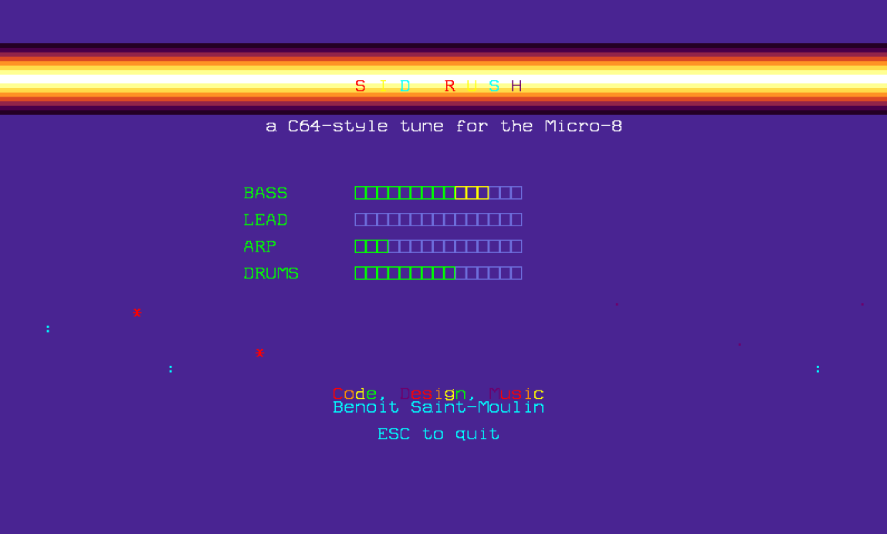

# SID RUSH

An original music demo and cracktro in the style of the Commodore 64, the first demo written for the **Micro-8**: an FM bass
gallop, chord arpeggios at the frame rate on the digital synth, an FM lead with a delayed vibrato, DPCM drums, a copper raster
bar, a rainbow title, parallax stars and the credits "Code, Design, Music". `Esc` quits.

| File | What it is |
|---|---|
| `SIDRUSH.SRC` | the program (Lofi), with its music and graphics data |
| `SIDRUSH.BIN` | the same, precompiled for **Micro-8 OS 0.8.0** (on another OS version, recompile the source) |

**On the machine**: copy `SIDRUSH.SRC` to the SD card, then `compile sidrush.src` and `run sidrush.bin`.

## How it works on the real hardware

- **Digital synth**: an envelope or a DPCM sample restarts on a rising edge of the trigger, so every hit is `synNoteOff` then
  `synNoteOn`, like the DRUMBOX example of the SD card.
- **Arpeggio**: one `synNoteOn` per frame, with no register `poke`: the firmware writes the two frequency bytes together, so the
  pitch never sits on a wrong value in between (two separate pokes made an audible tick). `synNoteOff(1)` at the end of the
  frame, just before `vSync()`, and a fast envelope release (`synEnv(1,0,5,9,15)`) make the pitch change with the gate closed.
- **Shifts** are only done on a `byte`, the rule of the machine's compiler.
- **Lines** stay well under 159 characters, the machine's read limit; the big arrays are split over several lines.

## The music as a tracker project

The same music is a project of the [Micro-8 Tracker](../Tracker): `SIDRUSH.M8S`, a single file to open in the tracker of
Micro-8 Studio, in TRACKER2 (FILE, then `R` for SID RUSH, or `L`) or in PLAYER (choose it in its list). It has the FM1 bass
(BASS01), the FM2 lead (LEAD02), the DRM drums and the SYN arpeggio, one pattern per bar (17), 34 positions, tempo 150. The
machine plays the arpeggio one note per step; with Studio's FX on (codes `Axy` and vibrato `Vxy`, only read by Studio),
Studio replays the fast arpeggio of the demo. It is in the examples of Micro-8 Studio, in `Examples/OS/BSMCODE/TRACKER`.
